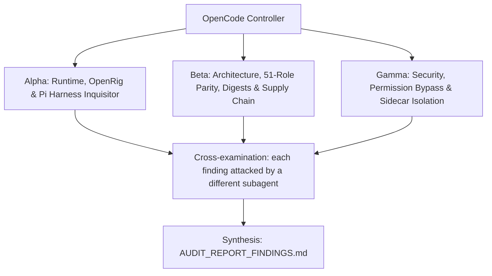

# ADVERSARIAL THREE-SUBAGENT AUDIT PROMPT: `heretek-rigs`

**Target Codebase**: the Git repository this file sits in. Resolve it with `git rev-parse --show-toplevel` and treat every path below as relative to that root. Nothing in this prompt depends on where the checkout lives.
**GitHub Remote**: `https://github.com/Heretek-AI/heretek-rigs`
**What it is supposed to be**: `heretek-rigs` is the production OpenRig (`@openrig/cli@0.6.13`, binary `rig`) multi-rig monorepo and agent catalog migrating all 51 specialized autonomous agent roles from `Heretek-AI/Heretek-Crew@5ffb1fc` across 9 domain directories (`specs/agents/<domain>/<role-slug>/` + `specs/agents/_shared/`) and 8 composable pod-aware OpenRig v0.2 bundles (`rigs/executive-and-architecture`, `rigs/fullstack-and-web-studio`, `rigs/systems-and-mobile-foundry`, `rigs/game-dev-and-sim-rig`, `rigs/cloud-sre-and-data-platform`, `rigs/qa-and-verification-gauntlet`, `rigs/defensive-sec-and-red-team`, and the hybrid `rigs/heretek-omni-fleet` with 3-seat `command` pod, 15 `pods/*.yaml` fragments, 51 `members/*.yaml` fragments, `rig.all-51.yaml`, and `rosters/heretek-omni-fleet.json`). `fleet/fleet.yaml` and `fleet/mcp-servers.yaml` are the single canonical YAML source of truth; the unified Python 3 toolchain (`scripts/generate-rigs.py`, `scripts/render-seat.py`, `scripts/seed-rig.py`, `scripts/bootstrap-pi-seats.sh`, `scripts/verify-rigs.sh`, `scripts/gate-role.sh`, `scripts/audit_loop.py`) deterministically generates `specs/`, materialized `rigs/` (zero symlinks), `rosters/`, `registry/` (`status.json` with RFC 8785 JCS `bodyDigest`, `entries/*.yaml`, `views/*/behaviour.json`), and per-seat Pi (`@earendil-works/pi-coding-agent@1.3.0`) configurations wired to `opencode-go/muse-spark-1.3-contributor:high` via OpenCode Go (`https://opencode.ai/inference/go/v1`). Since OpenRig records `permission_policy` for Pi but delegates runtime enforcement (`HONESTY_PIN`), `@gotgenes/pi-permission-system@41.0.0` enforces least-privilege tool rules with mandatory `"*..*": "deny"` path traversal protection, command-backed `"!cat"` secrets in `0600` `auth.json`/`mcp.json`, per-seat `<agentDir>/AGENTS.md` charters (zero `guidance_merge` collisions), and explicit `"deny"` rules on mutating AST/LSP extension tools (`code_rewrite`, `lsp_rename`, `lsp_code_actions`).
**Execution Context**: OpenCode v2 autonomous audit (`opencode run --model opencode-go/muse-spark-1.3-contributor --variant high`; works identically in any agent CLI that supports subagents and bash execution)
**Auditor Formation**: three independent adversarial subagents (Alpha, Beta, Gamma), a cross-examination pass, and a synthesis pass
**Output**: `AUDIT_REPORT_FINDINGS.md` at the repository root, ending with a mandatory deterministic status sentinel (`STATUS: NO_FINDINGS` or `STATUS: FINDINGS_DETECTED`) consumed by `scripts/audit_loop.py`.

This prompt is designed to be re-run. Each run audits the current `HEAD`, re-verifies every finding of the previous run, and overwrites `AUDIT_REPORT_FINDINGS.md`.

---

## 0. Preflight (the controller does this before spawning subagents)

1. **Baseline.** Record at the top of the report: `git rev-parse HEAD`, `git log -1 --format='%ci %s'`, the UTC date, and the versions of every tool you will use (`python3 --version`, `node --version`, `npm --version`, `git --version`, `jq --version`, `rg --version`, `docker compose version` if installed, `rig --version` from `@openrig/cli@0.6.13`, `pi --version` from `@earendil-works/pi-coding-agent@1.3.0`). If `git status --porcelain` shows changes other than this prompt file and a previous report, list the dirty files and audit a clean `git worktree` of `HEAD` instead of the working tree.
2. **Scratch space.** `export AUDIT_TMP="$(mktemp -d -t heretek-rigs-audit-XXXXXX)"`. Every clone, downloaded binary, packed tarball, sabotage copy, container volume, throwaway `OPENRIG_HOME`, and raw log goes under `$AUDIT_TMP`. Each subagent writes its raw notes to `$AUDIT_TMP/{alpha,beta,gamma}.md`.
3. **Disposable copy for experiments.** `git worktree add --detach "$AUDIT_TMP/wt" HEAD` (or `cp -a . "$AUDIT_TMP/wt"` if uncommitted). Sabotage, patched configs, and any file edits happen only there. The real checkout must end the audit with `git status --porcelain` showing nothing new but `AUDIT_REPORT_FINDINGS.md` (and this prompt file, if untracked). Remove the copy with `git worktree remove --force "$AUDIT_TMP/wt"` (and `rm -rf "$AUDIT_TMP"`) at the end.
4. **Previous run.** If `AUDIT_REPORT_FINDINGS.md` already exists, read it before anything else. Every finding in it gets a row in the Regression Ledger (section 6), re-verified from scratch: never copy a previous verdict forward.
5. **Network and host capabilities.** Probe what this host can do (local Python `jsonschema` Draft 2020-12 validator, `rig spec validate` / `rig bundle check`, `rig daemon start --no-kernel --port 7699` on loopback, `pi` binary presence, `docker compose config`, outbound HTTPS to `github.com`, `registry.npmjs.org`, `pypi.org`, `api.osv.dev`) and record it. When a check cannot run here, the claim is `UNVERIFIABLE` with the exact reason. A claim is never `VERIFIED` by inference, by reading the code alone, or because a test says so.

**Hard limits (all subagents):** no package publishing, no `git push`, no tags, no GitHub writes (issues, comments, PRs), no real API keys or credentials in any command, file, or report (generate throwaway keys and dummy values in `$AUDIT_TMP/secrets`), no destructive command outside `$AUDIT_TMP`, the OpenRig daemon runs only with `HOME` and `OPENRIG_HOME` under `$AUDIT_TMP` on a loopback port and every rig is brought down (`rig down`) and the daemon stopped (`rig daemon stop`) at the end, never read, print, or copy any real key file in the human's `$HERETEK_SECRETS`, and loopback ports only (`127.0.0.1`) with `docker compose down -v` after any container probe. Read-only against the real checkout.

---

## 1. Directive & Rules of Engagement

You are a team of **three elite, adversarial principal systems auditors**. Your mandate is to stress-test, debunk, and verify every claimed feature, architectural decision, integration contract, security invariant, and version pin in **`heretek-rigs`**, measured against what the repository is supposed to be (above) and what its own `README.md`, `docs/OSINT_ECOSYSTEM_REPORT.md`, `docs/OPENRIG_MUSE_GO_ARCHITECTURE.md`, and `PROMPT_SPOONFEEDER_OPENCODE_IMPLEMENTATION.md` claim.

### The Cardinal Rule: DO NOT BELIEVE TESTS
- Unit tests, acceptance scripts, and CI badges can lie: they assert obsolete invariants, mock away the real system, or test that a file *contains* a rule rather than that the rule *works*.
- This repository and its predecessor (`Heretek-Crew`) have a documented history of exactly that:
  - **OpenRig CLI & Bundle Containment Trap**: `rig spec validate` passes `runtime: opencode` (only `rig spec preflight` refuses it), and `checkBundleFolder` (`packages/cli/src/lib/bundle-check.ts:41`) uses `fs.realpathSync` containment while `assertTreeHasNoSymlinks` (`packages/cli/src/commands/specs.ts:44`) rejects symlinks — so `local:../../specs/agents/...` or symlinks inside `rigs/<rig>/` fail `rig bundle check`.
  - **`PI_PROVIDER_ENV_VARS` Secret Stripping Trap**: `packages/daemon/src/adapters/pi-runner-protocol.ts:102-107` only forwards `OPENROUTER_API_KEY`, `ZAI_API_KEY`, `KIMI_API_KEY`, and `MINIMAX_API_KEY` for `runtime: pi`, silently stripping `OPENCODE_API_KEY` unless per-seat `auth.json` is provisioned.
  - **`@gotgenes/pi-permission-system@41.0.0` Path Traversal & Extension Tool Bypasses**:
    1. `resolveConfigPath` (`src/utils.ts:39-47`) strips `./` and `/` without normalizing `..`, and `globToRegExp` (`src/matcher.ts:3-31`) converts `*` to `.*`, so `"docs/*": "allow"` allows writing `docs/../../src/evil.ts` unless `"*..*": "deny"` is placed **after** all allow rules in both `path_write` and `path`.
    2. `classifyToolKind` (`src/access-intent/tool-kind.ts:33-55`) only classifies built-in `read`/`write`/`edit`/`grep`/`find`/`ls` as `ToolKind = "path"` (checked against `path_write`). Third-party Pi extension tools (`pi-lsp-extension@1.4.0`) are classified as `ToolKind = "extension"` and checked only by tool name (`permission[toolName]`). Without explicit `"code_rewrite": "deny"`, `"lsp_rename": "deny"`, and `"lsp_code_actions": "deny"`, any seat loading `pi-lsp-extension@1.4.0` can mutate arbitrary files bypassing `path_write`!
  - **Shared `<cwd>/AGENTS.md` `guidance_merge` Collision**: `PiRuntimeAdapter` (`pi-runtime-adapter.ts:360`) keys `guidance_merge` blocks in `<cwd>/AGENTS.md` by `entry.path` (`guidance/role.md`), causing seats sharing `<cwd>` to overwrite each other's role instructions if `guidance_merge` is used in `agent.yaml`.
  - **Hallucinated / Dead Ecosystem Packages**: PyPI `r2mcp==0.2.5` is a Cloudflare R2 storage server (not radare2); npm `aws-mcp` is dead (0.0.1 from 2025); `obra/superpowers` skills in `Heretek-Crew` were truncated to single `SKILL.md` files missing upstream companion prompts and scripts.
- Never conclude that a component works because `./scripts/verify-rigs.sh` exits 0. Prove behavior against **the real thing it plugs into**: `@openrig/cli@0.6.13` (`rig spec validate`, `rig bundle check`, `rig agent validate`, `rig spec preflight`, `rig up`), `@earendil-works/pi-coding-agent@1.3.0`, `@gotgenes/pi-permission-system@41.0.0`, `Draft202012Validator` over `schemas/*.v1.schema.json`, `identity-vectors.json` digest rules, and `Heretek-Crew`'s 51-role catalog.

### The Second Rule: DO NOT BELIEVE THE PAPER TRAIL
- `docs/OSINT_ECOSYSTEM_REPORT.md`, `docs/OPENRIG_MUSE_GO_ARCHITECTURE.md`, `docs/NOTES.md`, `REMEDIATION_LOG.md`, and `README.md` are **claims under audit**, not evidence.
- Where the spec and reality disagree, reality wins and the spec is the defect.

### The Third Rule: SABOTAGE EVERY CRITICAL INVARIANT
- For each invariant marked **[S]** in section 3, break it with a one-line change in `$AUDIT_TMP/wt`, run `./scripts/verify-rigs.sh --check-only` (and `python3 ./scripts/audit_loop.py --self-test`) there, and record whether the suite went red. Restore the line after each run.
- A sabotage the suite does not catch is a finding: **P1** ("untested invariant"), or **P0** when the invariant is a security boundary.

### Verdict Vocabulary
Every claim in section 3 ends with exactly one status, each backed by a command and its output:
- `VERIFIED` (proven to work against the real thing), `PARTIAL` (works with caveats you name), `BROKEN` (proven not to work), `UNVERIFIABLE` (could not be run here, with the exact reason).

---

## 2. The Adversarial Triad (Subagent Roles)



### Subagent Alpha: Runtime, OpenRig Schema & Pi/Muse 1.3 Contributor Integration Inquisitor
* **Focus**: "Do all 51 AgentSpecs, 8 RigBundles, and seeded Pi seats conform to OpenRig `v0.6.13` and Pi `v1.3.0` contracts, pass `rig spec validate` and `rig bundle check`, and launch cleanly?"
* **Methodology**:
  - Audit every `rigs/*/rig.yaml` (plus `rigs/heretek-omni-fleet/rig.all-51.yaml`, `pods/*.yaml`, `members/*.yaml`) against `RIG_KEYS`, `POD_KEYS`, `MEMBER_KEYS`, and `EDGE_KEYS` from `openrig/packages/daemon/src/domain/rigspec-schema.ts`. Verify pod-local unqualified edges, cross-pod `pod.member` edges, and DAG acyclicity on `delegates_to`/`spawned_by`.
  - Run `rig spec validate <rig.yaml> --json` and `rig bundle check <rig-dir> --json` across all 8 `rigs/<rig-slug>/` directories. Confirm `rig bundle check --json` outputs `[]` (zero issues) and `find specs rigs -type l` is empty.
  - If the OpenRig daemon can start on loopback (`HOME=$AUDIT_TMP/home OPENRIG_HOME=$AUDIT_TMP/home/.openrig rig daemon start --no-kernel --port 7699`), run `rig agent validate` across all `agent.yaml` files and `rig spec preflight` across all 8 `rig.yaml` files, and test `rig expand` / `rig add` on `rigs/heretek-omni-fleet`.
  - Verify `scripts/render-seat.py`, `scripts/seed-rig.py`, and `scripts/bootstrap-pi-seats.sh`: confirm every seeded seat in `$OPENRIG_HOME/state/pi/<pod>-<member>@<rig>/agent/` has `models.json`, `auth.json` (`0600`, `"!cat <abs-path>"`), `settings.json`, `mcp.json` (`0600`), `AGENTS.md` (role charter), and `extensions/pi-permission-system/config.json` (`0600`).
  - Verify zero `guidance_merge` entries exist in any `agent.yaml` (`startup.files`), preventing the shared `<cwd>/AGENTS.md` overwrite bug, and confirm all 12 OpenRig core SOP skills (`agent-operated-workflows`, `delegating-work`, `forming-an-openrig-mental-model`, `messaging-the-human`, `mission-slice-sop`, `openrig-operating-model`, `openrig-user`, `orienting-to-an-inherited-seat`, `queue-handoff`, `refocusing`, `seat-continuity-and-handover`, `session-compaction-and-restore`) are projected via `resources.skills`.

### Subagent Beta: Architecture, 51-Role Parity, Cryptographic Digests & Supply Chain Auditor
* **Focus**: "Are all 51 roles from `Heretek-Crew` and 68 vendored skills 100% accounted for without truncation, do all v1 JSON Schemas validate, do cryptographic digests match disk, do the canonicalization rules replay the `identity-vectors.json` shape fixtures, and are all package/image pins real?"
* **Methodology**:
  - Cross-check `fleet/fleet.yaml`, `specs/agents/<domain>/<role-slug>/`, and Rigs 1–7 (`rigs/*/rig.yaml`) against all 51 roles in `Heretek-Crew` (specifically verifying Role 37 `static-analysis-lead` in Rig 6 and Role 51 `ai-red-teamer` in Rig 7, with partition counts 6 + 11 + 4 + 6 + 11 + 6 + 7 = 51).
  - Verify zero byte-drift between `specs/agents/<domain>/<role-slug>/{guidance,startup,runtime}` and every materialized `rigs/<rig-slug>/agents/<role-slug>/` copy, and verify `python3 scripts/generate-rigs.py` is 100% deterministic (`git status --porcelain` empty after re-run).
  - Validate all 8 `rigs/*/configurations.yaml`, 8 `registry/views/*/behaviour.json`, 8 `registry/entries/*.yaml`, and `registry/status.json` against `schemas/*.v1.schema.json` using `jsonschema.Draft202012Validator`.
  - Recompute `configurationId` (UTF-16 code-unit sort over `pod.member=runtime`), `packageDigest` (`openrig.package-digest/v1` over `JSON.stringify(path) + "\t" + sha256 + "\n"` sorted by UTF-16 code units), and `registry/status.json` `bodyDigest` (SHA-256 over RFC 8785 JCS canonical JSON) and prove they match the repository's files byte-for-byte; replay the `identity-vectors.json` shape fixtures (UTF-16 order, JCS canonical form, coverage/algorithm constants) separately — that file pins canonicalization rules, not per-rig digests.
  - Verify all 68 vendored skills in `specs/agents/_shared/skills/<id>/` against `fleet/skills-lock.json` (`obra/superpowers@bb92a77` full-fidelity directories (including upstream single-file skills where upstream is single-file, the multi-file `subagent-driven-development` sibling required by the `writing-plans`/`executing-plans` REQUIRED SUB-SKILL refs, and the `using-superpowers` sibling required by the `executing-plans` `../using-superpowers/references/` per-platform pointer), `trailofbits/skills@5c99c03` unmodified CC-BY-SA-4.0 with LICENSE, `getsentry/skills@f57ada2`, `anthropics/skills@dbd4588`, `vercel-labs/agent-skills@063bee9`, `@openrig/cli@0.6.13`), and confirm every pin in `fleet/mcp-servers.yaml` and `fleet/fleet.yaml` exists (zero `r2mcp==0.2.5`, zero `aws-mcp`, zero duplicate `pi-lsp@0.1.7`, zero `pi-subagents`).

### Subagent Gamma: Security, Permission Bypass, Extension Tool Containment & Sidecar Isolation Auditor
* **Focus**: "Can any seat bypass `path_write` via `..` traversal or mutating AST/LSP extension tools (`code_rewrite`, `lsp_rename`, `lsp_code_actions`), can any read-only seat mutate code, can secrets leak, or are sidecars exposed?"
* **Methodology**:
  - Audit rendered `extensions/pi-permission-system/config.json` across all 51 roles:
    1. Confirm `path_write` starts with `"*": "deny"`, blocks `"AGENTS.md": "deny"`, `"*/AGENTS.md": "deny"`, `".git/*": "deny"`, `"*/.git/*": "deny"`, `".pi/*": "deny"`, `"*/.pi/*": "deny"`, `".agents/*": "deny"`, `"*/.agents/*": "deny"`, `"fleet/*": "deny"`, `"scripts/*": "deny"`, and ends with `"*..*": "deny"`.
    2. Confirm `path` starts with `"*": "allow"`, denies secret patterns (`"*.env": "deny"`, `"*.env.*": "deny"` with `"*.env.example": "allow"`, `"*.pem": "deny"`, `"*.key": "deny"`, `"*id_rsa*": "deny"`, `"*kubeconfig*": "deny"`, `"*/secrets/*": "deny"`, `"*.pat"/"*.uri"/"*.profile"/"*.region"/"*.host"/"*.password"/"*.credentials"/"*.config"/"*.url"/"*.user": "deny"`), and ends with `"*..*": "deny"`.
    3. Confirm `external_directory: "deny"`, `promptTimeoutMs: 60000`, and zero `"ask"` rules exist anywhere in the config.
    4. Confirm mutating third-party extension tools are explicitly blocked across all 51 roles: `"code_rewrite": "deny"`, `"lsp_rename": "deny"`, `"lsp_code_actions": "deny"`.
    5. Test `resolveConfigPath` + `globToRegExp` against a hostile path corpus (`docs/../../src/evil.ts`, `./docs/security/../../../pwn.sh`, `.git/hooks/pre-commit`, `AGENTS.md`, `.env.production`) and run `scripts/gate-role.sh` across roles.
  - Verify that all 16 read-only-charter roles (`ai-red-teamer`, `appsec-engineer`, `binary-reverse-eng`, `cloud-sec-auditor`, `compliance-auditor`, `exec-director`, `firmware-sec-analyst`, `git-drift-coord`, `product-director`, `release-qa-officer`, `sre-incident-eng`, `system-architect`, `tech-docs-lead`, `threat-modeler`, `tpm-scrum-lead`, `ux-research-analyst`) plus `sabotage-qa-tester` and `static-analysis-lead` (18 seats total) carry `permission_policy: builtin:locked`, and that the 16 read-only-charter roles only allow `path_write` under `docs/*` or `sbom/*`.
  - Verify secret hygiene: `auth.json` and `mcp.json` use `"!cat <abs-path>"` only in `key`/`env`/`headers` (never in `args`), `scripts/render-seat.py` refuses missing or group/world-accessible (`mode & 0o077`) secret files without `--allow-missing-secrets`, and no `rig.yaml` `env:` contains secrets or `OPENRIG_*` variables.
  - Audit `docker-compose.sidecars.yml` and `Makefile`: confirm all host port mappings bind strictly to `127.0.0.1:`, `docker-socket-proxy` enforces `POST: "0"`, `BUILD: "0"`, `EXEC: "0"`, `VOLUMES: "0"`, `NETWORKS: "0"`, `AUTH: "0"`, `ghidra`, `radare2`, and `sonarqube` are connected ONLY to `heretek-devsec` (exact network sets — any additional network fails the gate), `ghidra` and `radare2` mount `./workspaces/binaries:/samples:ro`, `docker-android` is connected ONLY to `heretek-mobile`, and `Makefile` `guard-profiles` exits 1 when `mobile` is co-scheduled with `devsec` or `web-research`.

---

## 3. Comprehensive Inventory of Claimed Functions & Architectural Decisions

### Domain 1: 51-Agent Catalog Parity, Topology & Hybrid Omni-Fleet
* **Claim 1.1 [B][S]**: `fleet/fleet.yaml` defines all 51 canonical specialist roles from `Heretek-Crew` (Roles 01–50 plus Role 51 `ai-red-teamer`, including Role 37 `static-analysis-lead` in Rig 6), and all 51 role directories exist under `specs/agents/<domain>/<role-slug>/`.
* **Claim 1.2 [B][S]**: Rigs 1 through 7 (`executive-and-architecture`, `fullstack-and-web-studio`, `systems-and-mobile-foundry`, `game-dev-and-sim-rig`, `cloud-sre-and-data-platform`, `qa-and-verification-gauntlet`, `defensive-sec-and-red-team`) partition all 51 specialist roles with 100% coverage (6 + 11 + 4 + 6 + 11 + 6 + 7 = 51), each role in exactly one static rig.
* **Claim 1.3 [B][S]**: Rig 8 (`rigs/heretek-omni-fleet/`) implements the Hybrid Omni-Fleet architecture: default `rig.yaml` boots the 3-seat `command` pod (`exec-director`, `system-architect`, `tpm-scrum-lead`), accompanied by 15 pod fragments (`rigs/heretek-omni-fleet/pods/*.yaml`), 51 member fragments (`rigs/heretek-omni-fleet/members/*.yaml`), `rigs/heretek-omni-fleet/rig.all-51.yaml`, and `rosters/heretek-omni-fleet.json`.
* **Claim 1.4 [B][S]**: Every role directory in `specs/agents/<domain>/<role-slug>/` contains non-empty `agent.yaml`, `guidance/role.md`, `startup/context.md`, `runtime/pi-settings.json`, `runtime/mcp.json`, `runtime/policy-enforcement.json`, and `runtime/pi-permission-config.json`, with zero `TODO`/`FIXME`/`TBD`/`PLACEHOLDER`/`{{...}}` stub tokens (documented `@TOOLS@`/`@SECRETS@`/`@SEAT@` seed-substitution tokens in `runtime/mcp.json` excepted per Claim 4.3), and matches its materialized `rigs/<rig-slug>/agents/<role-slug>/` copy modulo the documented `local:../../_shared` → `local:../_shared` import rewrite (the only allowed delta; any other drift fails the gate).

### Domain 2: OpenRig `RigSpec` v0.2, `AgentSpec` v1.0 & Bundle Containment
* **Claim 2.1 [A][S]**: Every `rigs/<rig-slug>/rig.yaml` (and `rig.all-51.yaml`) declares `version: "0.2"`, uses only valid `RIG_KEYS`, `POD_KEYS`, `MEMBER_KEYS`, and `EDGE_KEYS` (`rigspec-schema.ts`), and passes `rig spec validate <rig.yaml> --json`.
* **Claim 2.2 [A][S]**: Every pod-local edge uses unqualified member IDs within the same pod, every cross-pod edge uses `pod.member` across distinct pods, every edge `kind` is one of `delegates_to`, `spawned_by`, `can_observe`, `collaborates_with`, `escalates_to`, and `delegates_to`/`spawned_by` edges form a cycle-free DAG.
* **Claim 2.3 [A][S]**: Every `agent.yaml` declares `version: "1.0"`, nested `defaults.lifecycle.{execution_mode: "interactive_resident", compaction_strategy: "default-compaction", restore_policy: "resume_if_possible"}` and `profiles.default.lifecycle.{compaction_strategy: "default-compaction", restore_policy: "resume_if_possible"}`, with zero `hooks` keys at any level.
* **Claim 2.4 [A][S]**: Zero `agent.yaml` files contain `guidance_merge` startup files (`startup.files` uses `context` only); role charters are rendered to per-seat `<agentDir>/AGENTS.md` so seats sharing `<cwd>` never overwrite each other's `<cwd>/AGENTS.md` managed blocks.
* **Claim 2.5 [A][S]**: Neither `specs/` nor `rigs/` contains any symbolic links (`find specs rigs -type l` is empty), every relative path inside `rigs/<rig-slug>/` resolves strictly within `rigs/<rig-slug>/`, and `rig bundle check <rig-dir> --json` returns `[]` across all 8 rigs.

### Domain 3: OpenRig v1 Bundle Formats & Cryptographic Digests
* **Claim 3.1 [B][S]**: All 8 `rigs/<rig-slug>/configurations.yaml`, 8 `registry/views/<rig-slug>/behaviour.json`, 8 `registry/entries/<rig-slug>.yaml`, and `registry/status.json` validate against `schemas/*.v1.schema.json` using `jsonschema.Draft202012Validator`.
* **Claim 3.2 [B][S]**: `registry/status.json` `bodyDigest` equals the lowercase hex SHA-256 over the RFC 8785 (JCS) canonical JSON of all other top-level fields.
* **Claim 3.3 [B][S]**: Across all 8 rigs, `configurationId` is the UTF-16 code-unit sorted joined mapping string (`pod.member=runtime` comma-joined, NOT a hash) while `packageDigest.value` (`openrig.package-digest/v1` sorted by UTF-16 code units) matches the exact SHA-256 value computed over the files on disk in `rigs/<rig-slug>/`.

### Domain 4: Muse Spark 1.3 Contributor, Seat Seeding & Command-Backed Secrets
* **Claim 4.1 [A][S]**: All 51 agents and all member seats across all 8 `rig.yaml` files pin `model: opencode-go/muse-spark-1.3-contributor:high` and `runtime: pi`, and `configurations.yaml` also declares an `all-omp` preset (`runtime: omp`).
* **Claim 4.2 [A][S]**: `scripts/render-seat.py`, `scripts/seed-rig.py`, and `scripts/bootstrap-pi-seats.sh` provision `$OPENRIG_HOME/state/pi/<pod>-<member>@<rig>/agent/{models.json,auth.json,settings.json,mcp.json,AGENTS.md,extensions/pi-permission-system/config.json}` with `0600` permissions on `auth.json`, `mcp.json`, and `config.json`, configuring `opencode-go` (`api: "openai-responses"`, `baseUrl: "https://opencode.ai/inference/go/v1"`, `id: "muse-spark-1.3-contributor"`).
* **Claim 4.3 [G][S]**: `auth.json` and `mcp.json` reference secrets exclusively via command-backed `"!cat <abs-path>"` whole-value references or `"!echo Bearer $(cat <abs-path>)"` Authorization headers (plus plain `@SECRETS@` file-path envs) in `key`, `env`, or `headers` (never in `args`), and `scripts/render-seat.py` refuses missing or group/other-readable (`mode & 0o077`) key files when `--allow-missing-secrets` is not set.
* **Claim 4.4 [G][S]**: No `rig.yaml` `env:` block contains any secret (`OPENCODE_API_KEY`, `GITHUB_TOKEN`, `*_PASSWORD`, `*_SECRET`, `*_TOKEN`) or reserved `OPENRIG_*` variable name, and no literal secrets appear anywhere in the repository.

### Domain 5: `@gotgenes/pi-permission-system@41.0.0` & AST/LSP Extension Hardening
* **Claim 5.1 [G][S]**: All 16 read-only-charter roles plus `sabotage-qa-tester` and `static-analysis-lead` (18 seats total) declare `permission_policy: builtin:locked` in `rig.yaml`, and the 16 read-only-charter roles only allow `path_write` within `docs/*` or `sbom/*` (`builtin:yolo` and `builtin:open` appear nowhere).
* **Claim 5.2 [G][S]**: Every seat's `extensions/pi-permission-system/config.json` starts `path_write` with `"*": "deny"`, explicitly denies `AGENTS.md`, `*/AGENTS.md`, `.git/*`, `*/.git/*`, `.pi/*`, `*/.pi/*`, `.agents/*`, `*/.agents/*`, `fleet/*`, `scripts/*`, and places `"*..*": "deny"` as the **last** key in both `path_write` and `path` so `..` traversal attempts are always denied.
* **Claim 5.3 [G][S]**: Every seat's `extensions/pi-permission-system/config.json` denies secret reads (`*.env`, `*.env.*` except `*.env.example`, `*.pem`, `*.key`, `*id_rsa*`, `*kubeconfig*`, `*/secrets/*`, `*.pat`, `*.uri`, `*.profile`, `*.region`, `*.host`, `*.password`, `*.credentials`, `*.config`, `*.url`, `*.user`), sets `external_directory: "deny"` and `promptTimeoutMs: 60000`, and contains zero `"ask"` rules.
* **Claim 5.4 [G][S]**: Every seat's `extensions/pi-permission-system/config.json` explicitly sets mutating AST/LSP extension tools (`"code_rewrite": "deny"`, `"lsp_rename": "deny"`, `"lsp_code_actions": "deny"`) to `"deny"` so `ToolKind = "extension"` tools from `pi-lsp-extension@1.4.0` cannot bypass `path_write`, while the 21 code-analysis/builder seats allow only read-only AST/LSP tools (`ast_grep`, `ast_search`, `code_overview`, `lsp_diagnostics`, `lsp_hover`, `lsp_definition`, `lsp_references`, `lsp_symbols`, `lsp_completions`) and never load the duplicate `pi-lsp@0.1.7` package.
* **Claim 5.5 [G][S]**: Every seat's `bash` map starts with `"*": "deny"` followed only by role-scoped allow patterns (with zero `git diff/log/show --output=*` write escapes or arbitrary interpreters on locked seats) and ends with the 42 terminal denies `"*--output=*"`, `"*--output *"`, `"*--output\t*"`, `"*--output-junit*"`, `"*--output-log*"`, `"*;*"`, `"*|*"`, `"*>*"`, `"*<*"`, `"*&*"`, `"*`*", `"*$*"`, `"*(*"`, `"*)*"`, `"* -p*"`, `"*\t-p*"`, `"*--patch*"`, `"*--full-diff*"`, `"*--textconv*"`, `"* -u*"`, `"*\t-u*"`, `"* -U*"`, `"*\t-U*"`, `"*--unified*"`, `"*--cc*"`, `"* -c *"`, `"*\t-c *"`, `"* -c\t*"`, `"*\t-c\t*"`, `"* -m *"`, `"*\t-m *"`, `"* -m\t*"`, `"*\t-m\t*"`, `"* -W*"`, `"*\t-W*"`, `"*--function-context*"`, `"*--word-diff*"`, `"*--color-words*"`, `"*--binary*"`, `"*--raw*"`, `"*OPENRIG_SESSION_NAME=*"`, `"*OPENRIG_URL=*"` (last-match-wins, so chained/redirection/patch-output suffixes deny even on allowed prefixes, with no allow key following the terminal-deny block; `ctest --output-on-failure`/`--output-format` hyphen-continuations stay allowed on suitably-permitted roles). Every seat's rendered `bash`/`path_write` allow-sets are subsets of the fleet-declared `bash_allow`/`path_write` sets (a hand-injected allow in a generated permission file fails the gate), and `mcp` starts with `"*": "deny"` followed only by `<server>: "allow"` for servers bound to that role.

### Domain 6: 68 Vendored Skills & Curated MCP Catalog
* **Claim 6.1 [B][S]**: `specs/agents/_shared/agent.yaml` (and `rigs/*/agents/_shared/agent.yaml`) vendors all 68 shared skills under `specs/agents/_shared/skills/<id>/` with valid `SKILL.md` frontmatter and `LICENSE`, matching `fleet/skills-lock.json`, including all 12 OpenRig core SOP skills (`agent-operated-workflows`, `delegating-work`, `forming-an-openrig-mental-model`, `messaging-the-human`, `mission-slice-sop`, `openrig-operating-model`, `openrig-user`, `orienting-to-an-inherited-seat`, `queue-handoff`, `refocusing`, `seat-continuity-and-handover`, `session-compaction-and-restore`) under `resources.skills` and full-fidelity `obra/superpowers@bb92a77` skill directories (including upstream single-file skills where upstream is single-file, the multi-file `subagent-driven-development` sibling required by the `writing-plans`/`executing-plans` REQUIRED SUB-SKILL refs, and the `using-superpowers` sibling required by the `executing-plans` `../using-superpowers/references/` per-platform pointer; every `../<id>/` doc ref outside fenced code blocks resolves to a vendored sibling directory).
* **Claim 6.2 [B][S]**: Every MCP server in `fleet/mcp-servers.yaml` is pinned to an exact package version in the catalog (including `radareorg/radare2-mcp@1.9.0` with `-R` and `awslabs.aws-api-mcp-server==1.5.6` with `READ_OPERATIONS_ONLY=true`, and zero `r2mcp==0.2.5`, `aws-mcp`, or `:latest` tags), with per-seat `runtime/mcp.json` resolving pins at seed time; liveness exceptions honestly labeled in-catalog (`semgrep: run-failed-here`, `radare2: not-run`) are not silent pins, and read-only modes/flags are enforced (`--read-only`, `--access-mode=restricted`, `CLICKHOUSE_ALLOW_WRITE_ACCESS=false`).

### Domain 7: Sidecar Docker Compose & Network Segmentation
* **Claim 7.1 [G][S]**: Every published host port in `docker-compose.sidecars.yml` binds strictly to `127.0.0.1:` (zero `0.0.0.0` or bare `<port>:<port>` host publishes), and every service image uses an exact version or `@sha256:` digest (zero `:latest`).
* **Claim 7.2 [G][S]**: `docker-socket-proxy` in `docker-compose.sidecars.yml` is pinned to `tecnativa/docker-socket-proxy:0.5.0`, mounts `/var/run/docker.sock:/var/run/docker.sock:ro`, and sets `POST: "0"`, `BUILD: "0"`, `EXEC: "0"`, `VOLUMES: "0"`, `NETWORKS: "0"`, `SWARM: "0"`, `SYSTEM: "0"`, `AUTH: "0"`.
* **Claim 7.3 [G][S]**: `ghidra`, `radare2`, and `sonarqube` connect only to the isolated `heretek-devsec` internal bridge network (exact network sets — any additional network fails the gate); `ghidra` and `radare2` mount `./workspaces/binaries:/samples:ro`; `docker-android` connects only to `heretek-mobile`; and `Makefile` `guard-profiles` exits 1 when `mobile` is co-scheduled with `devsec` or `web-research`.

### Domain 8: Deterministic Generator, Verifier & Automated Audit Loop
* **Claim 8.1 [A][S]**: `python3 scripts/generate-rigs.py` is idempotent: running it twice in a clean checkout produces zero `git status --porcelain` or `packageDigest` diffs.
* **Claim 8.2 [A][S]**: `./scripts/verify-rigs.sh --check-only` exits 0 on the clean repository and exits non-zero when any of the `[S]` invariants is sabotaged.
* **Claim 8.3 [A][S]**: `python3 scripts/audit_loop.py --self-test` exits 0 and proves that its fail-closed evaluator rejects `STATUS: NO_FINDINGS` whenever `verify-rigs.sh` fails, whenever a `### HR-` finding header is present, or whenever a Claim Ledger row is marked `BROKEN` or `PARTIAL`.
* **Claim 8.4 [B]**: All required planning and automation deliverables (`fleet/fleet.yaml`, `fleet/mcp-servers.yaml`, `docs/OSINT_ECOSYSTEM_REPORT.md`, `docs/OPENRIG_MUSE_GO_ARCHITECTURE.md`, `PROMPT_SPOONFEEDER_OPENCODE_IMPLEMENTATION.md`, `PROMPT_ADVERSARIAL_FLEET_AUDIT.md`, `PROMPT_FLEET_AUDIT_REMEDIATION.md`, `scripts/audit_loop.py`) exist, are non-empty, and contain no unresolved template placeholders.

---

## 4. Reality-Check Recipes

Run these commands from the repository root (`cd "$(git rev-parse --show-toplevel 2>/dev/null || pwd)"`) using `$AUDIT_TMP` for all scratch files:

```bash
set -euo pipefail
export AUDIT_TMP="$(mktemp -d -t heretek-rigs-audit-XXXXXX)"
mkdir -p "$AUDIT_TMP/logs" "$AUDIT_TMP/secrets"
chmod 700 "$AUDIT_TMP/secrets"
cp -a . "$AUDIT_TMP/wt"

# 1. Baseline verification gate & audit_loop self-test
./scripts/verify-rigs.sh --check-only | tee "$AUDIT_TMP/logs/verify.log"
python3 ./scripts/audit_loop.py --self-test | tee "$AUDIT_TMP/logs/self-test.log"

# 2. Real @openrig/cli@0.6.13 offline validation across all 8 rigs
for d in rigs/*/; do
  rig spec validate "${d}rig.yaml" --json | jq -e '.valid == true' >/dev/null
  test "$(rig bundle check "$d" --json | jq '[.checks[] | select(.status=="fail")] | length')" -eq 0
done

# 3. Verify rendered permission config shape across all 51 roles (path_write "..", extension tool denies, zero ask)
python3 -c '
import json, pathlib
for p in sorted(pathlib.Path("specs/agents").glob("*/*/runtime/pi-permission-config.json")):
    c = json.loads(p.read_text())
    perm = c["permission"]
    pw_keys = list(perm["path_write"].keys())
    path_keys = list(perm["path"].keys())
    assert pw_keys[0] == "*" and pw_keys[-1] == "*..*", f"{p}: bad path_write bounds {pw_keys}"
    assert path_keys[0] == "*" and path_keys[-1] == "*..*", f"{p}: bad path bounds {path_keys}"
    for mut in ("code_rewrite", "lsp_rename", "lsp_code_actions"):
        assert perm.get(mut) == "deny", f"{p}: missing {mut}=deny"
    assert "\"ask\"" not in json.dumps(c), f"{p}: contains ask"
print("51/51 permission configs verified")
'

# 4. Verify secret file permission refusal in render-seat.py (must fail on 0644 secret, pass on 0600 secret)
# HR-4.2: exec-director lives in the exec pod of executive-and-architecture
# (the command pod exists only in heretek-omni-fleet), and binds the github
# server, so the passing render needs --allow-missing-secrets for github.pat.
printf 'dummy-key\n' > "$AUDIT_TMP/secrets/opencode-go.key"
chmod 644 "$AUDIT_TMP/secrets/opencode-go.key"
! HERETEK_SECRETS="$AUDIT_TMP/secrets" python3 ./scripts/render-seat.py \
  --role exec-director --rig executive-and-architecture --pod exec \
  --out "$AUDIT_TMP/seat-bad" 2>/dev/null
chmod 600 "$AUDIT_TMP/secrets/opencode-go.key"
HERETEK_SECRETS="$AUDIT_TMP/secrets" python3 ./scripts/render-seat.py \
  --role exec-director --rig executive-and-architecture --pod exec \
  --allow-missing-secrets \
  --out "$AUDIT_TMP/seat-ok"
test "$(stat -c '%a' "$AUDIT_TMP/seat-ok/auth.json")" = "600"
test "$(stat -c '%a' "$AUDIT_TMP/seat-ok/extensions/pi-permission-system/config.json")" = "600"

# 5. Verify Makefile profile co-scheduling guard fails closed
! make guard-profiles SIDECAR_PROFILES="mobile devsec"
! make guard-profiles SIDECAR_PROFILES="mobile web-research"
make guard-profiles SIDECAR_PROFILES="web-research"

# 6. Test bootstrap-pi-seats.sh in an isolated OPENRIG_HOME
# HR-4.2: the exec pod seats exec-director as exec-exec-director@... (the
# command pod exists only in heretek-omni-fleet).
OPENRIG_HOME="$AUDIT_TMP/openrig-home" ./scripts/bootstrap-pi-seats.sh --rig executive-and-architecture
test -f "$AUDIT_TMP/openrig-home/state/pi/exec-exec-director@executive-and-architecture/agent/models.json"
test -f "$AUDIT_TMP/openrig-home/state/pi/exec-exec-director@executive-and-architecture/agent/AGENTS.md"
test "$(stat -c '%a' "$AUDIT_TMP/openrig-home/state/pi/exec-exec-director@executive-and-architecture/agent/auth.json")" = "600"
```

**Sabotage targets** (one-line breaks in `$AUDIT_TMP/wt`, then run `(cd "$AUDIT_TMP/wt" && ! ./scripts/verify-rigs.sh --check-only)` and restore after each test):
- `Claim 1.1 [S]`: Remove `specs/agents/qa/static-analysis-lead/agent.yaml` in `$AUDIT_TMP/wt` -> `./scripts/verify-rigs.sh --check-only` must exit 1.
- `Claim 2.1 [S]`: Add `unknown_key: true` to `rigs/executive-and-architecture/rig.yaml` in `$AUDIT_TMP/wt` -> `./scripts/verify-rigs.sh --check-only` must exit 1.
- `Claim 2.2 [S]`: Add a cycle edge `{kind: delegates_to, from: product-director, to: exec-director}` in `rigs/executive-and-architecture/rig.yaml` in `$AUDIT_TMP/wt` -> `./scripts/verify-rigs.sh --check-only` must exit 1.
- `Claim 2.4 [S]`: Change `delivery_hint: send_text` to `delivery_hint: guidance_merge` in `specs/agents/executive/exec-director/agent.yaml` in `$AUDIT_TMP/wt` -> `./scripts/verify-rigs.sh --check-only` must exit 1.
- `Claim 2.5 [S]`: Create a symlink `ln -s ../README.md rigs/executive-and-architecture/agents/link.md` in `$AUDIT_TMP/wt` -> `./scripts/verify-rigs.sh --check-only` must exit 1.
- `Claim 3.2 [S]`: Flip one hex char of `bodyDigest` in `registry/status.json` in `$AUDIT_TMP/wt` -> `./scripts/verify-rigs.sh --check-only` must exit 1.
- `Claim 4.3 [S]`: Replace `"!cat /..."` with `"sk-live-123456"` in `specs/agents/executive/exec-director/runtime/mcp.json` in `$AUDIT_TMP/wt` -> `./scripts/verify-rigs.sh --check-only` must exit 1.
- `Claim 5.1 [S]`: Change `exec-director` `permission_policy` to `builtin:yolo` in `rigs/executive-and-architecture/rig.yaml` in `$AUDIT_TMP/wt` -> `./scripts/verify-rigs.sh --check-only` must exit 1.
- `Claim 5.2 [S]`: Remove `"*..*": "deny"` from `path_write` in `specs/agents/executive/exec-director/runtime/policy-enforcement.json` in `$AUDIT_TMP/wt` -> `./scripts/verify-rigs.sh --check-only` must exit 1.
- `Claim 5.4 [S]`: Change `"code_rewrite": "deny"` to `"code_rewrite": "allow"` in `specs/agents/security/appsec-engineer/runtime/policy-enforcement.json` in `$AUDIT_TMP/wt` -> `./scripts/verify-rigs.sh --check-only` must exit 1.
- `Claim 7.1 [S]`: Change `127.0.0.1:8888:8080` to `0.0.0.0:8888:8080` in `docker-compose.sidecars.yml` in `$AUDIT_TMP/wt` -> `./scripts/verify-rigs.sh --check-only` must exit 1.
- `Claim 7.2 [S]`: Change `POST: "0"` to `POST: "1"` under `docker-socket-proxy` in `docker-compose.sidecars.yml` in `$AUDIT_TMP/wt` -> `./scripts/verify-rigs.sh --check-only` must exit 1.

---

## 5. Execution Directives for OpenCode

1. **Independent exploration.** Spawn Alpha, Beta, and Gamma concurrently as three separate subagents. Hand each one this entire file plus its role. They must not read each other's notes until step 4. Each one works through the claims it owns (ownership is marked `[A]`, `[B]`, `[G]` in section 3) and may file findings on any claim.
2. **Run things.** Prefer executing to reading. Use the recipes in section 4 and any further commands you need (`rig`, `pi`, `python3`, `jq`, `rg`, `bash`). Save the raw output of every command you cite under `$AUDIT_TMP/logs/`.
3. **Empirical Proof Mandate.** For every claim judged `BROKEN`, `PARTIAL`, insecure, or outdated, record:
   - the exact file path and line number (`path/to/file:123`);
   - the exact command executed to prove it, runnable as written from the repository root;
   - the raw output, error message, or registry response (trimmed to the relevant lines, never paraphrased);
   - for upstream comparisons, the upstream file path and commit SHA you compared against.
4. **Cross-examination.** When all three are done, each finding is handed to a different subagent (Alpha's to Beta, Beta's to Gamma, Gamma's to Alpha), whose job is to refute it: re-run the proof, look for a misreading, a wrong upstream version, or an environment artifact. A refuted finding is dropped or downgraded, and the refutation is noted in the finding.
5. **Coverage gate.** Before synthesis, check that every claim ID in section 3 has a status. Any claim without one goes back to its owner.
6. **Synthesis & Deterministic Loop Sentinel.** The controller writes `AUDIT_REPORT_FINDINGS.md` in the structure below, cleans up `$AUDIT_TMP`, confirms the real checkout has no changes apart from `AUDIT_REPORT_FINDINGS.md`, and prints the exact final status line:
   - `STATUS: NO_FINDINGS` if and only if there are zero P0/P1/P2/P3 findings, every verifiable claim in the Claim Ledger is `VERIFIED`, every `[S]` sabotage target was caught, and `./scripts/verify-rigs.sh --check-only` exited 0.
   - `STATUS: FINDINGS_DETECTED` in all other cases.

---

## 6. Report Structure: `AUDIT_REPORT_FINDINGS.md`

```markdown
# AUDIT_REPORT_FINDINGS: heretek-rigs

## Baseline
Commit, commit date, audit date (UTC), tool versions, host capabilities, and the list of checks that could not run here and why.

## Verdict
Three to six sentences: does `heretek-rigs` do what it is supposed to be, against the real systems it plugs into? Name the single most important thing to fix (or confirm zero findings).

## Prioritized Defect Matrix
| ID | Priority | Claim | Location | Summary |
|----|----------|-------|----------|---------|

## Findings
### HR-<claim-id>-<slug>: <title>
- **Priority:** P0 | P1 | P2 | P3
- **Claim:** <claim ID and text>
- **Location:** `path:line`
- **Proof:** the command(s), runnable from the repo root
- **Raw output:** fenced block, trimmed, verbatim
- **Why it matters:** one or two sentences, in terms of what breaks for a user
- **Remediation:** an exact, fail-closed diff or command sequence
- **Verify the fix:** the command that goes from failing to passing once fixed
- **Cross-examination:** who challenged it and what they found

## Claim Ledger
| Claim | Status | Evidence (command or finding ID) |
Every claim ID from section 3, no omissions.

## Sabotage Results
| Invariant | One-line sabotage (file:line, before -> after) | Suite result | Caught? |

## Regression Ledger
| Previous finding ID | Previous priority | Status now: FIXED / STILL OPEN / REGRESSED / NO LONGER APPLICABLE | Evidence |
(Write "First run" if there was no previous report.)

## Not Audited / Unverifiable
What could not be checked, why, and what a human needs to provide to check it.

## Final Loop Sentinel
STATUS: NO_FINDINGS (or STATUS: FINDINGS_DETECTED)
```

**Finding IDs are stable across runs.** Use `HR-<claim-id>-<short-slug>` (for example `HR-5.2-dotdot-guard`) so the next run's Regression Ledger can match findings by ID.

**Priority definitions:**
- **P0 / Critical:** the component does not work against its real host or upstream (invalid `rig.yaml` or `agent.yaml` rejected by OpenRig, non-empty `rig bundle check`, broken JSON Schema in `configurations.yaml`/`behaviour.json`/`status.json`, missing role from the 51-agent catalog, broken `opencode-go/muse-spark-1.3-contributor` config); a security boundary can be bypassed (missing `"*..*": "deny"` guard, missing `code_rewrite`/`lsp_rename`/`lsp_code_actions` deny, mutating tool on a `builtin:locked` seat, `POST=1` on `docker-socket-proxy`, non-loopback sidecar port, literal secret in repo or `rig.yaml` `env:`); a pinned artifact does not exist or is a wrong package (`r2mcp` PyPI).
- **P1 / High:** deprecated or end-of-life versions, fail-open error handling, an untested security or correctness invariant (sabotage survived), `guidance_merge` collision reintroduced, or byte drift between `specs/agents/` and `rigs/*/agents/`.
- **P2 / Medium:** non-fatal version lag, documentation that contradicts behavior, missing verification coverage for a claim, suboptimal resource choices.
- **P3 / Low:** style, dead code, naming, minor cleanups.

For every finding, provide the exact, fail-closed code diff or command sequence to remediate. Do not apply it to the real checkout during the audit pass.
