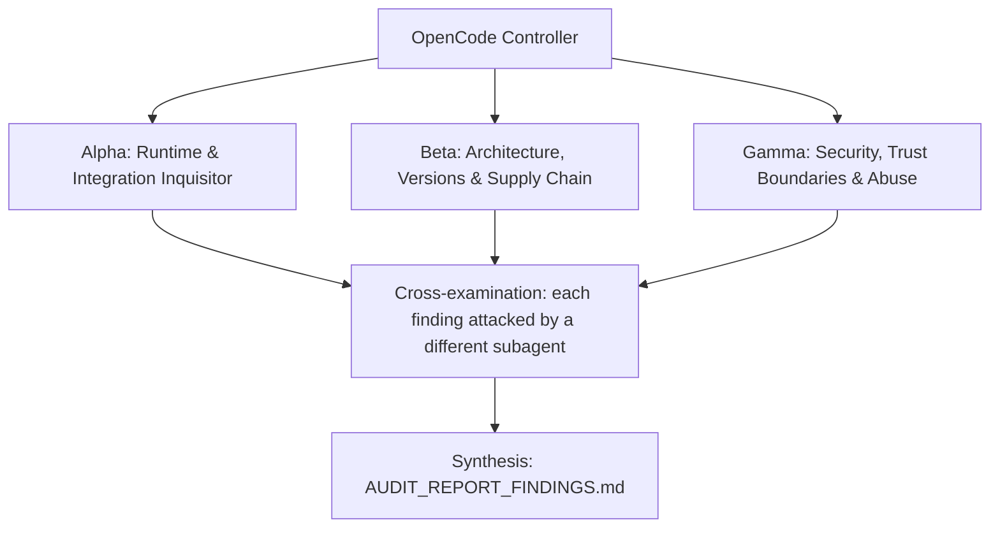

# ADVERSARIAL THREE-SUBAGENT AUDIT PROMPT: `heretek-rigs`

**Target Codebase**: the Git repository this file sits in. Resolve it with `git rev-parse --show-toplevel` and treat every path below as relative to that root. Nothing in this prompt depends on where the checkout lives.
**GitHub Remote**: `https://github.com/Heretek-AI/heretek-rigs`
**What it is supposed to be**: The 51 Heretek-Crew agents (Heretek-AI/Heretek-Crew@5ffb1fc, formerly OpenCode agents under Paperclip) re-homed as openrig 0.6.11 Pi 1.3.0 seats running `opencode-go/muse-spark-1.3-contributor`, in 7 static rigs (executive-and-architecture, fullstack-and-web-studio, systems-and-mobile-foundry, game-dev-and-sim-rig, cloud-sre-and-data-platform, qa-and-verification-gauntlet, defensive-sec-and-red-team) plus a dynamic `heretek-omni-fleet` rig scaled with `rig expand` and `rig add`. `fleet/fleet.yaml` and `fleet/mcp-servers.yaml` are the source of truth; `scripts/gen-specs.mjs` generates `specs/agents/**` (51 role AgentSpecs plus the `heretek-shared` skill pool of 62 vendored, pinned, licensed skills) and `rigs/**`; `scripts/seed-rig.mjs` renders each seat's Pi agent dir (command-backed `auth.json`, `settings.json`, `mcp.json`, charter `AGENTS.md`, pi-permission-system 41.0.0 config) before launch. openrig records `permission_policy` for Pi but enforces nothing, so pi-permission-system is the only enforcement layer: locked postures for the 10 judging seats, standard for builders, never yolo/open/ask. The operator consumes it by running `rig up` per rig against a workspace repo; seats coordinate through `rig queue` and `rig send`. Refusal boundary: no secrets in the repo or in `env:`, no second delegation path (no pi-subagents), no Paperclip/OpenCode machinery, no unpinned artifacts.
**Execution Context**: OpenCode v2 autonomous audit (works the same in any agent CLI that has subagents and a shell)
**Auditor Formation**: three independent adversarial subagents (Alpha, Beta, Gamma), a cross-examination pass, and a synthesis pass
**Output**: `AUDIT_REPORT_FINDINGS.md` at the repository root

This prompt is designed to be re-run. Each run audits the current `HEAD`, re-verifies every finding of the previous run, and overwrites `AUDIT_REPORT_FINDINGS.md`.

---

## 0. Preflight (the controller does this before spawning subagents)

1. **Baseline.** Record at the top of the report: `git rev-parse HEAD`, `git log -1 --format='%ci %s'`, the UTC date, and the versions of every tool you will use (node, npm, uv, git, jq, rg, `rig` from @openrig/cli, `pi` from @earendil-works/pi-coding-agent, tmux). If `git status --porcelain` shows changes other than this prompt file and a previous report, list the dirty files and audit a clean `git worktree` of `HEAD` instead of the working tree.
2. **Scratch space.** `export AUDIT_TMP="$(mktemp -d -t heretek-rigs-audit-XXXXXX)"`. Every clone, downloaded binary, packed tarball, sabotage copy, container volume and raw log goes under `$AUDIT_TMP`. Each subagent writes its raw notes to `$AUDIT_TMP/{alpha,beta,gamma}.md`.
3. **Disposable copy for experiments.** `git worktree add --detach "$AUDIT_TMP/wt" HEAD`. Sabotage, patched configs, and any file edits happen only there. The real checkout must end the audit with `git status --porcelain` showing nothing new but `AUDIT_REPORT_FINDINGS.md` (and this prompt file, if you copied it in untracked). Remove the copy with `git worktree remove --force "$AUDIT_TMP/wt"` at the end.
4. **Previous run.** If `AUDIT_REPORT_FINDINGS.md` already exists, read it before anything else. Every finding in it gets a row in the Regression Ledger (section 6), re-verified from scratch: never copy a previous verdict forward.
5. **Network and host capabilities.** You need outbound HTTPS to github.com, raw.githubusercontent.com, registry.npmjs.org, pypi.org, api.osv.dev, registry.modelcontextprotocol.io, api.githubcopilot.com and opencode.ai (live inference only). Probe what this host can do (does `rig daemon start --no-kernel --port 7699` bind on loopback, does tmux run, can `pi` reach `https://opencode.ai/inference/go/v1`, has the human placed an OpenCode Go key file for live checks (never read it), is Docker available for throwaway database backends, is radare2 installed) and record it. When a check cannot run here, the claim is `UNVERIFIABLE` with the exact reason. A claim is never `VERIFIED` by inference, by reading the code alone, or because a test says so.

**Hard limits (all subagents):** no package publishing, no `git push`, no tags, no GitHub writes (issues, comments, PRs), no real API keys or credentials in any command, file or report (generate throwaway keys and dummy values), no destructive command outside `$AUDIT_TMP`, the daemon runs only with `HOME` and `OPENRIG_HOME` under `$AUDIT_TMP` on a loopback port and every rig is `rig down` and the daemon `rig daemon stop` at the end, MCP backends are throwaway local instances only (never a production cluster, account or database), never read, print or copy the OpenCode Go key file or any file in the human's `$HERETEK_SECRETS`, and no `rig send` to any seat outside rigs you started. Read-only against the real checkout.

---

## 1. Directive & Rules of Engagement

You are a team of **three elite, adversarial principal systems auditors**. Your mandate is to stress-test, debunk, and verify every claimed feature, architectural decision, integration contract, security invariant, and version pin in **`heretek-rigs`**, measured against what the repository is supposed to be (above) and what its own `README.md`, `AGENTS.md` and `docs/` claim.

### The Cardinal Rule: DO NOT BELIEVE TESTS
- Unit tests, acceptance scripts and CI badges can lie: they assert obsolete invariants, mock away the real system, or test that a file *contains* a rule rather than that the rule *works*.
- This repository has a documented history of exactly that:
  - Heretek-Crew P0-2: the install gate passed (`npm ls` showed `@heretek-ai/opencode-harness@1.0.7`) while every harness primitive threw `rootDir must be a non-empty string` at runtime under the pinned CLI.
  - Heretek-Crew P0-4 and P0-6: the shape check `permissions[-1] == {shell,*,deny}` passed 51/51 while 66 MCP wildcard allows bypassed the shell deny and prefix-matched shell allows (`git status; id`) were never probed live.
  - Heretek-Crew P0-1 and P0-3: pinned image tags that did not exist in their registries were copied faithfully from the spec.
  - Planning-session spikes for this repo: `rig spec validate` returned `{"valid":true}` for `runtime: opencode` (only preflight refuses it); pi-permission-system wrote `docs/../evil.md` under a `docs/*` allow; `r2mcp==0.2.5` on PyPI is not radare2; Heretek-Crew's superpowers skills were truncated copies.
  - This repo's own gate tests (`scripts/gate-role.sh`, `tests/render-seat.test.mjs`) drive Pi in `pi -p` mode against `scripts/mock-openai.mjs`, a hand-written OpenAI-compatible mock that forces exactly one tool call. They prove the permission config, not the launched seat, not the real model, and not tool calls the model would actually choose.
- Never conclude that a component works because `npm test`, `node scripts/check-fleet.mjs` or `bash scripts/gate-role.sh <role>` exits 0. Prove behavior against **the real thing it plugs into**: a live openrig daemon from `@openrig/cli@0.6.11` with seats launched by `rig up` (not `pi -p`), Pi 1.3.0 talking to the real `opencode-go/muse-spark-1.3-contributor` endpoint, `pi mcp list --json` against each real MCP server, the npm, PyPI, OSV and official MCP registries, fresh clones of the pinned skill repos, the `@openrig/cli@0.6.11` tarball (`npm pack`), and upstream `mvschwarz/openrig` main for drift.

### The Second Rule: DO NOT BELIEVE THE PAPER TRAIL
- `docs/reports/*`, `docs/evidence/*`, "red-proof" logs, drift-guard `VERDICT: PASS` lines, `CHANGELOG.md`, and `README.md` are **claims under audit**, not evidence.
- The repo was built by an OpenCode agent (Muse 1.3 Contributor on OpenCode Go) from `docs/IMPLEMENTATION_PROMPT.md`; that brief, `fleet/fleet.yaml`, `fleet/mcp-servers.yaml` and `docs/OSINT_ECOSYSTEM_REPORT.md` were written by a planning session from spikes run with mock models and no live inference. Build gates that only check spec compliance cannot catch invented facts (API names, image tags, config shapes) in the spec. Matching the spec is not the same as working. Where the spec and reality disagree, reality wins and the spec is the defect.

### The Third Rule: SABOTAGE EVERY CRITICAL INVARIANT
- For each invariant marked **[S]** in section 3, break it with a one-line change in `$AUDIT_TMP/wt`, run the full suite there, and record whether the suite went red. Restore the line after each run.
- A sabotage the suite does not catch is a finding: **P1** ("untested invariant"), or **P0** when the invariant is a security boundary.

### Modern Version & Proper Deployment Imperative
- Every pinned version must be a **modern, supported, production-grade release that actually exists** in its registry. Flag invented versions, deprecated or archived packages, renamed organizations, floating tags (`latest`, `^` ranges on security-relevant deps, unpinned GitHub Actions), end-of-life runtimes, and versions with known CVEs (the ecosystem's audit tool, OSV: `https://api.osv.dev/v1/query`).
- Verify that integration patterns follow the **official upstream documentation and source code** of the system being integrated, at the version pinned and at the current upstream head (drift is a finding).

### Verdict vocabulary
Every claim in section 3 ends with exactly one status, each backed by a command and its output:
- `VERIFIED` (proven to work against the real thing), `PARTIAL` (works with caveats you name), `BROKEN` (proven not to work), `UNVERIFIABLE` (could not be run here, with the exact reason).

---

## 2. The Adversarial Triad (Subagent Roles)



### Subagent Alpha: Runtime & Integration Inquisitor

**Focus:** Do the 51 seats actually launch under a real openrig daemon as Pi seats on `opencode-go/muse-spark-1.3-contributor`, with their seeded files intact, their skills projected and their permission config loaded and enforcing, and does dynamic scaling work?

- Start a throwaway daemon (`HOME=$AUDIT_TMP/home OPENRIG_HOME=$AUDIT_TMP/home/.openrig rig daemon start --no-kernel --port 7699`), seed with `scripts/seed-rig.mjs` and launch every rig in `rigs/` with `rig up <rig>/rig.yaml --cwd $AUDIT_TMP/workspace --yes --json`. Count seats per rig against `fleet/fleet.yaml` (6, 11, 4, 6, 11, 6, 7) and read each runner's `/proc/<pid>/cmdline` for `--model` and `--no-approve`.
- Prove enforcement **inside a launched seat**, not with `pi -p`: with the human's key, `rig send` a seat an instruction to write outside its `path_write`, to read `.env`, and to run `curl`, then `rig capture` / read its session JSONL for the `[pi-permission-system] Denied by policy` text. Without a key, record UNVERIFIABLE for the live part and still check the config file is present after launch.
- Check that `<agentDir>/AGENTS.md` (the charter) is what the seat's system prompt carries, and that `<workspace>/AGENTS.md` holds only openrig's managed blocks (no `guidance/role.md` block, which would mean the shared-cwd collision is back).
- Run `rig down <rig>` then `rig up <rig> --existing` and diff every seeded file (`sha256sum`) before and after.
- Exercise the omni rig: `rig expand <RIG-ID> pods/<pod>.yaml --rig-root "$PWD"` for at least two pods and `rig add <rig> <pod> members/<role>.yaml --rig-root "$PWD"`, seeding first; then try both without seeding and record what the unseeded seat has (it should have no permission config: that is the failure mode to report).
- Drift: repeat one rig launch with `@openrig/cli` at upstream head (`mvschwarz/openrig` main, built from source or the newest npm version) and Pi's newest version; report what breaks.

### Subagent Beta: Architecture, Versions & Supply Chain

**Focus:** Is every pin real, current and the software it claims to be, is every vendored skill byte-identical to its pinned source with its licence, and does the generated tree match the data files exactly?

- Registry truth for every pin in `package.json`, `fleet/mcp-servers.yaml`, `docs/IMPLEMENTATION_PROMPT.md` section 3.2 and `.github/workflows/*.yml`: `npm view <pkg>@<ver> version deprecated repository.url time.modified`, PyPI JSON, `git ls-remote` for tags and SHAs, OSV for each. Confirm the replaced pins (`r2mcp==0.2.5`, `aws-mcp@1.0.2`, `@modelcontextprotocol/server-github`, `server-postgres`, `mcp-server-duckdb`, `mcp-server-kubernetes`, `docker-mcp`, `@executeautomation/playwright-mcp-server`) appear nowhere in `specs/`, `rigs/` or rendered seats.
- Recompute every `fleet/skills-lock.json` tree hash from fresh clones at the pinned SHAs (and from the `@openrig/cli@0.6.11` tarball via `npm pack`) and compare with `specs/agents/_shared/skills/<id>` minus any added `LICENSE`. Any difference is a finding (CC-BY-SA trailofbits files must be unmodified).
- Regenerate: run `scripts/gen-specs.mjs` in `$AUDIT_TMP/wt` from the pinned inputs and `git diff --stat`; it must be empty. Then diff each `specs/agents/<domain>/<role>/agent.yaml` skills list against `fleet/fleet.yaml`.
- Cross-check `fleet/fleet.yaml` against Heretek-Crew `5ffb1fc` (`roles/*/opencode/opencode.json`): every role present, every `fs:write` allow translated to `path_write`, every shell allow either translated or listed as a rewrite in `docs/OSINT_ECOSYSTEM_REPORT.md` section 6, every original skill present.
- Contract currency: compare the RigSpec and AgentSpec fields this repo uses with the validators at the pinned `@openrig/cli@0.6.11` and at upstream head; compare `settings.json` and `mcp.json` keys with Pi's `docs/settings.md` and `docs/mcp.md` at 1.3.0 and at the newest Pi.
- Scope: the repo must not ship a second delegation path (no `pi-subagents`), no `pi-mcp-adapter`, no web-access package, and no copy of Paperclip/OpenCode machinery.

### Subagent Gamma: Security, Trust Boundaries & Abuse

**Focus:** Can a seat write, read or run anything its role should not, can a secret leak, and can the supply chain or the seeding step be subverted?

- Build a bypass corpus for `path_write` against every role's rendered config with the mock harness (`scripts/gate-run.sh`): `..` in every position, absolute paths inside and outside the cwd, symlinks created by an allowed tool and then written through, trailing slashes, `./` prefixes, Unicode look-alikes, very long paths, case changes on case-insensitive filesystems.
- Build a bash corpus against each allow pattern: `;`, `&&`, `||`, `|`, `$( )`, backticks, newlines, `>`, `>>`, `<(`, here-docs, env-prefix (`FOO=1 cmd`), `xargs`, and argument-level escapes of allowed tools (`git diff --stat --output=x`, `git log --oneline --output=x`, `git show --stat --output=x`, `semgrep scan --output x`, `trivy fs -o x`, `npm test -- <args>`, `cargo test -- <args>`, `pytest -p <plugin>`, `rig send` to impersonate a lead, `rig queue` to assign work to a locked seat). Any write or exec outside the role's scope is a finding.
- Secrets: `git log -p --all | rg -n "ghp_|github_pat_|sk-|AKIA|xox[bp]-|BEGIN (RSA|OPENSSH) PRIVATE"`; grep every rendered `mcp.json` and `auth.json` for literal secrets; confirm the key file mode check in `scripts/render-seat.mjs` and that a seat cannot `read` `$HERETEK_SECRETS` (external_directory) nor `cat` it (bash), and that pi-permission-system review logs do not record secret values.
- Trust roots: who can change a seat's permissions? Check that seats cannot write their own `<agentDir>` (outside cwd), `AGENTS.md`, `.pi/`, `.agents/`, `.git/` (hooks, config `fsmonitor`), CI files, `fleet/*.yaml` or `scripts/*` when the workspace is this repo.
- MCP blast radius: for every server, prove the read-only claim (GitHub `/readonly` tool list, Kubernetes `--read-only`, AWS `READ_OPERATIONS_ONLY`, Postgres `restricted`, ClickHouse write flag, radare2 `-R`) against a throwaway backend, and that a seat's `mcp` map hides servers it is not bound to.
- CI supply chain: every action pinned to a full SHA, `permissions:` minimal, no `curl | sh`, no unpinned `npm i -g`, no secrets in workflow logs.

---

## 3. Comprehensive Inventory of Claimed Functions & Architectural Decisions

### Domain 1: Fleet completeness and topology
* **Claim 1.1 [B][S]**: `fleet/fleet.yaml` holds exactly 51 roles, and each sits in exactly one static seat (`scripts/check-fleet.mjs` enforces it).
* **Claim 1.2 [A]**: The 7 static rigs launch with 6, 11, 4, 6, 11, 6 and 7 seats (51 total), every seat in lifecycle `run`.
* **Claim 1.3 [B]**: The omni rig has a 3-seat command pod, 15 pod fragments under `rigs/heretek-omni-fleet/pods/` and 51 member fragments under `rigs/heretek-omni-fleet/members/`.
* **Claim 1.4 [B][S]**: Every edge uses one of `delegates_to`, `spawned_by`, `can_observe`, `collaborates_with`, `escalates_to` and stays inside its rig; pod edges stay inside their pod.
* **Claim 1.5 [A]**: Every `reports_to.address` in `fleet/fleet.yaml` is a live session name (`<pod>-<member>@<rig>`) that `rig send` reaches.

### Domain 2: openrig contract
* **Claim 2.1 [A][B]**: All 52 `specs/agents/**/agent.yaml` pass `rig agent validate` and all 8 `rigs/*/rig.yaml` pass both `rig spec validate` and `rig spec preflight` (`ready: true`).
* **Claim 2.2 [A][S]**: Every seat runs `runtime: pi` and inherits `opencode-go/muse-spark-1.3-contributor` from its agent.yaml defaults (runner `--model` argument).
* **Claim 2.3 [A][S]**: No spec uses a `guidance_merge` startup file; each seat's charter reaches its system prompt through `<agentDir>/AGENTS.md`, and no seat receives another seat's charter.
* **Claim 2.4 [A]**: `rig expand <RIG-ID> <pod.yaml> --rig-root <ABS>` and `rig add <rig> <pod> <member.yaml> --rig-root <ABS>` attach seeded seats to the running omni rig.
* **Claim 2.5 [B]**: `permission_policy` is `builtin:locked` for the 10 judging seats (7 security, static-analysis-lead, sabotage-qa-tester, release-qa-officer) and `builtin:standard` elsewhere; `builtin:yolo` and `builtin:open` appear nowhere.

### Domain 3: Seat seeding and credentials
* **Claim 3.1 [A][S]**: `scripts/seed-rig.mjs` writes `auth.json`, `settings.json`, `mcp.json`, `AGENTS.md` and `extensions/pi-permission-system/config.json` (mode 0600) for every seat, and all five survive `rig up`, `rig down` and `rig up --existing` unchanged.
* **Claim 3.2 [G][S]**: The model key is only ever referenced as `"!cat <abs path>"`; `scripts/render-seat.mjs` refuses a missing key or a key file with group/other permission bits.
* **Claim 3.3 [G]**: No secret appears in git history, `rig.yaml`, any `env:` block, rendered files, transcripts or pi-permission-system logs.
* **Claim 3.4 [A]**: A launched seat answers a prompt through the live OpenCode Go endpoint.
* **Claim 3.5 [B]**: Each seat's `defaultThinkingLevel` matches `fleet/fleet.yaml` (`high` or `xhigh`), and no role requests `max`.

### Domain 4: Permission enforcement
* **Claim 4.1 [A][S]**: pi-permission-system 41.0.0 is loaded in every launched seat (from `$HERETEK_TOOLS/pi-packages`), and a denied write inside a launched seat produces the `Denied by policy` result.
* **Claim 4.2 [G][S]**: Every seat's `path_write` map starts with `"*":"deny"` and ends with `"*..*":"deny"`; no `..` path can write outside the role's globs.
* **Claim 4.3 [G][S]**: Seats cannot write `AGENTS.md`, `.git/*`, `*/.git/*`, `.pi/*` or `.agents/*`.
* **Claim 4.4 [G][S]**: Seats cannot read `*.env`, `*.env.*` (except `.env.example`), `*.pem`, `*.key`, `*id_rsa*`, `*/secrets/*`, or anything outside the cwd.
* **Claim 4.5 [G][S]**: The bash map is deny-all plus the role's allow-list; compound commands, substitutions and redirections out of scope are denied, and no allow pattern is a general interpreter or network client.
* **Claim 4.6 [G]**: No allow pattern lets an allowed tool write files through its own flags (for example `git diff --stat --output=x`).
* **Claim 4.7 [G][S]**: The `mcp` map denies every server except the ones bound to the role in `fleet/fleet.yaml`.
* **Claim 4.8 [G]**: No config contains `ask`, and every config sets `promptTimeoutMs: 60000`.
* **Claim 4.9 [A][S]**: `scripts/gate-role.sh` proves, for all 51 roles, at least one real allow and the denials listed in it, and goes red when a guard is removed.

### Domain 5: Skills
* **Claim 5.1 [A][B]**: Every seat carries the 6 openrig-core skills (`openrig-operating-model`, `mission-slice-sop`, `delegating-work`, `queue-handoff`, `refocusing`, `seat-continuity-and-handover`), projected under `<agentDir>/skills/heretek-shared:<id>`.
* **Claim 5.2 [B][S]**: Each of the 62 vendored shared skills matches its `fleet/skills-lock.json` tree hash at the pinned source (superpowers `bb92a77`, trailofbits `5c99c03`, getsentry `f57ada2`, anthropics `dbd4588`, vercel-labs `063bee9`, `@openrig/cli@0.6.11`).
* **Claim 5.3 [B]**: Every vendored skill carries its licence (in-tree or the copied source-root `LICENSE`), and the CC-BY-SA trailofbits files are unmodified.
* **Claim 5.4 [B]**: The 7 superpowers skills are the full upstream directories, not the truncated Heretek-Crew copies.
* **Claim 5.5 [A]**: Skill loading works under `external_directory: "deny"` (a seat can read its own `skills/*/SKILL.md`), and no two skills in a seat share a `name`.

### Domain 6: MCP servers
* **Claim 6.1 [B][S]**: Every pin in `fleet/mcp-servers.yaml` exists in its registry and is the software named in `source:` (in particular radare2 comes from `radareorg/radare2-mcp@1.9.0`, AWS from `awslabs.aws-api-mcp-server==1.5.6`).
* **Claim 6.2 [G]**: Every server with a read-only mode runs in it (GitHub `/x/<toolset>/readonly`, Kubernetes `--read-only`, AWS `READ_OPERATIONS_ONLY=true`, Postgres `--access-mode=restricted`, ClickHouse `CLICKHOUSE_ALLOW_WRITE_ACCESS=false`, radare2 `-R`).
* **Claim 6.3 [G][S]**: Secrets reach MCP servers only through whole-value `!cat` in `env` or `headers`; no `args` entry starts with `!`.
* **Claim 6.4 [A]**: Every seat with a `deferred` server has `tool_search` in `defaultTools` and `"tool_search":"allow"`, and `tool_search` loads that server's tools.
* **Claim 6.5 [A]**: Each server marked `run-verified` reports `state: connected` in `pi mcp list --json` for a seat bound to it.
* **Claim 6.6 [B]**: The dropped servers (git, filesystem, docker) are bound to no role.

### Domain 7: Packaging, versions and release
* **Claim 7.1 [B]**: `@openrig/cli@0.6.11`, `@earendil-works/pi-coding-agent@1.3.0`, `@gotgenes/pi-permission-system@41.0.0` and `yaml@2.9.1` exist, are not deprecated and have no open OSV advisories.
* **Claim 7.2 [B]**: `package-lock.json` is committed and `npm ci` reproduces `node_modules` exactly.
* **Claim 7.3 [G]**: CI actions are pinned to full commit SHAs, `permissions: contents: read`, and no step installs anything unpinned.
* **Claim 7.4 [B]**: `LICENSE.md` is unchanged from `02f9c24` (the owner has not chosen a licence; that is itself a P2 to report).

### Domain 8: Scope, CI and ecosystem fit
* **Claim 8.1 [B][S]**: `scripts/gen-specs.mjs` is deterministic: a second run on the committed inputs yields no diff.
* **Claim 8.2 [B][S]**: `scripts/check-fleet.mjs` fails on a bad edge kind, a forbidden bash allow, a floating MCP pin and a literal secret.
* **Claim 8.3 [B]**: `README.md`, `docs/OSINT_ECOSYSTEM_REPORT.md` and `docs/IMPLEMENTATION_PROMPT.md` agree with `fleet/*.yaml` (counts, rigs, pins).
* **Claim 8.4 [A][B]**: The fleet still validates and launches against upstream openrig head; the Heretek-AI/openrig fork (`0376204`, 10 commits behind `d4741c9` at planning time) is not required.

## 4. Reality-Check Recipes

```bash
# Run from the repository root. Everything mutable lives under $AUDIT_TMP.
set -euo pipefail
ROOT=$(git rev-parse --show-toplevel); cd "$ROOT"
export HOME_REAL=$HOME
export HOME="$AUDIT_TMP/home" OPENRIG_HOME="$AUDIT_TMP/home/.openrig"
export HERETEK_TOOLS="$AUDIT_TMP/tools" HERETEK_SECRETS="$AUDIT_TMP/secrets"
mkdir -p "$HOME" "$HERETEK_TOOLS/pi-packages" "$HERETEK_SECRETS" "$AUDIT_TMP/logs" && chmod 700 "$HERETEK_SECRETS"

# Pins straight from the repo files
RIG_VER=$(rg -o '@openrig/cli@[0-9.]+' docs/IMPLEMENTATION_PROMPT.md | head -1 | cut -d@ -f3)
PI_VER=$(rg -o 'pi-coding-agent@[0-9.]+' docs/IMPLEMENTATION_PROMPT.md | head -1 | cut -d@ -f2)
PPS_VER=$(rg -o 'pi-permission-system@[0-9.]+' docs/IMPLEMENTATION_PROMPT.md | head -1 | cut -d@ -f2)
npm i --prefix "$AUDIT_TMP/cli" "@openrig/cli@$RIG_VER" "@earendil-works/pi-coding-agent@$PI_VER" >/dev/null
export PATH="$AUDIT_TMP/cli/node_modules/.bin:$PATH"
rig --version; pi --version
npm i --prefix "$HERETEK_TOOLS/pi-packages" --omit=peer "@gotgenes/pi-permission-system@$PPS_VER" >/dev/null

# The checking method works: a tag that must not exist, a package that is not what its name says
npm view "@openrig/cli@0.0.0-does-not-exist" version 2>&1 | head -1          # must be an E404
curl -s https://pypi.org/pypi/r2mcp/json | jq -r '.info.summary'             # must NOT mention radare2

# Registry truth for MCP pins
node -e 'const Y=require("yaml");for(const[n,s]of Object.entries(Y.parse(require("fs").readFileSync("fleet/mcp-servers.yaml","utf8")).servers))console.log(n, s.pin)' | tee "$AUDIT_TMP/logs/mcp-pins.txt"
rg -o 'pin: npm:(\S+)' -r '$1' fleet/mcp-servers.yaml | while read -r p; do echo "$p $(npm view "$p" version deprecated 2>&1 | tr '\n' ' ')"; done
rg -o 'pypi:([A-Za-z0-9_.-]+)==([0-9.]+)' -r '$1 $2' fleet/mcp-servers.yaml | while read -r n v; do echo "$n $v $(curl -s https://pypi.org/pypi/$n/$v/json | jq -r '.info.version // "MISSING"')"; done

# Static invariants, tests, determinism
npm ci >/dev/null && node scripts/check-fleet.mjs && node --test tests/*.test.mjs
bad=0; for f in $(find specs -name agent.yaml); do rig agent validate "$f" --json | jq -e .valid >/dev/null || { echo "BAD $f"; bad=1; }; done; echo "agents_bad=$bad"
for d in rigs/*/; do (cd "$d" && echo "$d $(rig spec validate rig.yaml --json | jq -c .valid) $(rig spec preflight rig.yaml --json | jq -c '{ready,errors}')"); done

# Rendered config shape, all 51 roles (dry-run; no daemon)
printf 'dummy' > "$HERETEK_SECRETS/opencode-go.key" && chmod 600 "$HERETEK_SECRETS/opencode-go.key"
for r in $(node -e 'console.log(Object.keys(require("yaml").parse(require("fs").readFileSync("fleet/fleet.yaml","utf8")).roles).join(" "))'); do
  read -r rig pod < <(node -e 'const r=require("yaml").parse(require("fs").readFileSync("fleet/fleet.yaml","utf8")).roles[process.argv[1]];console.log(r.rig,r.pod)' "$r")
  node scripts/render-seat.mjs --role "$r" --rig "$rig" --pod "$pod" --dry-run --allow-missing-secrets 2>/dev/null \
    | jq -r --arg r "$r" '."extensions/pi-permission-system/config.json".permission as $p | "\($r) first=\($p.path_write|keys_unsorted|first) last=\($p.path_write|keys_unsorted|last) bash0=\($p.bash|keys_unsorted|first) ask=\(tostring|test("\"ask\""))"'
done | tee "$AUDIT_TMP/logs/config-shape.txt" | rg -v 'first=\* last=\*\.\.\* bash0=\* ask=false' || echo "all 51 configs have the expected shape"

# Gate probes, all 51 roles (mock model)
fails=0; for r in $(node -e 'console.log(Object.keys(require("yaml").parse(require("fs").readFileSync("fleet/fleet.yaml","utf8")).roles).join(" "))'); do GATE_TIMEOUT=30 bash scripts/gate-role.sh "$r" >> "$AUDIT_TMP/logs/gate.txt" 2>&1 || fails=$((fails+1)); done; echo "roles_failed=$fails"

# Bypass probe template (add your own corpus lines)
A="$AUDIT_TMP/agent-appsec"; W="$AUDIT_TMP/work"; mkdir -p "$W" && git -C "$W" init -q
node scripts/render-seat.mjs --role appsec-engineer --rig defensive-sec-and-red-team --pod blue --model-provider mock --model-id mock-model --out "$A" --allow-missing-secrets
printf '{"providers":{"mock":{"baseUrl":"http://127.0.0.1:18555/v1","api":"openai-completions","apiKey":"mock","models":[{"id":"mock-model"}]}}}\n' > "$A/models.json"
GATE_TIMEOUT=30 bash scripts/gate-run.sh "$A" "$W" bash '{"command":"git diff --stat --output=pwned.txt"}'; ls "$W"
GATE_TIMEOUT=30 bash scripts/gate-run.sh "$A" "$W" write '{"path":"./docs/security/advisories/../../../pwned2.txt","content":"x"}'; ls "$W"

# Skill provenance. Step 1 clones the pinned sources; step 2 checks vendored dirs against the lock.
# Beta must ALSO hash each lock entry's source dir in the fresh clone ("$AUDIT_TMP/vendor/<owner>_<repo>/<path>") with the same h()
# and compare with "tree": the lock is a claim until both sides match.
mkdir -p "$AUDIT_TMP/vendor" && cd "$AUDIT_TMP/vendor"
for spec in obra/superpowers@bb92a77 trailofbits/skills@5c99c03 getsentry/skills@f57ada2 anthropics/skills@dbd4588 vercel-labs/agent-skills@063bee9; do
  repo=${spec%@*}; sha=${spec#*@}; d=${repo/\//_}; git clone -q "https://github.com/$repo" "$d" && git -C "$d" checkout -q "$sha"; done
cd "$ROOT"
node -e '
const fs=require("fs"),p=require("path"),c=require("crypto");
const lock=JSON.parse(fs.readFileSync("fleet/skills-lock.json","utf8")).skills;
const h=(dir)=>{const x=c.createHash("sha256");const w=(d)=>fs.readdirSync(d,{withFileTypes:true}).sort((a,b)=>a.name.localeCompare(b.name)).forEach(e=>{const f=p.join(d,e.name);if(e.isDirectory())w(f);else{x.update(p.relative(dir,f)+"\0");x.update(fs.readFileSync(f));}});w(dir);return "sha256:"+x.digest("hex");};
for(const[id,l]of Object.entries(lock)){const t=p.join("specs/agents/_shared/skills",id);const tmp=fs.mkdtempSync(p.join(process.env.AUDIT_TMP,"s-"));fs.cpSync(t,tmp,{recursive:true});if(l.license_file.startsWith("LICENSE ("))fs.rmSync(p.join(tmp,"LICENSE"));console.log(h(tmp)===l.tree?"ok  ":"DIFF",id);}' | tee "$AUDIT_TMP/logs/skills.txt" | rg DIFF || echo "all vendored skills match the lock"

# Live daemon (Alpha). Loopback only; stop everything at the end.
rig daemon start --no-kernel --port 7699
mkdir -p "$AUDIT_TMP/workspace" && git -C "$AUDIT_TMP/workspace" init -q
node scripts/seed-rig.mjs rigs/defensive-sec-and-red-team/rig.yaml --allow-missing-secrets
(cd rigs/defensive-sec-and-red-team && rig up rig.yaml --cwd "$AUDIT_TMP/workspace" --yes --json | jq -c '{status,errors}')
rig ps --nodes --rig defensive-sec-and-red-team
# ... launch the other rigs, expand/add on the omni rig, then:
for r in $(rig ps --json | jq -r '.[].name'); do rig down "$r" --json | jq -c '{rigName,sessionsKilled}'; done; rig daemon stop

# Secrets in history
git log -p --all | rg -n 'ghp_|github_pat_|sk-[A-Za-z0-9]{20}|AKIA[0-9A-Z]{16}|xox[bp]-|BEGIN (RSA|OPENSSH) PRIVATE' || echo "no secret patterns in history"
```

**Sabotage targets** (one-line breaks in `$AUDIT_TMP/wt`, then run `node scripts/check-fleet.mjs`, `node --test tests/*.test.mjs` and `bash scripts/gate-role.sh` for the affected role):
- 1.1: delete one role's entry from a pod's `members` in `fleet/fleet.yaml`.
- 1.4: change one rig edge `kind` to `reviews`, or point a rig edge at another rig's member.
- 2.2: set `runtime: opencode` for one member in a generated `rigs/*/rig.yaml` (validate passes; does anything in the suite catch it?).
- 2.3: add a `guidance/role.md` `guidance_merge` file to one agent.yaml `startup.files` in `scripts/gen-specs.mjs`.
- 3.1: in `scripts/render-seat.mjs`, skip writing `extensions/pi-permission-system/config.json`.
- 3.2: in `scripts/render-seat.mjs`, drop the `mode & 0o077` check, or write the key value instead of `!cat <path>`.
- 4.1: remove the package path from `settings.json` `packages` in `scripts/render-seat.mjs`.
- 4.2: remove `"*..*": "deny"` from the `path_write` guard list in `scripts/render-seat.mjs`, or move the guards before the role allows.
- 4.3: remove `"AGENTS.md": "deny"` from the guard list.
- 4.4: remove `"*.env": "deny"` from the `path` map.
- 4.5: change `bash` `"*": "deny"` to `"allow"`.
- 4.7: set `mcpAllow["*"] = "allow"` in `scripts/render-seat.mjs`.
- 4.9: make `expect()` in `scripts/gate-role.sh` always print `ok`.
- 5.2: change one byte in a vendored `specs/agents/_shared/skills/*/SKILL.md`.
- 6.1: change a pin in `fleet/mcp-servers.yaml` to `@latest`.
- 6.3: put `"!cat @SECRETS@/x"` into one server's `args`.
- 8.1: make `scripts/gen-specs.mjs` iterate roles in `Object.keys` order of a shuffled copy.
- 8.2: delete the `KINDS.has(e.kind)` check in `scripts/check-fleet.mjs`.

---

## 5. Execution Directives for OpenCode

1. **Independent exploration.** Spawn Alpha, Beta and Gamma concurrently as three separate subagents. Hand each one this entire file plus its role. They must not read each other's notes until step 4. Each one works through the claims it owns (ownership is marked `[A]`, `[B]`, `[G]` in section 3) and may file findings on any claim.
2. **Run things.** Prefer executing to reading. Use the recipes in section 4 and any further commands you need (`git ls-remote`, `curl`, `jq`, `rg`, node, npm view, npm pack, uvx, rig, pi). Save the raw output of every command you cite under `$AUDIT_TMP/logs/`.
3. **Empirical Proof Mandate.** For every claim judged `BROKEN`, `PARTIAL`, insecure, or outdated, record:
   - the exact file path and line number (`path/to/file.ts:123`);
   - the exact command executed to prove it, runnable as written from the repository root;
   - the raw output, error message, or registry response (trimmed to the relevant lines, never paraphrased);
   - for upstream comparisons, the upstream file path and commit SHA you compared against.
4. **Cross-examination.** When all three are done, each finding is handed to a different subagent (Alpha's to Beta, Beta's to Gamma, Gamma's to Alpha), whose job is to refute it: re-run the proof, look for a misreading, a wrong upstream version, or an environment artifact. A refuted finding is dropped or downgraded, and the refutation is noted in the finding.
5. **Coverage gate.** Before synthesis, check that every claim ID in section 3 has a status. Any claim without one goes back to its owner.
6. **Synthesis.** The controller writes `AUDIT_REPORT_FINDINGS.md` in the structure below, then cleans up (`git worktree remove`, stop any containers or processes you started) and confirms the real checkout has no changes apart from the report and this prompt file.

---

## 6. Report Structure: `AUDIT_REPORT_FINDINGS.md`

```markdown
# AUDIT_REPORT_FINDINGS: heretek-rigs

## Baseline
Commit, commit date, audit date (UTC), tool versions, host capabilities, and the list of checks that could not run here and why.

## Verdict
Three to six sentences: does `heretek-rigs` do what it is supposed to be, against the real systems it plugs into? Name the single most important thing to fix.

## Prioritized Defect Matrix
| ID | Priority | Claim | Location | Summary |
|----|----------|-------|----------|---------|

## Findings
### HR-<claim-id>-<slug>: <title>
- **Priority:** P0 | P1 | P2 | P3
- **Claim:** <claim ID and text>
- **Location:** `path:line`
- **Proof:** the command(s), runnable from the repo root
- **Raw output:** fenced block, trimmed, verbatim
- **Why it matters:** one or two sentences, in terms of what breaks for a user
- **Remediation:** an exact, fail-closed diff or command sequence
- **Verify the fix:** the command that goes from failing to passing once fixed
- **Cross-examination:** who challenged it and what they found

## Claim Ledger
| Claim | Status | Evidence (command or finding ID) |
Every claim ID from section 3, no omissions.

## Sabotage Results
| Invariant | One-line sabotage (file:line, before -> after) | Suite result | Caught? |

## Regression Ledger
| Previous finding ID | Previous priority | Status now: FIXED / STILL OPEN / REGRESSED / NO LONGER APPLICABLE | Evidence |
(Write "First run" if there was no previous report.)

## Not Audited / Unverifiable
What could not be checked, why, and what a human needs to provide to check it.
```

**Finding IDs are stable across runs.** Use `HR-<claim-id>-<short-slug>` (for example `HR-4.2-dotdot-guard`) so the next run's Regression Ledger can match findings by ID.

**Priority definitions:**
- **P0 / Critical:** the component does not work against its real host or upstream (a seat that does not launch under `rig up`, a launched seat without its pi-permission-system config or whose config does not deny, a role missing from the fleet, a write or read outside a role's scope, an MCP pin that does not exist or is not the claimed software, a secret in git, a rendered file or a rig `env:`); a security boundary can be bypassed; a pinned artifact does not exist; a release on a registry is broken.
- **P1 / High:** deprecated or end-of-life versions, fail-open error handling, an untested security or correctness invariant (sabotage survived), an integration contract that drifted from the current upstream head, severe scope or architecture drift from what the repo is supposed to be.
- **P2 / Medium:** non-fatal version lag, documentation that contradicts behavior, missing CI coverage for a reality check, suboptimal resource or performance choices.
- **P3 / Low:** style, dead code, naming, minor cleanups.

For every finding, provide the exact, fail-closed code diff or command sequence to remediate. Do not apply it to the real checkout.
