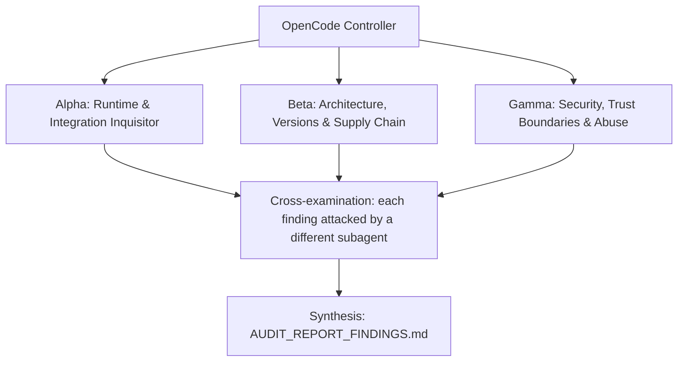

# ADVERSARIAL THREE-SUBAGENT AUDIT PROMPT: `heretek-rigs`

**Target Codebase**: the Git repository this file sits in. Resolve it with `git rev-parse --show-toplevel` and treat every path below as relative to that root. Nothing in this prompt depends on where the checkout lives.
**GitHub Remote**: `https://github.com/Heretek-AI/heretek-rigs`
**What it is supposed to be**: `heretek-rigs` is the production OpenRig (`v0.6.11`) multi-rig monorepo and agent catalog migrating all 51 specialized autonomous agent roles from `Heretek-AI/Heretek-Crew` across 9 domain directories (`specs/agents/<domain>/<role-slug>/` + `specs/agents/shared/`) and 8 composable pod-aware OpenRig v0.2 bundles (`rigs/executive-and-architecture`, `rigs/fullstack-and-web-studio`, `rigs/systems-and-mobile-foundry`, `rigs/game-dev-and-sim-rig`, `rigs/cloud-sre-and-data-platform`, `rigs/qa-and-verification-gauntlet`, `rigs/defensive-sec-and-red-team`, and `rigs/heretek-omni-fleet`), wired to execute on `runtime: pi` (and `runtime: omp`) using `opencode-go/muse-spark-1.3-contributor:high` via OpenCode Go (`https://opencode.ai/inference/go/openai/v1/responses`), backed by digest-pinned Docker Compose sidecars (`docker-compose.sidecars.yml`), OpenRig v1 JSON Schemas (`schemas/*.v1.schema.json`), and cryptographic registry artifacts (`registry/status.json`, `registry/entries/*.yaml`, `registry/views/*/behaviour.json`, `rosters/heretek-omni-fleet.json`). It refuses any unpinned `:latest` image or package, any symlink inside `specs/` or `rigs/`, any mutating tool or shell access on its 16 read-only auditor/director roles, and any secret stored in `rig.yaml` `env:`.
**Execution Context**: OpenCode v2 autonomous audit (works the same in any agent CLI that has subagents and a shell)
**Auditor Formation**: three independent adversarial subagents (Alpha, Beta, Gamma), a cross-examination pass, and a synthesis pass
**Output**: `AUDIT_REPORT_FINDINGS.md` at the repository root, ending with a mandatory deterministic status sentinel (`STATUS: NO_FINDINGS` or `STATUS: FINDINGS_DETECTED`) consumed by `scripts/audit_loop.py`.

This prompt is designed to be re-run. Each run audits the current `HEAD`, re-verifies every finding of the previous run, and overwrites `AUDIT_REPORT_FINDINGS.md`.

---

## 0. Preflight (the controller does this before spawning subagents)

1. **Baseline.** Record at the top of the report: `git rev-parse HEAD`, `git log -1 --format='%ci %s'`, the UTC date, and the versions of every tool you will use (`node --version`, `python3 --version`, `jq --version`, `docker compose version`, `rig --version` if installed, `pi --version` if installed). If `git status --porcelain` shows changes other than this prompt file and a previous report, list the dirty files and audit a clean `git worktree` of `HEAD` instead of the working tree.
2. **Scratch space.** `export AUDIT_TMP="$(mktemp -d -t heretek-rigs-audit-XXXXXX)"`. Every clone, downloaded binary, packed tarball, sabotage copy, container volume and raw log goes under `$AUDIT_TMP`. Each subagent writes its raw notes to `$AUDIT_TMP/{alpha,beta,gamma}.md`.
3. **Disposable copy for experiments.** `git worktree add --detach "$AUDIT_TMP/wt" HEAD` (or `cp -a . "$AUDIT_TMP/wt"` if not yet committed). Sabotage, patched configs, and any file edits happen only there. The real checkout must end the audit with `git status --porcelain` showing nothing new but `AUDIT_REPORT_FINDINGS.md` (and this prompt file, if you copied it in untracked). Remove the copy with `git worktree remove --force "$AUDIT_TMP/wt"` (or `rm -rf "$AUDIT_TMP"`) at the end.
4. **Previous run.** If `AUDIT_REPORT_FINDINGS.md` already exists, read it before anything else. Every finding in it gets a row in the Regression Ledger (section 6), re-verified from scratch: never copy a previous verdict forward.
5. **Network and host capabilities.** You need outbound HTTPS to github.com, raw.githubusercontent.com, registry.npmjs.org, pypi.org, registry-1.docker.io, ghcr.io, opencode.ai, and registry.modelcontextprotocol.io when running live registry probes. Probe what this host can do (local Python `jsonschema` Draft 2020-12 validator, `docker compose config`, `rig` CLI binary presence, `pi` binary presence, outbound HTTPS) and record it. When a check cannot run here, the claim is `UNVERIFIABLE` with the exact reason. A claim is never `VERIFIED` by inference, by reading the code alone, or because a test says so.

**Hard limits (all subagents):** no package publishing, no `git push`, no tags, no GitHub writes (issues, comments, PRs), no real API keys or credentials in any command, file or report (generate throwaway keys and dummy values), no destructive command outside `$AUDIT_TMP`, and loopback ports only (`127.0.0.1`) with `docker compose down -v` after any container probe. Read-only against the real checkout.

---

## 1. Directive & Rules of Engagement

You are a team of **three elite, adversarial principal systems auditors**. Your mandate is to stress-test, debunk, and verify every claimed feature, architectural decision, integration contract, security invariant, and version pin in **`heretek-rigs`**, measured against what the repository is supposed to be (above) and what its own `README.md`, `docs/OSINT_ECOSYSTEM_REPORT.md`, `docs/OPENRIG_MUSE_GO_ARCHITECTURE.md`, and `PROMPT_SPOONFEEDER_OPENCODE_IMPLEMENTATION.md` claim.

### The Cardinal Rule: DO NOT BELIEVE TESTS
- Unit tests, acceptance scripts and CI badges can lie: they assert obsolete invariants, mock away the real system, or test that a file *contains* a rule rather than that the rule *works*.
- This repository and its predecessor (`Heretek-Crew`) have a documented history of exactly that:
  - In `Heretek-Crew`, static smoke tests previously passed 225 checks while the `firecrawl` sidecar lacked three mandatory backend containers and probed a 404 `/health` route instead of `/e2e-test`.
  - Naive spec generators often assume OpenRig's `PI_PROVIDER_ENV_VARS` forwards `OPENCODE_API_KEY` into `runtime: pi` seats, when `packages/daemon/src/adapters/pi-runner-protocol.ts:102-107` only forwards `OPENROUTER_API_KEY`, `ZAI_API_KEY`, `KIMI_API_KEY`, and `MINIMAX_API_KEY`.
  - Naive bundle layouts use symlinks or `local:../../specs/agents/...` paths that pass shallow YAML syntax checks (`rig agent validate`) while failing OpenRig's `checkBundleFolder` (`packages/cli/src/lib/bundle-check.ts:41` `fs.realpathSync` containment check) and `assertTreeHasNoSymlinks` (`packages/cli/src/commands/specs.ts:44`).
  - Naive Python validators pass unquoted YAML dates (`2026-10-18`) directly from `yaml.safe_load` (`datetime.date`) to `Draft202012Validator` or fail to verify RFC 8785 (JCS) `bodyDigest` on `registry/status.json`.
- Never conclude that a component works because `./scripts/verify-rigs.sh` exits 0. Prove behavior against **the real thing it plugs into**: OpenRig's `RigSpecSchema` (`rigspec-schema.ts`), `validateAgentSpec` (`agent-manifest.ts`), `checkBundleFolder` (`bundle-check.ts`), `checkDeclaredConfigurations` (`bundle-configuration.ts`), `Draft202012Validator` over `schemas/*.v1.schema.json`, `identity-vectors.json` digest rules, and `Heretek-Crew`'s 51-role catalog.

### The Second Rule: DO NOT BELIEVE THE PAPER TRAIL
- `docs/OSINT_ECOSYSTEM_REPORT.md`, `docs/OPENRIG_MUSE_GO_ARCHITECTURE.md`, `docs/NOTES.md`, `REMEDIATION_LOG.md`, and `README.md` are **claims under audit**, not evidence.
- The repo was built by agents from `PROMPT_SPOONFEEDER_OPENCODE_IMPLEMENTATION.md`. Build gates that only check spec compliance cannot catch invented facts (API names, image tags, config shapes) in the spec. Matching the spec is not the same as working. Where the spec and reality disagree, reality wins and the spec is the defect.

### The Third Rule: SABOTAGE EVERY CRITICAL INVARIANT
- For each invariant marked **[S]** in section 3, break it with a one-line change in `$AUDIT_TMP/wt`, run `./scripts/verify-rigs.sh` (and `./scripts/audit_loop.py --self-test`) there, and record whether the suite went red. Restore the line after each run.
- A sabotage the suite does not catch is a finding: **P1** ("untested invariant"), or **P0** when the invariant is a security boundary.

### Modern Version & Proper Deployment Imperative
- Every pinned version must be a **modern, supported, production-grade release that actually exists** in its registry. Flag invented versions, deprecated or archived packages, renamed organizations, floating tags (`latest`, `^` ranges on security-relevant deps, unpinned GitHub Actions), end-of-life runtimes, and versions with known CVEs.
- Verify that integration patterns follow the **official upstream documentation and source code** of `mvschwarz/openrig` (`v0.6.11`), `earendil-works/pi`, and `opencode.ai/v2/docs/console/go`.

### Verdict vocabulary
Every claim in section 3 ends with exactly one status, each backed by a command and its output:
- `VERIFIED` (proven to work against the real thing), `PARTIAL` (works with caveats you name), `BROKEN` (proven not to work), `UNVERIFIABLE` (could not be run here, with the exact reason).

---

## 2. The Adversarial Triad (Subagent Roles)



### Subagent Alpha: Runtime, OpenRig Schema & Pi/Muse 1.3 Contributor Integration Inquisitor
* **Focus**: "Do all 51 AgentSpecs and 8 RigBundles actually conform to OpenRig's parser/validator/bundler contracts and Pi's OpenCode Go runtime requirements?"
* **Methodology**:
  - Audit every `rigs/*/rig.yaml` against `RIG_KEYS`, `POD_KEYS`, `MEMBER_KEYS`, and `EDGE_KEYS` from `openrig/packages/daemon/src/domain/rigspec-schema.ts`. Verify that pod-local edges use unqualified member IDs, cross-pod edges use `pod.member` across distinct pods, and `delegates_to`/`spawned_by` edges form a strict DAG with zero cycles.
  - Audit every `specs/agents/*/*/agent.yaml` and `rigs/*/agents/*/agent.yaml` against `validateAgentSpec` from `openrig/packages/daemon/src/domain/agent-manifest.ts` (`version: "1.0"` quoted string, `execution_mode: "interactive_resident"`, `compaction_strategy` in `default-compaction|managed-compaction|handover|apprentice-handover`, no `hooks` key).
  - Verify `checkBundleFolder` (`bundle-check.ts`) invariants across all 8 `rigs/<rig-slug>/` directories: zero symlinks (`find specs rigs -type l`), all `agent_ref` (`local:agents/<role>`) and `imports` (`local:../shared`) resolve strictly inside `rigs/<rig-slug>/`, `README.md` is declared in `rig.yaml` `docs`, and `configurations.yaml` matches `rig.yaml`'s authored mapping for the `recommended` preset.
  - Verify `scripts/bootstrap-pi-seats.sh`: confirm it provisions `$OPENRIG_HOME/state/pi/<pod>-<member>@<rig>/agent/{models.json,auth.json,settings.json,mcp.json}` with `auth.json` mode `0600` and `models.json` pointing `opencode-go` (`openai-responses`) at `https://opencode.ai/inference/go/openai/v1` for `muse-spark-1.3-contributor`.
  - Verify that OpenRig core skills (`openrig-operating-model`, `mission-slice-sop`, `delegating-work`, `queue-handoff`, `refocusing`, `seat-continuity-and-handover`) are declared in `specs/agents/shared/agent.yaml` under `resources.skills` (since `PiRuntimeAdapter.projectEntry` skips `category === "plugin"`).

### Subagent Beta: Architecture, 51-Role Parity, Cryptographic Digests & Supply Chain Auditor
* **Focus**: "Are all 51 roles from `Heretek-Crew` 100% accounted for without stubs, do all v1 JSON Schemas and cryptographic digests validate, and are all package/image pins real and current?"
* **Methodology**:
  - Cross-check `specs/agents/<domain>/<role-slug>/` and Rigs 1–7 (`rigs/*/rig.yaml`) against all 51 roles in `Heretek-Crew/roles-catalog/ROLE_CATALOG_50.md` and `Heretek-Crew/roles/*` (specifically verifying that Role 37 `static-analysis-lead` in Rig 6 and Role 51 `ai-red-teamer` in Rig 7 are both present in full).
  - Verify zero byte-drift between `specs/agents/<domain>/<role-slug>/{guidance,startup,runtime,skills}` and every vendored `rigs/<rig-slug>/agents/<role-slug>/` copy.
  - Validate all 8 `rigs/*/configurations.yaml`, 8 `registry/views/*/behaviour.json`, 8 `registry/entries/*.yaml`, and `registry/status.json` against `schemas/*.v1.schema.json` using `jsonschema.Draft202012Validator`.
  - Recompute `configurationId` (UTF-16 code-unit sort over `pod.member=runtime`), `packageDigest` (`openrig.package-digest/v1` over `JSON.stringify(path) + "\t" + sha256 + "\n"`), and `registry/status.json` `bodyDigest` (SHA-256 over RFC 8785 JCS canonical JSON) and prove they match the recorded values byte-for-byte.
  - Audit every pinned Pi package (`pi-mcp-adapter@5.3.2`, `pi-subagents@0.79.1`, `pi-lsp-extension@1.4.0`, `pi-lsp@0.1.7`, `pi-ast-grep@0.1.0`, `pi-web-access@0.42.0`, `@vtstech/pi-security@1.3.2`, `pi-opencode-go-provider@v1.1.29`), MCP server package (`npx pkg@ver` / `uvx pkg==ver`), and Docker image in `docker-compose.sidecars.yml` for exact version/digest pins (zero `:latest`).

### Subagent Gamma: Security, Least-Privilege Policies, Sidecar Isolation & Secret Hygiene Auditor
* **Focus**: "Can any read-only auditor role mutate code, can any MCP server execute unauthorized writes, are secrets leaked in `rig.yaml` or bundles, or are sidecars exposed?"
* **Methodology**:
  - Verify that all 16 read-only-charter roles (`ai-red-teamer`, `appsec-engineer`, `binary-reverse-eng`, `cloud-sec-auditor`, `compliance-auditor`, `exec-director`, `firmware-sec-analyst`, `git-drift-coord`, `product-director`, `release-qa-officer`, `sre-incident-eng`, `system-architect`, `tech-docs-lead`, `threat-modeler`, `tpm-scrum-lead`, `ux-research-analyst`) carry `permission_policy: builtin:locked` in both `rig.yaml` and `runtime/policy-enforcement.json`, set `pi_security_mode: "max"`, and restrict `fs_write_allows` strictly to documentation/report paths (`docs/**`, `sbom/**`).
  - Audit `runtime/mcp.json` across all 51 roles: verify that `git` MCP servers restrict `includeTools` to the 8 `readOnlyHint: true` tools (`git_blame`, `git_changelog_analyze`, `git_diff`, `git_log`, `git_reflog`, `git_show`, `git_status`, `git_wrapup_instructions`), `filesystem` excludes `write_file`/`edit_file`/`create_directory`/`move_file`, `kubernetes` excludes `kubectl_exec_into_pod`, `docker` excludes `create-container`/`deploy-compose`, and `aws` excludes `run-aws-code`.
  - Verify secret hygiene across the entire repository: confirm no `rig.yaml` `env:` block contains API keys or passwords, no `OPENRIG_*` reserved variable names appear in `rig.yaml` `env:`, no sensitive files (`.env`, `*.pem`, `*.key`, `id_rsa*`) exist in `rigs/` or `specs/`, and `.env.example` uses `CHANGE_ME__*` placeholders.
  - Audit `docker-compose.sidecars.yml` and `Makefile`: confirm all host port mappings bind strictly to `127.0.0.1:`, `docker-socket-proxy` enforces `POST: "0"`, `BUILD: "0"`, `EXEC: "0"`, `VOLUMES: "0"`, `NETWORKS: "0"`, `AUTH: "0"`, `ghidra` and `radare2` are isolated on `heretek-devsec` with `:ro` sample mounts, `docker-android` is isolated on `heretek-mobile`, and `Makefile` `guard-profiles` exits 1 when `mobile` is co-scheduled with `devsec` or `web-research`.

---

## 3. Comprehensive Inventory of Claimed Functions & Architectural Decisions

### Domain 1: 51-Agent Catalog Parity & Completeness
* **Claim 1.1 [B][S]**: All 51 canonical specialist roles from `Heretek-Crew/roles-catalog/ROLE_CATALOG_50.md` (Roles 01–50 plus Role 51 `ai-red-teamer`, including Role 37 `static-analysis-lead`) exist under `specs/agents/<domain>/<role-slug>/`.
* **Claim 1.2 [B][S]**: Every role directory in `specs/agents/<domain>/<role-slug>/` contains a non-empty `agent.yaml`, `guidance/role.md`, `startup/context.md`, `runtime/pi-settings.json`, `runtime/mcp.json`, `runtime/policy-enforcement.json`, and at least one `skills/<skill-id>/SKILL.md` with valid YAML frontmatter (`name` and `description`), with zero `TODO` or placeholder stubs.
* **Claim 1.3 [B][S]**: Rigs 1 through 7 (`executive-and-architecture`, `fullstack-and-web-studio`, `systems-and-mobile-foundry`, `game-dev-and-sim-rig`, `cloud-sre-and-data-platform`, `qa-and-verification-gauntlet`, `defensive-sec-and-red-team`) partition all 51 specialist roles with 100% coverage (6 + 11 + 4 + 6 + 11 + 6 + 7 = 51) and zero omissions.
* **Claim 1.4 [B]**: Rig 8 (`heretek-omni-fleet`) and `rosters/heretek-omni-fleet.json` include all 51 specialist roles across 9 departmental pods (`exec`, `gamedev`, `webui`, `lang`, `cloudsre`, `qa`, `sec`, `dataai`, `ops`).
* **Claim 1.5 [B][S]**: Every vendored agent directory `rigs/<rig-slug>/agents/<role-slug>/` is byte-for-byte identical to its canonical source `specs/agents/<domain>/<role-slug>/` across `guidance/`, `startup/`, `runtime/`, and `skills/`, differing only in `agent.yaml`'s `imports[0].ref` (`local:../shared` vs `local:../../shared`).

### Domain 2: OpenRig `RigSpec` v0.2 & `AgentSpec` v1.0 Schema Conformance
* **Claim 2.1 [A][S]**: Every `rigs/<rig-slug>/rig.yaml` declares `version: "0.2"`, a matching `name`, a non-empty `pods` array, and uses only keys in `RIG_KEYS`, `POD_KEYS`, `MEMBER_KEYS`, and `EDGE_KEYS` (`rigspec-schema.ts`).
* **Claim 2.2 [A][S]**: Every pod-local edge in `rigs/<rig-slug>/rig.yaml` uses unqualified member IDs within the same pod, every cross-pod edge uses `pod.member` IDs across different pods, and all `delegates_to` / `spawned_by` edges form a cycle-free DAG.
* **Claim 2.3 [A][S]**: Every `agent.yaml` in `specs/agents/` and `rigs/*/agents/` declares `version: "1.0"` (as a string), `execution_mode: "interactive_resident"`, `compaction_strategy: "default-compaction"`, `restore_policy: "resume_if_possible"`, and contains no forbidden `resources.hooks` or `uses.hooks` keys.
* **Claim 2.4 [A][S]**: `specs/agents/shared/agent.yaml` declares OpenRig's core operating skills (`openrig-operating-model`, `mission-slice-sop`, `delegating-work`, `queue-handoff`, `refocusing`, `seat-continuity-and-handover`) under `resources.skills` so `runtime: pi` and `runtime: omp` seats receive them via `PiRuntimeAdapter.projectEntry()`.
* **Claim 2.5 [A][S]**: Neither `specs/` nor `rigs/` contains any symbolic links (`find specs rigs -type l` returns empty), and every `agent_ref`, `imports[].ref`, `culture_file`, `docs[].path`, and `startup.files[].path` inside `rigs/<rig-slug>/` resolves within `rigs/<rig-slug>/` (`checkBundleFolder` parity).

### Domain 3: OpenRig v1 Bundle Formats & Cryptographic Digests
* **Claim 3.1 [B][S]**: All 8 `rigs/<rig-slug>/configurations.yaml` files validate against `schemas/bundle-configurations.v1.schema.json` (`openrig.bundle-configurations/v1`), and their `recommended` preset matches `rig.yaml` as authored.
* **Claim 3.2 [B][S]**: All 8 `registry/views/<rig-slug>/behaviour.json` files validate against `schemas/bundle-behaviour.v1.schema.json` (`openrig.bundle-behaviour/v1`).
* **Claim 3.3 [B][S]**: All 8 `registry/entries/<rig-slug>.yaml` files validate against `schemas/registry-entry.v1.schema.json` (`openrig.registry-entry/v1`).
* **Claim 3.4 [B][S]**: `registry/status.json` validates against `schemas/bundle-status.v1.schema.json` (`openrig.status-rule/v1`), and its `bodyDigest` equals the lowercase hex SHA-256 over the RFC 8785 (JCS) canonical JSON of all other top-level fields.
* **Claim 3.5 [B][S]**: In every `rigs/<rig-slug>/bundle.yaml`, `registry/views/<rig-slug>/behaviour.json`, `registry/entries/<rig-slug>.yaml`, and `registry/status.json`, `configurationId` and `packageDigest` (`openrig.package-digest/v1`) match the exact SHA-256 values computed over the files on disk in `rigs/<rig-slug>/`.

### Domain 4: Muse Spark 1.3 Contributor & OpenCode Go Runtime Wiring
* **Claim 4.1 [A][S]**: All 51 agents (`defaults.model` and `profiles.default.preferences.model`) and all member seats across all 8 `rig.yaml` files pin `model: opencode-go/muse-spark-1.3-contributor:high` and `runtime: pi`.
* **Claim 4.2 [A][S]**: `scripts/bootstrap-pi-seats.sh` provisions `$OPENRIG_HOME/state/pi/<pod>-<member>@<rig>/agent/{models.json,auth.json,settings.json,mcp.json}` for every seat, setting `auth.json` permissions to `0600` and configuring `opencode-go` with `"api": "openai-responses"`, `"baseUrl": "https://opencode.ai/inference/go/openai/v1"`, `"id": "muse-spark-1.3-contributor"`, `"contextWindow": 1048576`, and `"maxTokens": 131072`.
* **Claim 4.3 [A]**: Every role's `runtime/pi-settings.json` disables `builtin:mcp` (`"extensions": ["-builtin:mcp"]`) and loads `npm:pi-mcp-adapter@5.3.2` and `git:github.com/monotykamary/pi-opencode-go-provider@v1.1.29` alongside role-specific Pi packages.
* **Claim 4.4 [A]**: Every `rigs/<rig-slug>/configurations.yaml` also declares an `all-omp` preset (`runtime: omp`) compatible with OpenRig's `OMP_PROVIDER_ENV_VARS` (`"opencode-go": "OPENCODE_API_KEY"`).

### Domain 5: MCP Server Pinning & Least-Privilege Tool Scoping
* **Claim 5.1 [B][S]**: Every `npx` and `uvx` MCP server in `runtime/mcp.json` across all 51 roles is pinned to an exact version (`npx -y <pkg>@<ver>` or `uvx <pkg>==<ver>`), with zero `:latest` or unpinned packages.
* **Claim 5.2 [G][S]**: Every role with a `git` MCP server restricts `includeTools` in `runtime/mcp.json` to the 8 read-only tools (`git_blame`, `git_changelog_analyze`, `git_diff`, `git_log`, `git_reflog`, `git_show`, `git_status`, `git_wrapup_instructions`).
* **Claim 5.3 [G][S]**: Every role with `filesystem`, `kubernetes`, `docker`, or `aws` MCP servers explicitly excludes mutating/exec tools (`write_file`, `edit_file`, `create_directory`, `move_file`, `kubectl_exec_into_pod`, `create-container`, `deploy-compose`, `run-aws-code`) in `runtime/mcp.json`.
* **Claim 5.4 [G]**: Every `runtime/mcp.json` sets `"approveTools": "destructive"` and `"lifecycle": "lazy"` so idle MCP servers do not consume memory or context tokens.

### Domain 6: Permission Policies & Read-Only Charter Containment
* **Claim 6.1 [G][S]**: All 16 read-only-charter roles (`ai-red-teamer`, `appsec-engineer`, `binary-reverse-eng`, `cloud-sec-auditor`, `compliance-auditor`, `exec-director`, `firmware-sec-analyst`, `git-drift-coord`, `product-director`, `release-qa-officer`, `sre-incident-eng`, `system-architect`, `tech-docs-lead`, `threat-modeler`, `tpm-scrum-lead`, `ux-research-analyst`) declare `permission_policy: builtin:locked` on their member seats and `pi_security_mode: "max"` in `runtime/policy-enforcement.json`.
* **Claim 6.2 [G][S]**: None of the 16 read-only-charter roles permits `fs_write_allows` outside `docs/**`, `sbom/**`, or `deploy/security/**` in `runtime/policy-enforcement.json`.
* **Claim 6.3 [G][S]**: Every role's `runtime/policy-enforcement.json` includes the 8 canonical secret-read denies (`.env`, `*.env.*`, `**/.env`, `**/*.env.*`, `**/secrets/**`, `**/kubeconfig*`, `**/*.pem`, `**/id_rsa*`) and ends with `fs_write_deny_tail: "*"` and `shell_deny_tail: "*"`.
* **Claim 6.4 [G]**: Custom policy files `policies/heretek-readonly-audit.policy.md` and `policies/heretek-builder-standard.policy.md` carry valid `policy_schema_version: 1` frontmatter (`source: custom`, `surface: config`, `default_posture`, `allow`, `ask`, `deny`, `destructive_class`).

### Domain 7: Sidecar Docker Compose & Network Segmentation
* **Claim 7.1 [G][S]**: Every published host port in `docker-compose.sidecars.yml` binds strictly to `127.0.0.1:` (zero `0.0.0.0` or bare `<port>:<port>` host publishes).
* **Claim 7.2 [G][S]**: `docker-socket-proxy` in `docker-compose.sidecars.yml` is pinned to `tecnativa/docker-socket-proxy:0.5.0`, mounts `/var/run/docker.sock:/var/run/docker.sock:ro`, and sets `POST: "0"`, `BUILD: "0"`, `EXEC: "0"`, `VOLUMES: "0"`, `NETWORKS: "0"`, `SWARM: "0"`, `SYSTEM: "0"`, `AUTH: "0"`.
* **Claim 7.3 [G][S]**: `ghidra` and `radare2` connect only to the isolated `heretek-devsec` bridge network and mount `./workspaces/binaries:/samples:ro`; `docker-android` connects only to `heretek-mobile`.
* **Claim 7.4 [G][S]**: `Makefile` `guard-profiles` refuses to co-schedule `mobile` alongside `devsec` or `web-research` (exiting 1 before invoking `docker compose`).
* **Claim 7.5 [B][S]**: Every service image in `docker-compose.sidecars.yml` uses an exact version tag or immutable `@sha256:` digest (zero `:latest` tags), and all secret environment variables use fail-closed `:?` guards.

### Domain 8: Generator, Verifier, Secret Hygiene & Automated Audit Loop
* **Claim 8.1 [A][S]**: `python3 scripts/generate-rigs.py` is idempotent: running it twice in a clean checkout produces zero `git status --porcelain` or `packageDigest` diffs.
* **Claim 8.2 [G][S]**: No `rig.yaml` `env:` block contains any secret key (`OPENCODE_API_KEY`, `GITHUB_TOKEN`, `*_PASSWORD`, `*_SECRET`, `*_TOKEN`) or reserved `OPENRIG_*` variable name.
* **Claim 8.3 [A][S]**: `./scripts/verify-rigs.sh --check-only` exits 0 on the clean repository and exits non-zero when any of the `[S]` invariants is sabotaged.
* **Claim 8.4 [A][S]**: `python3 scripts/audit_loop.py --self-test` exits 0 and proves that its fail-closed evaluator rejects `STATUS: NO_FINDINGS` whenever `verify-rigs.sh` fails, whenever a `### HR-` finding header is present, or whenever a Claim Ledger row is marked `BROKEN` or `PARTIAL`.
* **Claim 8.5 [B]**: All 6 required deliverables (`docs/OSINT_ECOSYSTEM_REPORT.md`, `docs/OPENRIG_MUSE_GO_ARCHITECTURE.md`, `PROMPT_SPOONFEEDER_OPENCODE_IMPLEMENTATION.md`, `PROMPT_ADVERSARIAL_FLEET_AUDIT.md`, `PROMPT_FLEET_AUDIT_REMEDIATION.md`, `scripts/audit_loop.py`) exist, are non-empty, and contain no unresolved template placeholders (double-brace template tokens).

---

## 4. Reality-Check Recipes

Run these commands from the repository root (`cd "$(git rev-parse --show-toplevel 2>/dev/null || pwd)"`) using `$AUDIT_TMP` for all scratch files:

```bash
export AUDIT_TMP="$(mktemp -d -t heretek-rigs-audit-XXXXXX)"
cp -a . "$AUDIT_TMP/wt"

# 1. Baseline verification gate & audit_loop self-test
./scripts/verify-rigs.sh --check-only | tee "$AUDIT_TMP/verify.log"
python3 ./scripts/audit_loop.py --self-test | tee "$AUDIT_TMP/self-test.log"

# 2. Prove the negative control (a known-bad schema fixture or mutated bodyDigest MUST fail Draft202012Validator / verify-rigs.sh)
python3 -c '
import json, pathlib
p = pathlib.Path("registry/status.json")
d = json.loads(p.read_text())
d["bodyDigest"] = "0" * 64
p.write_text(json.dumps(d))
' && (cd "$AUDIT_TMP/wt" && python3 -c '
import json, pathlib
p = pathlib.Path("registry/status.json")
d = json.loads(p.read_text())
d["bodyDigest"] = "0" * 64
p.write_text(json.dumps(d))
' && ! ./scripts/verify-rigs.sh --check-only)

# Restore clean disposable worktree before running systematic sabotage
rm -rf "$AUDIT_TMP/wt" && cp -a . "$AUDIT_TMP/wt"

# 3. Verify zero symlinks, zero :latest tags, zero secrets in rig.yaml env:, and 51 roles
test -z "$(find specs rigs -type l)"
! grep -rn ":latest" specs/ rigs/ docker-compose.sidecars.yml
! grep -rn "OPENCODE_API_KEY\|GITHUB_TOKEN\|PASSWORD\|SECRET" rigs/*/rig.yaml
test "$(find specs/agents -mindepth 2 -maxdepth 2 -type d | wc -l)" -eq 51

# 4. Verify Makefile profile co-scheduling guard fails closed
! make guard-profiles SIDECAR_PROFILES="mobile devsec"
! make guard-profiles SIDECAR_PROFILES="mobile web-research"
make guard-profiles SIDECAR_PROFILES="web-research"

# 5. Test bootstrap-pi-seats.sh in an isolated OPENRIG_HOME
OPENRIG_HOME="$AUDIT_TMP/openrig-home" ./scripts/bootstrap-pi-seats.sh --rig executive-and-architecture
test -f "$AUDIT_TMP/openrig-home/state/pi/governance-exec-director@executive-and-architecture/agent/models.json"
test "$(stat -c '%a' "$AUDIT_TMP/openrig-home/state/pi/governance-exec-director@executive-and-architecture/agent/auth.json")" = "600"
```

**Sabotage targets**:
- `Claim 1.1 [S]`: Remove `specs/agents/qa-verification/static-analysis-lead/agent.yaml` in `$AUDIT_TMP/wt` -> `./scripts/verify-rigs.sh` must exit 1.
- `Claim 2.1 [S]`: Add `unknown_key: true` to `rigs/executive-and-architecture/rig.yaml` in `$AUDIT_TMP/wt` -> `./scripts/verify-rigs.sh` must exit 1.
- `Claim 2.2 [S]`: Add a cycle edge `{kind: delegates_to, from: product-director, to: exec-director}` in `rigs/executive-and-architecture/rig.yaml` in `$AUDIT_TMP/wt` -> `./scripts/verify-rigs.sh` must exit 1.
- `Claim 2.5 [S]`: Create a symlink `ln -s ../README.md rigs/executive-and-architecture/agents/link.md` in `$AUDIT_TMP/wt` -> `./scripts/verify-rigs.sh` must exit 1.
- `Claim 3.4 [S]`: Flip one hex char of `bodyDigest` in `registry/status.json` in `$AUDIT_TMP/wt` -> `./scripts/verify-rigs.sh` must exit 1.
- `Claim 4.1 [S]`: Change `model:` in `rigs/executive-and-architecture/rig.yaml` to `anthropic/claude-sonnet-4-5` in `$AUDIT_TMP/wt` -> `./scripts/verify-rigs.sh` must exit 1.
- `Claim 6.1 [S]`: Change `exec-director` `permission_policy` to `builtin:yolo` in `rigs/executive-and-architecture/rig.yaml` in `$AUDIT_TMP/wt` -> `./scripts/verify-rigs.sh` must exit 1.
- `Claim 7.1 [S]`: Change `127.0.0.1:8888:8080` to `0.0.0.0:8888:8080` in `docker-compose.sidecars.yml` in `$AUDIT_TMP/wt` -> `./scripts/verify-rigs.sh` must exit 1.
- `Claim 7.2 [S]`: Change `POST: "0"` to `POST: "1"` under `docker-socket-proxy` in `docker-compose.sidecars.yml` in `$AUDIT_TMP/wt` -> `./scripts/verify-rigs.sh` must exit 1.

---

## 5. Execution Directives for OpenCode

1. **Independent exploration.** Spawn Alpha, Beta and Gamma concurrently as three separate subagents. Hand each one this entire file plus its role. They must not read each other's notes until step 4. Each one works through the claims it owns (ownership is marked `[A]`, `[B]`, `[G]` in section 3) and may file findings on any claim.
2. **Run things.** Prefer executing to reading. Use the recipes in section 4 and any further commands you need (`git ls-remote`, `curl`, `jq`, `rg`, `python3`, `bash`). Save the raw output of every command you cite under `$AUDIT_TMP/logs/`.
3. **Empirical Proof Mandate.** For every claim judged `BROKEN`, `PARTIAL`, insecure, or outdated, record:
   - the exact file path and line number (`path/to/file:123`);
   - the exact command executed to prove it, runnable as written from the repository root;
   - the raw output, error message, or registry response (trimmed to the relevant lines, never paraphrased);
   - for upstream comparisons, the upstream file path and commit SHA you compared against.
4. **Cross-examination.** When all three are done, each finding is handed to a different subagent (Alpha's to Beta, Beta's to Gamma, Gamma's to Alpha), whose job is to refute it: re-run the proof, look for a misreading, a wrong upstream version, or an environment artifact. A refuted finding is dropped or downgraded, and the refutation is noted in the finding.
5. **Coverage gate.** Before synthesis, check that every claim ID in section 3 has a status. Any claim without one goes back to its owner.
6. **Synthesis & Deterministic Loop Sentinel.** The controller writes `AUDIT_REPORT_FINDINGS.md` in the structure below, cleans up `$AUDIT_TMP`, confirms the real checkout has no changes apart from `AUDIT_REPORT_FINDINGS.md`, and prints the exact final status line:
   - `STATUS: NO_FINDINGS` if and only if there are zero P0/P1/P2/P3 findings, every verifiable claim in the Claim Ledger is `VERIFIED`, every `[S]` sabotage target was caught, and `./scripts/verify-rigs.sh --check-only` exited 0.
   - `STATUS: FINDINGS_DETECTED` in all other cases.

---

## 6. Report Structure: `AUDIT_REPORT_FINDINGS.md`

```markdown
# AUDIT_REPORT_FINDINGS: heretek-rigs

## Baseline
Commit, commit date, audit date (UTC), tool versions, host capabilities, and the list of checks that could not run here and why.

## Verdict
Three to six sentences: does `heretek-rigs` do what it is supposed to be, against the real systems it plugs into? Name the single most important thing to fix (or confirm zero findings).

## Prioritized Defect Matrix
| ID | Priority | Claim | Location | Summary |
|----|----------|-------|----------|---------|

## Findings
### HR-<claim-id>-<slug>: <title>
- **Priority:** P0 | P1 | P2 | P3
- **Claim:** <claim ID and text>
- **Location:** `path:line`
- **Proof:** the command(s), runnable from the repo root
- **Raw output:** fenced block, trimmed, verbatim
- **Why it matters:** one or two sentences, in terms of what breaks for a user
- **Remediation:** an exact, fail-closed diff or command sequence
- **Verify the fix:** the command that goes from failing to passing once fixed
- **Cross-examination:** who challenged it and what they found

## Claim Ledger
| Claim | Status | Evidence (command or finding ID) |
Every claim ID from section 3, no omissions.

## Sabotage Results
| Invariant | One-line sabotage (file:line, before -> after) | Suite result | Caught? |

## Regression Ledger
| Previous finding ID | Previous priority | Status now: FIXED / STILL OPEN / REGRESSED / NO LONGER APPLICABLE | Evidence |
(Write "First run" if there was no previous report.)

## Not Audited / Unverifiable
What could not be checked, why, and what a human needs to provide to check it.

## Final Loop Sentinel
STATUS: NO_FINDINGS (or STATUS: FINDINGS_DETECTED)
```

**Finding IDs are stable across runs.** Use `HR-<claim-id>-<short-slug>` (for example `HR-2.1-unknown-rig-key`) so the next run's Regression Ledger can match findings by ID.

**Priority definitions:**
- **P0 / Critical:** the component does not work against its real host or upstream (invalid `rig.yaml` or `agent.yaml` rejected by OpenRig, broken JSON Schema in `configurations.yaml`/`behaviour.json`/`status.json`, missing role from the 51-agent catalog, broken `opencode-go/muse-spark-1.3-contributor` config); a security boundary can be bypassed (mutating tool on a `builtin:locked` seat, `POST=1` on `docker-socket-proxy`, non-loopback sidecar port); a pinned artifact does not exist.
- **P1 / High:** deprecated or end-of-life versions, fail-open error handling, an untested security or correctness invariant (sabotage survived), an integration contract that drifted from `openrig@0.6.11`, or byte drift between `specs/agents/` and `rigs/*/agents/`.
- **P2 / Medium:** non-fatal version lag, documentation that contradicts behavior, missing verification coverage for a claim, suboptimal resource choices.
- **P3 / Low:** style, dead code, naming, minor cleanups.

For every finding, provide the exact, fail-closed code diff or command sequence to remediate. Do not apply it to the real checkout during the audit pass.

