# OpenRig v0.6.11 + Pi v1.3.0 + Muse Spark 1.3 Contributor Architecture Specification (`heretek-rigs`)

**Target Repository**: `Heretek-AI/heretek-rigs`  
**Upstream Framework**: `mvschwarz/openrig` (`@openrig/cli@0.6.11`, commit `379f0a0d` / `d4741c9dc3ed899f0b39dc4b13d571407ee986d4`)  
**Primary Runtime Harness**: `@earendil-works/pi-coding-agent@1.3.0` (`runtime: pi`, fallback `runtime: omp`)  
**Permission Enforcement Harness**: `@gotgenes/pi-permission-system@41.0.0` (with mandatory `"*..*": "deny"` traversal guard)  
**Optional Builder AST/LSP Extensions**: `pi-lsp-extension@1.4.0` + `pi-ast-grep@0.1.0` (read-only tools allowed, mutating tools explicitly denied)  
**Inference Provider & Model**: OpenCode Go (`https://opencode.ai/inference/go/v1`, `api: openai-responses`) serving `opencode-go/muse-spark-1.3-contributor:high` (1,048,576 context window, 131,072 max output tokens)

---

## 1. Spoonfeeder Ground-Truth Verdict Table (Source-Verified)

Every architectural assumption was tested directly against the unpacked source code of `@openrig/cli@0.6.11`, `@earendil-works/pi-coding-agent@1.3.0`, `@gotgenes/pi-permission-system@41.0.0`, `pi-lsp-extension@1.4.0`, and `Heretek-Crew@5ffb1fc`:

| # | Architectural Claim / Risk | Verdict | Source Evidence (`file:line`) | Architectural Resolution |
|---|---|---|---|---|
| 1 | OpenRig CLI binary name and offline vs daemon commands | **VERIFIED** | `packages/cli/package.json:24-27` (`"bin": {"rig": "dist/index.js", "openrig-tui": ...}`) | Binary is `rig` (never `openrig`). `rig spec validate` and `rig bundle check` run offline (`rig bundle check --json` prints `[]` on 0 findings); `rig agent validate` and `rig spec preflight` require `rig daemon start --no-kernel` |
| 2 | Does OpenRig have an `opencode` runtime? | **FALSE (No `opencode` runtime)** | `packages/daemon/src/domain/rigspec-schema.ts:12-20` | Supported runtimes are `claude-code`, `codex`, `pi`, `omp`, `terminal`, `stub`. `runtime: opencode` passes `rig spec validate` and fails only in `rig spec preflight` |
| 3 | Does OpenRig forward `OPENCODE_API_KEY` into `runtime: pi` seats? | **FALSE (Stripped by `buildPiChildEnv`)** | `packages/daemon/src/adapters/pi-runner-protocol.ts:111-117, 140-149` | `PI_PROVIDER_ENV_VARS` only forwards `OPENROUTER_API_KEY`, `ZAI_API_KEY`, `KIMI_API_KEY`, `MINIMAX_API_KEY` (`OMP_PROVIDER_ENV_VARS` forwards `OPENCODE_API_KEY` for `runtime: omp`). Provision `<agentDir>/auth.json` (`0600`) with command-backed `"!cat <SECRETS>/opencode-go.key"` |
| 4 | Is `opencode-go/muse-spark-1.3-contributor` built into Pi 1.3.0? | **TRUE** | `@earendil-works/pi-coding-agent@1.3.0` `dist/bundle/chunks/chunk-66G7ITPS.js` | Built-in provider `opencode-go` (`api: "openai-responses"`, `baseUrl: "https://opencode.ai/inference/go/v1"`, `contextWindow: 1048576`, `maxTokens: 131072`, `thinkingLevelMap: {off..xhigh}`). `splitThinkingSuffix` parses `:high` / `:xhigh` |
| 5 | Does `checkBundleFolder` allow `local:../../specs/agents/...` or `openrig-home:` local plugin paths? | **FALSE (Both fail `bundle-check`)** | `packages/cli/src/lib/bundle-check.ts:41-105` & `packages/cli/src/commands/specs.ts:44` | `bundle-check.ts:41` checks `fs.realpathSync` containment inside `rigs/<rig>/`, and `bundle-check.ts:98` runs `fileRead(entry.source.path, dir)` on `source.kind === "local"` plugins. Materialize `rigs/<rig>/agents/_shared` and `rigs/<rig>/agents/<role>` (zero symlinks) and omit `plugins` |
| 6 | Does `PiRuntimeAdapter.projectEntry` project `plugins` for `runtime: pi`? | **FALSE (Skipped)** | `packages/daemon/src/adapters/pi-runtime-adapter.ts:480` | `if (entry.category === "plugin") return;`. All 12 `openrig-core` SOP skills are vendored under `specs/agents/_shared/skills/` as `resources.skills` |
| 7 | Does `guidance_merge` collide when seats share `cwd: "."`? | **TRUE (Overwrites role block)** | `packages/daemon/src/adapters/pi-runtime-adapter.ts:442-503` | `projectEntry` writes `<!-- OPENRIG:BEGIN:<effectiveId> -->` into `<cwd>/AGENTS.md`, skipping only `blockId === "rig-role"`. Set `uses.guidance: []` (zero `guidance_merge`) and seed role charters into `<agentDir>/AGENTS.md` |
| 8 | Does OpenRig enforce `permission_policy` (`builtin:locked`) at runtime for Pi seats? | **FALSE (Metadata only; passes `--no-approve`)** | `packages/cli/src/commands/policy.ts:34-41` & `pi-runtime-adapter.ts:392-398` | `builtin:yolo` passes `--approve`; all other policies pass `--no-approve`. Real runtime enforcement is provided by `@gotgenes/pi-permission-system@41.0.0` |
| 9 | Does `@vtstech/pi-security@1.3.2` respect `$PI_CODING_AGENT_DIR`? | **FALSE (Broken for OpenRig)** | `@vtstech/pi-security@1.3.2` `security.js:19-34` | Hardcodes `path.join(os.homedir(), ".pi", "agent", "security.json")`, ignoring `$PI_CODING_AGENT_DIR`. Rejected in favor of `@gotgenes/pi-permission-system@41.0.0` |
| 10 | Does `@gotgenes/pi-permission-system@41.0.0` normalize `..` in `path_write` globs? | **FALSE (`..` traversal bypass)** | `@gotgenes/pi-permission-system@41.0.0` `src/policy/wildcard-matcher.ts` | `write docs/../evil.md` matches `"docs/*":"allow"`. Place `"*..*":"deny"` **last** in both `path_write` and `path` (last matching rule wins) |
| 11 | Do mutating extension tools (`code_rewrite`, `lsp_rename`, `lsp_code_actions`) pass through `path_write`? | **FALSE (`ToolKind = "extension"`)** | `@gotgenes/pi-permission-system@41.0.0` `src/access-intent/tool-kind.ts:33-55` | Only native `read`/`write`/`edit`/`grep`/`find`/`ls` are classified as `"path"`. Explicitly set `"code_rewrite":"deny"`, `"lsp_rename":"deny"`, `"lsp_code_actions":"deny"` so 100% of file writes go through native `write`/`edit` |

---

## 2. End-to-End Fleet & Seat Architecture

```mermaid
flowchart TD
    subgraph Canonical["1. Canonical Source of Truth (Committed)"]
        FY["fleet/fleet.yaml (51 Roles, 7 Static Rigs, Omni Spec)"]
        MY["fleet/mcp-servers.yaml (20 Pinned MCP Servers)"]
        VC["Pinned Skill Clones (.scratch/vendor/* + Heretek-Crew@5ffb1fc + openrig-core)"]
    end

    subgraph Generator["2. Deterministic Python Generator (scripts/generate-rigs.py)"]
        GEN["scripts/generate-rigs.py"]
        SL["fleet/skills-lock.json (62 Shared Skills + SHA-256 Tree Hashes)"]
        SA["specs/agents/_shared + specs/agents/<domain>/<role>/ (52 AgentSpecs v1.0)"]
        RB["rigs/<rig>/ (8 RigBundles v0.2 + Materialized agents/ + configurations.yaml + bundle.yaml)"]
        RO["rosters/heretek-omni-fleet.json (51-Seat OpenRig v1 Roster)"]
        RG["registry/entries/*.yaml + registry/views/*/behaviour.json + registry/status.json (JCS)"]
    end

    subgraph Seeder["3. Pre-Launch Seat Seeder (scripts/seed-rig.py / render-seat.py)"]
        SEC["$HERETEK_SECRETS (0700 dir, 0600 files)"]
        SD["$OPENRIG_HOME/state/pi/<pod>-<member>@<rig>/agent/"]
        AU["auth.json (0600, '!cat $HERETEK_SECRETS/opencode-go.key')"]
        MD["models.json (0600, opencode-go openai-responses)"]
        ST["settings.json (0600, defaultTools + pi-permission-system)"]
        MC["mcp.json (0600, '!cat' secrets, direct/deferred exposure)"]
        PP["extensions/pi-permission-system/config.json (0600, '*..*':'deny' last)"]
        AG["AGENTS.md (0600, Role Charter + Seat Escalation Block)"]
    end

    FY --> GEN
    MY --> GEN
    VC --> GEN
    GEN --> SL
    GEN --> SA
    GEN --> RB
    GEN --> RO
    GEN --> RG
    FY --> SD
    MY --> SD
    SEC --> AU
    SD --> AU
    SD --> MD
    SD --> ST
    SD --> MC
    SD --> PP
    SD --> AG
```



---

## 3. OpenRig v1 JSON Schemas & Cryptographic Digest Formulas

All generated bundle and registry artifacts validate against the 6 official OpenRig v1 JSON Schemas in `schemas/*.v1.schema.json` (verified against `openrig/docs/reference/schemas/fixtures/identity-vectors.json`):

1. **`configurationId` (`schemas/bundle-common.v1.schema.json`)**:
   - Sort seat keys (`<pod>.<member>`) by **UTF-16 code units** (`[int.from_bytes(s[i].encode("utf-16-le"), "little") for i in range(len(s))]`).
   - Join as `"<pod>.<member>=<runtime>"` with commas:
     ```python
     def compute_configuration_id(mapping: dict) -> str:
         return ",".join(f"{k}={mapping[k]}" for k in sorted(mapping.keys(), key=utf16_key))
     ```
2. **`packageDigest` (`openrig.package-digest/v1`)**:
   - Hash every file inside `rigs/<rig>/` except `bundle.yaml`, `.DS_Store`, `Thumbs.db`, and `.gitkeep`.
   - Sort relative POSIX paths by UTF-16 code units, format each line as `f"{json.dumps(path, ensure_ascii=False)}\t{sha256_hex}\n"`, and compute lowercase hex SHA-256 over the UTF-8 concatenation.
3. **`registry/status.json` `bodyDigest` (`openrig.status-rule/v1`, RFC 8785 JCS)**:
   - Remove the top-level `bodyDigest` key, serialize the remaining object via RFC 8785 JSON Canonicalization Scheme (`json.dumps(body, sort_keys=True, separators=(",", ":"), ensure_ascii=False).encode("utf-8")`), and compute lowercase hex SHA-256.

---

## 4. Hybrid Omni-Fleet (`rigs/heretek-omni-fleet/`) Dynamic Scaling Architecture

To balance low-memory startup with full 51-role dynamic scaling and schema coverage, Rig 8 (`heretek-omni-fleet`) uses a **Hybrid Omni-Fleet** design:
- **Default Boot Spec (`rigs/heretek-omni-fleet/rig.yaml`)**: Boots the 3-seat `command` pod (`exec-director`, `tpm-scrum-lead`, `system-architect`) and passes `rig bundle check` with 0 findings.
- **Materialized Agent Pool (`rigs/heretek-omni-fleet/agents/`)**: Contains `_shared` plus all 51 specialist role directories (`agents/<role>/`) with `imports: [{ref: "local:../_shared", version: "1.0"}]`.
- **15 Pod Fragments (`rigs/heretek-omni-fleet/pods/<pod>.yaml`)**: Attach any of the 15 domain pods at runtime via:
  ```bash
  python3 scripts/seed-rig.py rigs/heretek-omni-fleet/pods/<pod>.yaml --rig heretek-omni-fleet --allow-missing-secrets
  ID=$(rig ps --json | jq -r '.[] | select(.name=="heretek-omni-fleet") | .rigId')
  (cd rigs/heretek-omni-fleet && rig expand "$ID" pods/<pod>.yaml --rig-root "$PWD" --json)
  ```
- **51 Member Fragments (`rigs/heretek-omni-fleet/members/<role>.yaml`)**: Attach any individual specialist seat to a running pod via:
  ```bash
  python3 scripts/seed-rig.py rigs/heretek-omni-fleet/members/<role>.yaml --rig heretek-omni-fleet --pod <pod> --allow-missing-secrets
  (cd rigs/heretek-omni-fleet && rig add heretek-omni-fleet <pod> members/<role>.yaml --rig-root "$PWD" --json)
  ```
- **Full 51-Seat Static Profile (`rigs/heretek-omni-fleet/rig.all-51.yaml`)**: Full static RigSpec v0.2 containing all 15 pods and 51 seats.
- **51-Seat Roster (`rosters/heretek-omni-fleet.json`)**: OpenRig v1 Roster indexing all 51 seats across the fleet.
