# Heretek-Rigs Technical & Architecture Documentation

**Repository**: `Heretek-AI/heretek-rigs`
**Target Orchestration Framework**: OpenRig v0.7.2 (`@openrig/cli@0.7.2`, commit `8b180689`, CLI binary `rig`)
**Primary Agent Runtime Harness**: Pi Coding Agent v1.3.0 (`@earendil-works/pi-coding-agent@1.3.0`, CLI binary `pi`)
**Runtime Permission Enforcement**: `@gotgenes/pi-permission-system@41.0.0` (fail-closed policy engine with mandatory `"*..*": "deny"` traversal guard)
**Optional Builder AST/LSP Extensions**: `pi-lsp-extension@1.4.0` and `pi-ast-grep@0.1.0` (enabled on 21 builder and code-analysis seats)
**Primary Model & Provider**: `opencode-go/muse-spark-1.3-contributor:high` via OpenCode Go (`https://opencode.ai/inference/go/v1`, `api: openai-responses`, 1,048,576 context window, 131,072 max output tokens)

## 1. System Overview

`heretek-rigs` is a deterministic, zero-trust, multi-agent software engineering monorepo that packages **51 specialist AI engineering roles** across **8 OpenRig v0.2 bundles** (`rigs/*/`). Synthesized from `Heretek-AI/Heretek-Crew@5ffb1fc` and engineered against the source-verified internals of `@openrig/cli@0.6.13` (re-checked for the 0.7.2 bump; see `docs/sprints/CLI-0.7.2-BUMP.md`) and `@earendil-works/pi-coding-agent@1.3.0`, the repository turns a single declarative catalog (`fleet/fleet.yaml` and `fleet/mcp-servers.yaml`) into a complete fleet of self-contained OpenRig bundles, AgentSpecs, rosters, cryptographic registry views, and isolated runtime seat configurations.

### Core Design Pillars

- **Single Canonical Source of Truth**: Every AgentSpec (`specs/agents/`), RigBundle (`rigs/`), OpenRig Roster (`rosters/heretek-omni-fleet.json`), Registry Entry (`registry/entries/`), Behaviour View (`registry/views/`), and JCS Status Index (`registry/status.json`) is deterministically generated from `fleet/fleet.yaml` and `fleet/mcp-servers.yaml` by `scripts/generate-rigs.py`. Hand-editing generated leaves is strictly prohibited and caught by cryptographic digest and idempotency gates.
- **Zero-Trust Runtime Permission Enforcement**: OpenRig records `permission_policy` (`builtin:locked` or `builtin:standard`) in bundle metadata, while actual tool-call gating inside each Pi seat is enforced by `@gotgenes/pi-permission-system@41.0.0`. Every seat enforces default-deny tool maps, role-scoped `path_write` globs, 11 immutable write-guard patterns, 29 path read-guard patterns, 42 terminal `bash` deny rules (narrowed `--output` equals/space/tab write-forms plus targeted `--output-junit`/`--output-log` denies, chaining/redirection metachars, diff/patch-exfiltration flags, identity-forgery forms), and explicit blocks on mutating AST/LSP extension tools (`code_rewrite`, `lsp_rename`, `lsp_code_actions`).
- **Zero-Leak Command-Backed Secrets**: Credentials never enter `rig.yaml`, Git history, child process environments, or agent transcripts. Instead, `scripts/render-seat.py` writes `0600` per-seat `auth.json` and `mcp.json` files using Pi's native `!cat` and `!echo Bearer $(cat ...)` command-backed secret expansion against `$HERETEK_SECRETS` (`0700` directory, `0600` owner-verified regular files opened with `O_NOFOLLOW`).
- **Complete Bundle Containment & Zero Symlinks**: All 8 rigs materialize their own `agents/_shared` and `agents/<role>` trees with zero symbolic links, satisfying OpenRig's `assertTreeHasNoSymlinks` and `checkBundleFolder` (`rig bundle check`) with zero findings.
- **Multi-Profile Isolated Sidecars**: Supporting services (`searxng`, `browserless`, `firecrawl`, `ghidra`, `radare2`, `sonarqube`, `qdrant`, `docker-android`, `docker-socket-proxy`) run on loopback-only ports (`127.0.0.1`), pinned container image tags (zero `:latest`), and isolated Docker bridge networks (`heretek`, `heretek-devsec`, `heretek-mobile`) with fail-closed co-scheduling guards.

## 2. Source-Verified Architectural Invariants (OpenRig v0.6.13, re-checked at v0.7.2 + Pi v1.3.0)

Every architectural decision in `heretek-rigs` is grounded in direct source verification of `@openrig/cli@0.6.13` (`mvschwarz/openrig`), `@earendil-works/pi-coding-agent@1.3.0`, and `@gotgenes/pi-permission-system@41.0.0`. The table below documents the 11 foundational invariants and how `heretek-rigs` resolves each constraint.

| # | Architectural Risk / Question | Upstream Source Behavior | Upstream Source Evidence | `heretek-rigs` Resolution |
| :--- | :--- | :--- | :--- | :--- |
| 1 | What is the OpenRig CLI binary name, and which commands require the daemon? | CLI binary is `rig` (plus `openrig-tui`), never `openrig`. Offline validation vs live daemon validation are split across subcommands. | `packages/cli/package.json:24-27` | Use `rig spec validate` and `rig bundle check` offline (`rig bundle check --json` emits `[]` on 0 findings); start `rig daemon start --no-kernel` before `rig agent validate` and `rig spec preflight`. |
| 2 | Does OpenRig support `runtime: opencode`? | **No.** Supported runtimes are `claude-code`, `codex`, `pi`, `omp`, `terminal`, and `stub`. `runtime: opencode` passes `rig spec validate` but fails `rig spec preflight`. | `packages/daemon/src/domain/rigspec-schema.ts:12-20` | All 51 seats run on `runtime: pi` (with `all-omp`, `all-claude`, and `all-codex` presets in `configurations.yaml`), using Pi 1.3.0's built-in `opencode-go` provider. |
| 3 | Does OpenRig forward `OPENCODE_API_KEY` into `runtime: pi` child processes? | **No.** `buildPiChildEnv` uses a strict allow-list and only forwards `OPENROUTER_API_KEY`, `ZAI_API_KEY`, `KIMI_API_KEY`, and `MINIMAX_API_KEY` for `pi` (`OPENCODE_API_KEY` is only forwarded for `omp`). | `packages/daemon/src/adapters/pi-runner-protocol.ts:111-117, 140-149` | `scripts/render-seat.py` provisions `<agentDir>/auth.json` (`0600`) with `{"opencode-go": {"type": "api_key", "key": "!cat $HERETEK_SECRETS/opencode-go.key"}}`. |
| 4 | Is `opencode-go/muse-spark-1.3-contributor` natively supported in Pi 1.3.0? | **Yes.** Pi 1.3.0 ships the `opencode-go` provider (`api: "openai-responses"`, `baseUrl: "https://opencode.ai/inference/go/v1"`, `contextWindow: 1048576`, `maxTokens: 131072`) and parses `:high` / `:xhigh` suffixes via `splitThinkingSuffix`. | `@earendil-works/pi-coding-agent@1.3.0` `dist/bundle/chunks/chunk-66G7ITPS.js` | Pin `opencode-go/muse-spark-1.3-contributor:high` in `rig.yaml` / `agent.yaml` and write explicit provider metadata into `<agentDir>/models.json`. |
| 5 | Does `rig bundle check` allow `local:../../specs/agents/...` or `openrig-home:` local plugin paths? | **No.** `bundle-check.ts` enforces `fs.realpathSync` containment inside `rigs/<rig>/` and calls `fileRead(entry.source.path, dir)` on `source.kind === "local"` plugins. | `packages/cli/src/lib/bundle-check.ts:41-105` & `commands/specs.ts:44` | Materialize `rigs/<rig>/agents/_shared` and `rigs/<rig>/agents/<role>` inside every rig directory (zero symlinks) with `imports: [{ref: "local:../_shared", version: "1.0"}]` and omit `plugins`. |
| 6 | Does `PiRuntimeAdapter.projectEntry` project `plugins` for `runtime: pi`? | **No.** `if (entry.category === "plugin") return;` skips plugin projection for Pi seats. | `packages/daemon/src/adapters/pi-runtime-adapter.ts:480` | Vendor all 12 `openrig-core` SOP skills directly into `specs/agents/_shared/skills/` and bind them as `resources.skills`. |
| 7 | Does `guidance_merge` collide when multiple seats share `cwd: "."`? | **Yes.** `projectEntry` writes `<!-- OPENRIG:BEGIN:<effectiveId> -->` into `<cwd>/AGENTS.md`, overwriting role blocks when seats share a working directory. | `packages/daemon/src/adapters/pi-runtime-adapter.ts:442-503` | Set `uses.guidance: []` across all 51 AgentSpecs (zero `guidance_merge` startup files) and seed each seat's role charter + escalation block into its isolated `<agentDir>/AGENTS.md`. |
| 8 | Does OpenRig enforce `permission_policy: builtin:locked` at runtime for Pi seats? | **No.** OpenRig maps `builtin:yolo` to `--approve` and all other policies (`builtin:locked`, `builtin:standard`) to `--no-approve`. | `packages/cli/src/commands/policy.ts:34-41` & `pi-runtime-adapter.ts:392-398` | Enforce granular runtime permissions in every seat via `@gotgenes/pi-permission-system@41.0.0` at `<agentDir>/extensions/pi-permission-system/config.json`. |
| 9 | Does `@vtstech/pi-security@1.3.2` respect `$PI_CODING_AGENT_DIR`? | **No.** It hardcodes `path.join(os.homedir(), ".pi", "agent", "security.json")`, ignoring OpenRig's per-seat `$PI_CODING_AGENT_DIR`. | `@vtstech/pi-security@1.3.2` `security.js:19-34` | Reject `@vtstech/pi-security` and standardize on `@gotgenes/pi-permission-system@41.0.0` across all 51 seats. |
| 10 | Does `@gotgenes/pi-permission-system@41.0.0` normalize `..` in `path_write` and `path` globs? | **No.** `wildcard-matcher.ts` evaluates globs before lexical `..` resolution, so `docs/../evil.md` matches `"docs/*": "allow"`. | `@gotgenes/pi-permission-system@41.0.0` `src/policy/wildcard-matcher.ts` | Place `"*..*": "deny"` **last** in both `path_write` and `path` (since last matching rule wins), blocking all relative path-traversal escapes. |
| 11 | Do mutating extension tools (`code_rewrite`, `lsp_rename`, `lsp_code_actions`) pass through `path_write`? | **No.** Only native `read`/`write`/`edit`/`grep`/`find`/`ls` have `ToolKind = "path"`; extension tools are classified as `"extension"` and bypass `path_write`. | `@gotgenes/pi-permission-system@41.0.0` `src/access-intent/tool-kind.ts:33-55` | Explicitly set `"code_rewrite": "deny"`, `"lsp_rename": "deny"`, and `"lsp_code_actions": "deny"` in every seat's top-level `permission` map so 100% of writes go through native `write`/`edit`. |

## 3. End-to-End Architecture & Repository Layout

### Data Flow Pipeline

```mermaid
flowchart TD
    subgraph Canonical["1. Canonical Inputs (Tracked in Git)"]
        FY["fleet/fleet.yaml
(51 Roles, 7 Domain Rigs, Omni Spec)"]
        MY["fleet/mcp-servers.yaml
(20 Pinned MCP Servers)"]
        SC["schemas/*.v1.schema.json
+ rigspec-keys.pinned.json"]
        PL["policies/*.policy.md
(Builder Standard & Read-Only Audit)"]
    end

    subgraph Generator["2. Deterministic Generator (scripts/generate-rigs.py)"]
        GEN["scripts/generate-rigs.py
(make generate / make idempotent)"]
        SL["fleet/skills-lock.json
(68 Shared Skills + SHA-256 Tree Hashes)"]
        SA["specs/agents/_shared + specs/agents/<domain>/<role>/
(52 AgentSpecs v1.0 + 7 Files per Role)"]
        RB["rigs/<rig>/
(8 RigBundles v0.2 + Materialized agents/ + bundle.yaml)"]
        RO["rosters/heretek-omni-fleet.json
(51-Seat OpenRig v1 Roster)"]
        RG["registry/entries/*.yaml + registry/views/*/behaviour.json
+ registry/status.json (RFC 8785 JCS)"]
    end

    subgraph Seeder["3. Pre-Launch Seat Provisioner (scripts/seed-rig.py & render-seat.py)"]
        SEC["$HERETEK_SECRETS
(0700 Dir, 0600 Owner-Verified Files)"]
        SD["$OPENRIG_HOME/state/pi/<pod>-<member>@<rig>/agent/
(All Files Mode 0600)"]
        AU["auth.json ('!cat $HERETEK_SECRETS/opencode-go.key')"]
        MD["models.json (opencode-go / muse-spark-1.3-contributor)"]
        ST["settings.json (defaultTools + pi-permission-system)"]
        MC["mcp.json ('!cat' & '!echo Bearer' Secrets)"]
        PP["extensions/pi-permission-system/config.json
(11 path_write Guards, 29 path Guards, 15 bash Denies)"]
        AG["AGENTS.md (Role Charter + Seat Escalation Block)"]
    end

    FY --> GEN
    MY --> GEN
    SC --> GEN
    GEN --> SL
    GEN --> SA
    GEN --> RB
    GEN --> RO
    GEN --> RG
    FY --> SD
    MY --> SD
    SEC --> AU
    SD --> AU
    SD --> MD
    SD --> ST
    SD --> MC
    SD --> PP
    SD --> AG
```

### Directory & File Layout

| Path | Classification | Purpose & Contents |
| :--- | :--- | :--- |
| `fleet/fleet.yaml` | Canonical Source | Master machine-readable definition of the model (`opencode-go/muse-spark-1.3-contributor:high`), 7 static rigs, 1 hybrid omni-fleet (`omni`), 15 pods, and all 51 specialist roles (charter sources, skills, MCP bindings, `path_write`, `bash_allow`, escalation chains). |
| `fleet/mcp-servers.yaml` | Canonical Source | Catalog of 20 pinned Model Context Protocol (MCP) servers (`codebase-memory`, `context7`, `github`, `memory`, `playwright`, `chrome-devtools`, `mobile`, `openapi`, `semgrep`, `radare2`, `aws`, `duckdb`, `postgres`, `kubernetes`, `k6`, `qdrant`, `prometheus`, `clickhouse`, `redis`, `terraform`) plus 3 documented dropped legacy servers (`git`, `filesystem`, `docker`). |
| `fleet/skills-lock.json` | Generated Artifact | Cryptographic lockfile recording `source`, `path`, `license_file`, and directory `tree` (SHA-256) for all 68 shared skills vendored into `specs/agents/_shared/skills/`. |
| `specs/agents/_shared/` | Generated Artifact | Shared `heretek-shared` AgentSpec v1.0 (`agent.yaml`) declaring all 68 shared skills in `specs/agents/_shared/skills/<skill-id>/`. |
| `specs/agents/<domain>/<role>/` | Generated Artifact | Canonical AgentSpec v1.0 directories partitioned across 9 domains (`cloud-sre`, `data-ai`, `executive`, `gamedev`, `languages`, `operations`, `qa`, `security`, `web-design`). Each role contains 7 core artifacts plus role-local skills. |
| `rigs/<rig>/` | Generated Artifact | 8 self-contained OpenRig v0.2 bundle directories (`executive-and-architecture`, `fullstack-and-web-studio`, `systems-and-mobile-foundry`, `game-dev-and-sim-rig`, `cloud-sre-and-data-platform`, `qa-and-verification-gauntlet`, `defensive-sec-and-red-team`, `heretek-omni-fleet`). Each includes `rig.yaml`, `bundle.yaml`, `configurations.yaml`, `CULTURE.md`, `README.md`, `SETUP.md`, and materialized `agents/_shared` + `agents/<role>` copies. |
| `rigs/heretek-omni-fleet/{pods,members}/` | Generated Artifact | 15 pod fragments (`pods/<pod>.yaml`), 51 member fragments (`members/<role>.yaml`), and `rig.all-51.yaml` enabling dynamic runtime scaling via `rig expand` and `rig add`. |
| `rosters/heretek-omni-fleet.json` | Generated Artifact | OpenRig v1 Roster indexing all 51 seats across the fleet with `seat`, `host`, `capabilities`, `engagement` modes, `use_when`, `why`, and `caveat`. |
| `registry/` | Generated Artifact | OpenRig v1 Registry catalog: `registry/entries/<rig>.yaml`, `registry/views/<rig>/behaviour.json`, and `registry/status.json` signed with RFC 8785 JCS `bodyDigest`. |
| `schemas/` | Canonical Schema | 6 official OpenRig v1 JSON Schemas (`agent-manifest.v1.schema.json`, `bundle-behaviour.v1.schema.json`, `bundle-common.v1.schema.json`, `bundle-configurations.v1.schema.json`, `bundle-status.v1.schema.json`, `registry-entry.v1.schema.json`) plus `rigspec-keys.pinned.json` and `rigspec-schema.pinned.ts`. |
| `policies/` | Canonical Policy | Custom OpenRig policy definitions: `heretek-builder-standard.policy.md` (`default_posture: allow` for toolchain, `ask` for remote/PR mutations) and `heretek-readonly-audit.policy.md` (`default_posture: deny` for read-only/audit seats). |
| `docker-compose.sidecars.yml` | Canonical Infra | Fail-closed Docker Compose specification defining 10 sidecar services across 5 opt-in profiles (`qa-testing`, `web-research`, `devsec`, `ai-gateway`, `mobile`) and 3 isolated bridge networks (`heretek`, `heretek-devsec`, `heretek-mobile`). |
| `scripts/` | Canonical Tooling | Operational and verification scripts: `generate-rigs.py`, `render-seat.py`, `seed-rig.py`, `bootstrap-pi-seats.sh`, `compose-sidecars.sh`, `verify-rigs.sh`, `gate-role.sh`, `gate-run.sh`, `mock-openai.mjs`, and `audit_loop.py`. |
| `tests/test_render_seat.py` | Canonical Tests | Offline `unittest` suite verifying seat rendering, `!cat` command-backed credentials, `0600` secret permission enforcement, and `*..*` / terminal bash deny ordering. |
| `claude/` & `gemini/` | Retired Snapshots | Pre-implementation planning spike snapshots marked with `RETIRED.md` banners; retained strictly for audit provenance and superseded by `docs/` and `fleet/`. |

### Per-Role Artifact Structure (`specs/agents/<domain>/<role>/` & `rigs/<rig>/agents/<role>/`)

Every specialist role directory in `specs/agents/<domain>/<role>/` and its materialized counterpart in `rigs/<rig>/agents/<role>/` contains an identical 7-file core layout (with only `imports[0].ref` adjusted from `local:../../_shared` in `specs/` to `local:../_shared` in `rigs/`):

1. `agent.yaml`: OpenRig AgentSpec v1.0 defining `defaults` (`runtime: pi`, `model: opencode-go/muse-spark-1.3-contributor:high`, `effort`), `imports`, `profiles.default.uses.skills`, `resources.skills`, and `startup.files` (`startup/context.md` delivered via `send_text` on `fresh_start`).
2. `guidance/role.md`: Full specialist role charter, mission statement, operating principles, domain constraints, and deliverables.
3. `startup/context.md`: Initial seat briefing sent via `send_text` upon fresh seat launch, instructing the agent to run `rig whoami`, inspect its queue via `rig queue list`, and respect its `path_write` boundaries.
4. `runtime/pi-settings.json`: Template for Pi's `settings.json` (`defaultProvider`, `defaultModel`, `defaultThinkingLevel`, `defaultTools`, `packages`).
5. `runtime/mcp.json`: Template for Pi's native `mcp.json` showing the role's bound MCP servers with `@TOOLS@`, `@SECRETS@`, and `@SEAT@` placeholders.
6. `runtime/policy-enforcement.json`: Complete audit wrapper containing `role`, `openrig_permission_policy`, `readonly_charter`, `harness`, `pi_packages`, `promptTimeoutMs`, and the full `permission` tree.
7. `runtime/pi-permission-config.json`: Exact runtime configuration payload (`promptTimeoutMs` + `permission`) written to `<agentDir>/extensions/pi-permission-system/config.json`.
8. `skills/<local-skill-id>/SKILL.md`: One or more role-local specialist skills.

## 4. The 8-Rig Fleet Topology

The 51 specialist roles are partitioned across **7 domain-specific static rigs** (`6 + 11 + 4 + 6 + 11 + 6 + 7 = 51` seats with zero overlap and 100% role coverage), plus **Rig 8 (`heretek-omni-fleet`)**, a composable command-and-control rig that boots a 3-seat command pod by default and scales dynamically to any of the 15 pods or 51 specialist seats.

### Summary of the 8 OpenRig Bundles

| # | Rig ID (`rigs/<id>/`) | Title | Default Boot Seats | Pods (`lead`) | Rig-Level Policy | Sidecar Profiles | Purpose |
| :--- | :--- | :--- | :--- | :--- | :--- | :--- | :--- |
| 1 | `executive-and-architecture` | Executive & Architecture | 6 | `exec` (`exec-director`), `delivery` (`tpm-scrum-lead`) | `builtin:locked` | `core`, `ai-gateway`, `web-research` | Executive governance, OKR decomposition, product strategy, system architecture (MADR), sprint management, git worktree drift coordination, and docs-as-code. |
| 2 | `fullstack-and-web-studio` | Full-stack & Web Studio | 11 | `build` (`ts-node-fullstack`), `design` (`ui-ux-designer`) | `builtin:standard` | `core`, `qa-testing`, `web-research` | TypeScript/Node, Python/FastAPI, Go, and Java/Kotlin backend engineering paired with UI/UX prototyping, design systems, frontend perf, a11y, mobile web, copy, and UX research. |
| 3 | `systems-and-mobile-foundry` | Systems & Mobile Foundry | 4 | `systems` (`rust-systems-spec`), `mobile` (`android-mobile-spec`) | `builtin:standard` | `core`, `qa-testing`, `mobile` | Low-level Rust and C++ systems engineering paired with native Android (Jetpack Compose) and iOS (Swift 6 / SwiftUI) development. |
| 4 | `game-dev-and-sim-rig` | Game Dev & Simulation | 6 | `engine` (`engine-systems-eng`), `gameplay` (`game-systems-dev`) | `builtin:standard` | `core` | Real-time ECS game engine architecture, deterministic physics simulation, GPU shader pipelines, gameplay state machines, behavior trees, and glTF/KTX2 asset pipelines. |
| 5 | `cloud-sre-and-data-platform` | Cloud, SRE & Data Platform | 11 | `platform` (`cloud-platform-eng`), `sre` (`sre-incident-eng`), `data` (`dba-specialist`), `ml` (`mlops-serving-eng`) | `builtin:standard` | `core`, `ai-gateway`, `observability` | OpenTofu/Terraform IaC, Kubernetes/Helm orchestration, CVE lockfile patching, SRE incident triage, Prometheus/OTel observability, PostgreSQL/Redis/DuckDB/ClickHouse data pipelines, MLOps serving, and Qdrant RAG evaluation. |
| 6 | `qa-and-verification-gauntlet` | QA & Verification Gauntlet | 6 | `qa` (`release-qa-officer`) | `builtin:standard` | `core`, `qa-testing` | Release readiness veto gate, Playwright E2E browser testing, OpenAPI contract testing, k6 load testing, adversarial mutation sabotage, and Semgrep/CodeQL static analysis. |
| 7 | `defensive-sec-and-red-team` | Defensive Security & Red Team | 7 | `blue` (`threat-modeler`), `red` (`ai-red-teamer`) | `builtin:locked` | `core`, `devsec` | STRIDE threat modeling, OWASP SAST reachability triage, AWS IAM auditing, SBOM/license compliance, adversarial LLM/MCP red-teaming, and Radare2/Ghidra binary & firmware reverse engineering. |
| 8 | `heretek-omni-fleet` | Heretek 51-Agent Omni-Fleet | 3 (scales to 51) | `command` (`exec-director`) + 15 pod fragments | `builtin:standard` (command seats `builtin:locked`) | `core` | Composable master command center (`exec-director`, `tpm-scrum-lead`, `system-architect`) with 15 pod fragments (`pods/*.yaml`), 51 member fragments (`members/*.yaml`), and full 51-seat static profile (`rig.all-51.yaml`). |

### Pod Structure, Coordination Edges & Continuity Policy

Every pod across all 8 rigs configures OpenRig's `continuity_policy` with `enabled: true`, `sync_triggers: [pre_compaction, pre_shutdown, milestone]`, `artifacts: {session_log: true, restore_brief: true, quiz: false}`, and `restore_protocol: {peer_driven: true, verify_via_quiz: false}`. Each member seat configures `restore_policy: resume_if_possible` and `compaction_strategy: default-compaction`.

The table below details the exact pod-internal edges (`from` and `to` are bare member IDs within the pod) and cross-pod rig edges (`from` and `to` are `<pod>.<member>` qualified addresses) enforced by `scripts/verify-rigs.sh` V2:

| Rig ID | Pod ID | Pod Lead | Pod Members | Intra-Pod Edges (`pods[].edges`) | Cross-Pod Rig Edges (`edges`) |
| :--- | :--- | :--- | :--- | :--- | :--- |
| `executive-and-architecture` | `exec` | `exec-director` | `exec-director`, `product-director`, `system-architect` | `exec-director` `delegates_to` `product-director`, `system-architect` | `exec.exec-director` `delegates_to` `delivery.tpm-scrum-lead`; `exec.system-architect` `collaborates_with` `delivery.tpm-scrum-lead`; `exec.product-director` `can_observe` `delivery.tech-docs-lead` |
| `executive-and-architecture` | `delivery` | `tpm-scrum-lead` | `tpm-scrum-lead`, `git-drift-coord`, `tech-docs-lead` | `tpm-scrum-lead` `delegates_to` `git-drift-coord`, `tech-docs-lead` | (See row above) |
| `fullstack-and-web-studio` | `build` | `ts-node-fullstack` | `ts-node-fullstack`, `python-backend-spec`, `go-backend-eng`, `java-kotlin-eng` | `ts-node-fullstack` `delegates_to` `python-backend-spec`, `go-backend-eng`, `java-kotlin-eng` | `build.ts-node-fullstack` `collaborates_with` `design.ui-ux-designer` |
| `fullstack-and-web-studio` | `design` | `ui-ux-designer` | `ui-ux-designer`, `design-system-eng`, `fe-perf-eng`, `a11y-specialist`, `mobile-web-eng`, `brand-copy-spec`, `ux-research-analyst` | `ui-ux-designer` `delegates_to` all 6 pod members; `a11y-specialist` `can_observe` `mobile-web-eng`, `design-system-eng` | (See row above) |
| `systems-and-mobile-foundry` | `systems` | `rust-systems-spec` | `rust-systems-spec`, `cpp-lowlevel-eng` | `rust-systems-spec` `delegates_to` `cpp-lowlevel-eng` | `systems.rust-systems-spec` `collaborates_with` `mobile.android-mobile-spec` |
| `systems-and-mobile-foundry` | `mobile` | `android-mobile-spec` | `android-mobile-spec`, `ios-mobile-spec` | `android-mobile-spec` `delegates_to` `ios-mobile-spec` | (See row above) |
| `game-dev-and-sim-rig` | `engine` | `engine-systems-eng` | `engine-systems-eng`, `physics-sim-eng`, `graphics-shader-eng` | `engine-systems-eng` `delegates_to` `physics-sim-eng`, `graphics-shader-eng` | `engine.engine-systems-eng` `collaborates_with` `gameplay.game-systems-dev` |
| `game-dev-and-sim-rig` | `gameplay` | `game-systems-dev` | `game-systems-dev`, `game-ai-dev`, `tech-artist-pipeline` | `game-systems-dev` `delegates_to` `game-ai-dev`, `tech-artist-pipeline` | (See row above) |
| `cloud-sre-and-data-platform` | `platform` | `cloud-platform-eng` | `cloud-platform-eng`, `k8s-orchestrator`, `dependency-patcher` | `cloud-platform-eng` `delegates_to` `k8s-orchestrator`, `dependency-patcher` | `platform.cloud-platform-eng` `collaborates_with` `sre.sre-incident-eng`; `data.dba-specialist` `collaborates_with` `ml.mlops-serving-eng`; `sre.sre-incident-eng` `escalates_to` `platform.cloud-platform-eng` |
| `cloud-sre-and-data-platform` | `sre` | `sre-incident-eng` | `sre-incident-eng`, `observability-eng` | `sre-incident-eng` `delegates_to` `observability-eng` | (See row above) |
| `cloud-sre-and-data-platform` | `data` | `dba-specialist` | `dba-specialist`, `cache-streaming-eng`, `data-pipeline-eng`, `analytics-metrics-eng` | `dba-specialist` `delegates_to` `cache-streaming-eng`, `data-pipeline-eng`, `analytics-metrics-eng` | (See row above) |
| `cloud-sre-and-data-platform` | `ml` | `mlops-serving-eng` | `mlops-serving-eng`, `vector-rag-spec` | `mlops-serving-eng` `delegates_to` `vector-rag-spec` | (See row above) |
| `qa-and-verification-gauntlet` | `qa` | `release-qa-officer` | `release-qa-officer`, `e2e-browser-qa`, `api-contract-tester`, `load-stress-tester`, `sabotage-qa-tester`, `static-analysis-lead` | `release-qa-officer` `delegates_to` all 5 pod members; `static-analysis-lead` `can_observe` `e2e-browser-qa`, `api-contract-tester` | None (`edges: []`) |
| `defensive-sec-and-red-team` | `blue` | `threat-modeler` | `threat-modeler`, `appsec-engineer`, `cloud-sec-auditor`, `compliance-auditor` | `threat-modeler` `delegates_to` `appsec-engineer`, `cloud-sec-auditor`, `compliance-auditor` | `blue.threat-modeler` `collaborates_with` `red.ai-red-teamer`; `blue.appsec-engineer` `can_observe` `red.binary-reverse-eng` |
| `defensive-sec-and-red-team` | `red` | `ai-red-teamer` | `ai-red-teamer`, `binary-reverse-eng`, `firmware-sec-analyst` | `ai-red-teamer` `delegates_to` `binary-reverse-eng`, `firmware-sec-analyst` | (See row above) |
| `heretek-omni-fleet` | `command` | `exec-director` | `exec-director`, `tpm-scrum-lead`, `system-architect` | `exec-director` `delegates_to` `tpm-scrum-lead`; `system-architect` `collaborates_with` `tpm-scrum-lead` | None in default 3-seat boot spec (`rig.all-51.yaml` includes all 15 pods and cross-pod edges) |

### Runtime Presets (`rigs/<rig>/configurations.yaml`)

Every rig bundle includes an `openrig.bundle-configurations/v1` manifest (`configurations.yaml`) declaring 5 runtime presets across all seats in the rig:
- `recommended`: Maps every seat to `pi` (default).
- `all-pi`: Maps every seat to `pi`.
- `all-omp`: Maps every seat to `omp` (Oh My Pi fallback harness).
- `all-claude`: Maps every seat to `claude-code`.
- `all-codex`: Maps every seat to `codex`.

## 5. Complete 51-Role Specialist Catalog

The 51 roles in `fleet/fleet.yaml` are divided into **18 `builtin:locked` roles** (the 16 read-only/docs-only roles where `readonly_charter: true`, plus the 2 QA gate/mutation roles `static-analysis-lead` and `sabotage-qa-tester`) and **33 `builtin:standard` builder/active-QA roles**. Every role uses `opencode-go/muse-spark-1.3-contributor:high` with thinking effort set to `xhigh` (5 strategic/security roles: `exec-director`, `system-architect`, `threat-modeler`, `ai-red-teamer`, `binary-reverse-eng`) or `high` (46 roles).

### Role Attributes, Escalation, Packages, MCPs, Writable Paths & Skills

| # | Role ID | Title | Static Rig / Pod | Pod Lead | Escalates To (`reports_to`) | Policy | Thinking | Heartbeat | Pi Packages | MCP Bindings | Writable Globs (`path_write`) | Skills Loadout |
| :--- | :--- | :--- | :--- | :--- | :--- | :--- | :--- | :--- | :--- | :--- | :--- | :--- |
| 1 | `a11y-specialist` | Accessibility (a11y) & Usability Specialist | `fullstack-and-web-studio` / `design` | No | `delivery-tpm-scrum-lead@executive-and-architecture` | `builtin:standard` | `high` | On-demand (0s) | `@gotgenes/pi-permission-system@41.0.0` | `playwright`, `chrome-devtools` | `tests/a11y/*`, `docs/a11y/*` | 6 core + 1 shared (`web-design-guidelines`) + local: `wcag-axe-audit-automation` |
| 2 | `ai-red-teamer` | Adversarial AI Red-Teamer | `defensive-sec-and-red-team` / `red` | Yes | `exec-system-architect@executive-and-architecture` | `builtin:locked` | `xhigh` | On-demand (0s) | `@gotgenes/pi-permission-system@41.0.0` | `codebase-memory`, `context7` | `docs/security/ai-redteam/*` | 9 core + 2 shared (`skill-scanner`, `agentic-actions-auditor`) + local: `auditing-mcp-servers-for-tool-poisoning`, `detecting-ai-model-prompt-injection-attacks`, `detecting-indirect-prompt-injection`, `testing-for-system-prompt-leakage`, `testing-prompt-injection-in-rag-pipelines` |
| 3 | `analytics-metrics-eng` | Analytics & Metrics Engineer | `cloud-sre-and-data-platform` / `data` | No | `exec-system-architect@executive-and-architecture` | `builtin:standard` | `high` | On-demand (0s) | `@gotgenes/pi-permission-system@41.0.0` | `codebase-memory`, `clickhouse` | `migrations/clickhouse/*`, `analytics/*` | 6 core + local: `clickhouse-schema-and-aggregation-optimization` |
| 4 | `android-mobile-spec` | Mobile Android Specialist | `systems-and-mobile-foundry` / `mobile` | Yes | `delivery-tpm-scrum-lead@executive-and-architecture` | `builtin:standard` | `high` | On-demand (0s) | `@gotgenes/pi-permission-system@41.0.0`, `pi-lsp-extension@1.4.0`, `pi-ast-grep@0.1.0` | `mobile`, `codebase-memory` | `app/src/*`, `build.gradle*`, `app/build.gradle*`, `docs/evidence/android-artemis/*` | 9 core + local: `artemis-android-ui-exploration`, `jetpack-compose-state-hoisting` |
| 5 | `api-contract-tester` | API & Contract Testing Specialist | `qa-and-verification-gauntlet` / `qa` | No | `delivery-tpm-scrum-lead@executive-and-architecture` | `builtin:standard` | `high` | On-demand (0s) | `@gotgenes/pi-permission-system@41.0.0` | `openapi` | `tests/api/*`, `openapi/*` | 6 core + 4 shared (`requesting-code-review`, `tdd`, `verification-before-completion`, `document-api-endpoint`) + local: `dotnet-expert`, `openapi-contract-verification` |
| 6 | `appsec-engineer` | Application Security (AppSec) Engineer | `defensive-sec-and-red-team` / `blue` | No | `exec-system-architect@executive-and-architecture` | `builtin:locked` | `high` | On-demand (0s) | `@gotgenes/pi-permission-system@41.0.0`, `pi-lsp-extension@1.4.0`, `pi-ast-grep@0.1.0` | `semgrep`, `codebase-memory` | `docs/security/advisories/*` | 6 core + 7 shared (`code-review`, `security-audit`, `semgrep`, `sarif-parsing`, `variant-analysis`, `fp-check`, `security-review`) + local: `owasp-reachability-triage` |
| 7 | `binary-reverse-eng` | Binary & Protocol Reverse Engineer | `defensive-sec-and-red-team` / `red` | No | `exec-system-architect@executive-and-architecture` | `builtin:locked` | `xhigh` | On-demand (0s) | `@gotgenes/pi-permission-system@41.0.0` | `radare2` | `docs/protocols/*`, `docs/forensics/*` | 6 core + 2 shared (`dwarf-expert`, `yara-rule-authoring`) + local: `radare2-defensive-disassembly`, `rea-evidence-based-decompilation` |
| 8 | `brand-copy-spec` | Brand & Creative Copy Specialist | `fullstack-and-web-studio` / `design` | No | `delivery-tpm-scrum-lead@executive-and-architecture` | `builtin:standard` | `high` | On-demand (0s) | `@gotgenes/pi-permission-system@41.0.0` | None | `locales/*`, `docs/brand/*` | 6 core + local: `actionable-microcopy-refactoring`, `humanizer` |
| 9 | `cache-streaming-eng` | Cache & Streaming Systems Engineer | `cloud-sre-and-data-platform` / `data` | No | `exec-system-architect@executive-and-architecture` | `builtin:standard` | `high` | On-demand (0s) | `@gotgenes/pi-permission-system@41.0.0` | `redis` | `schemas/events/*`, `src/cache/*`, `deploy/kafka/*` | 6 core + local: `kafka-topic-and-consumer-tuning` |
| 10 | `cloud-platform-eng` | Cloud Platform Engineer | `cloud-sre-and-data-platform` / `platform` | Yes | `exec-system-architect@executive-and-architecture` | `builtin:standard` | `high` | On-demand (0s) | `@gotgenes/pi-permission-system@41.0.0` | `aws`, `codebase-memory`, `terraform` | `terraform/*`, `infra/*` | 9 core + local: `opentofu-plan-and-validation` |
| 11 | `cloud-sec-auditor` | Cloud Security & IAM Auditor | `defensive-sec-and-red-team` / `blue` | No | `exec-system-architect@executive-and-architecture` | `builtin:locked` | `high` | On-demand (0s) | `@gotgenes/pi-permission-system@41.0.0` | `aws`, `codebase-memory` | `docs/security/cloud/*` | 6 core + 3 shared (`security-audit`, `gha-security-review`, `agentic-actions-auditor`) + local: `iam-least-privilege-audit` |
| 12 | `compliance-auditor` | Compliance & License Auditor | `defensive-sec-and-red-team` / `blue` | No | `exec-system-architect@executive-and-architecture` | `builtin:locked` | `high` | On-demand (0s) | `@gotgenes/pi-permission-system@41.0.0` | `github(repos)` | `sbom/*`, `docs/compliance/*` | 6 core + 2 shared (`supply-chain-risk-auditor`, `spec-to-code-compliance`) + local: `sbom-generation-and-license-audit` |
| 13 | `cpp-lowlevel-eng` | C++ Systems & Low-Level Engineer | `systems-and-mobile-foundry` / `systems` | No | `delivery-tpm-scrum-lead@executive-and-architecture` | `builtin:standard` | `high` | On-demand (0s) | `@gotgenes/pi-permission-system@41.0.0`, `pi-lsp-extension@1.4.0`, `pi-ast-grep@0.1.0` | `codebase-memory` | `src/*`, `include/*`, `tests/*`, `CMakeLists.txt` | 6 core + 5 shared (`systematic-debugging`, `test-driven-development`, `c-review`, `address-sanitizer`, `libfuzzer`) + local: `modern-cpp-sanitizer-verification` |
| 14 | `data-pipeline-eng` | Data Pipeline & ETL Engineer | `cloud-sre-and-data-platform` / `data` | No | `exec-system-architect@executive-and-architecture` | `builtin:standard` | `high` | On-demand (0s) | `@gotgenes/pi-permission-system@41.0.0` | `duckdb`, `codebase-memory` | `dbt/*`, `pipelines/*` | 6 core + local: `duckdb-dbt-pipeline-execution` |
| 15 | `dba-specialist` | Database Administrator (DBA) | `cloud-sre-and-data-platform` / `data` | Yes | `exec-system-architect@executive-and-architecture` | `builtin:standard` | `high` | On-demand (0s) | `@gotgenes/pi-permission-system@41.0.0` | `postgres`, `codebase-memory` | `migrations/*`, `docs/db/*` | 9 core + local: `zero-downtime-migration-audit` |
| 16 | `dependency-patcher` | Dependency & CVE Patching Steward | `cloud-sre-and-data-platform` / `platform` | No | `delivery-tpm-scrum-lead@executive-and-architecture` | `builtin:standard` | `high` | On-demand (0s) | `@gotgenes/pi-permission-system@41.0.0`, `pi-lsp-extension@1.4.0`, `pi-ast-grep@0.1.0` | `codebase-memory` | `*package-lock.json`, `*pnpm-lock.yaml`, `package.json`, `Cargo.toml`, `Cargo.lock`, `pyproject.toml`, `go.mod`, `go.sum` | 6 core + 1 shared (`supply-chain-risk-auditor`) + local: `automated-lockfile-patching` |
| 17 | `design-system-eng` | Design System Engineer | `fullstack-and-web-studio` / `design` | No | `delivery-tpm-scrum-lead@executive-and-architecture` | `builtin:standard` | `high` | On-demand (0s) | `@gotgenes/pi-permission-system@41.0.0`, `pi-lsp-extension@1.4.0`, `pi-ast-grep@0.1.0` | `chrome-devtools`, `codebase-memory` | `packages/ui/*`, `tokens/*`, `src/components/ui/*` | 6 core + 2 shared (`tailwind-ui`, `typescript-astro`) + local: `impeccable-taste`, `storybook-component-tokenization` |
| 18 | `e2e-browser-qa` | End-to-End Browser Automation Engineer | `qa-and-verification-gauntlet` / `qa` | No | `delivery-tpm-scrum-lead@executive-and-architecture` | `builtin:standard` | `high` | On-demand (0s) | `@gotgenes/pi-permission-system@41.0.0` | `playwright`, `chrome-devtools` | `tests/e2e/*`, `playwright.config.*` | 6 core + 3 shared (`requesting-code-review`, `verification-before-completion`, `webapp-testing`) + local: `playwright-page-object-automation` |
| 19 | `engine-systems-eng` | Engine & Systems Programmer | `game-dev-and-sim-rig` / `engine` | Yes | `delivery-tpm-scrum-lead@executive-and-architecture` | `builtin:standard` | `high` | On-demand (0s) | `@gotgenes/pi-permission-system@41.0.0`, `pi-lsp-extension@1.4.0`, `pi-ast-grep@0.1.0` | `codebase-memory` | `src/engine/*`, `tests/engine/*` | 9 core + local: `cache-conscious-ecs-design` |
| 20 | `exec-director` | Director / CEO-Delegate | `executive-and-architecture` / `exec` | Yes | `Human (top of chain)` | `builtin:locked` | `xhigh` | 1800s | `@gotgenes/pi-permission-system@41.0.0` | `github(issues)`, `memory` | `docs/executive/*` | 12 core + 1 shared (`dispatching-parallel-agents`) + local: `executive-okr-decomposition` |
| 21 | `fe-perf-eng` | Frontend Performance Engineer | `fullstack-and-web-studio` / `design` | No | `delivery-tpm-scrum-lead@executive-and-architecture` | `builtin:standard` | `high` | On-demand (0s) | `@gotgenes/pi-permission-system@41.0.0`, `pi-lsp-extension@1.4.0`, `pi-ast-grep@0.1.0` | `chrome-devtools`, `playwright` | `*.config.js`, `*.config.ts`, `docs/perf/*` | 6 core + 1 shared (`react-best-practices`) + local: `core-web-vitals-profiling` |
| 22 | `firmware-sec-analyst` | Firmware & Embedded Security Analyst | `defensive-sec-and-red-team` / `red` | No | `exec-system-architect@executive-and-architecture` | `builtin:locked` | `high` | On-demand (0s) | `@gotgenes/pi-permission-system@41.0.0` | `radare2` | `docs/security/firmware/*` | 6 core + 2 shared (`yara-rule-authoring`, `dwarf-expert`) + local: `firmware-extraction-and-hardening-audit` |
| 23 | `game-ai-dev` | Game AI Programmer | `game-dev-and-sim-rig` / `gameplay` | No | `delivery-tpm-scrum-lead@executive-and-architecture` | `builtin:standard` | `high` | On-demand (0s) | `@gotgenes/pi-permission-system@41.0.0`, `pi-lsp-extension@1.4.0`, `pi-ast-grep@0.1.0` | `codebase-memory` | `src/game/ai/*`, `tests/game/ai/*` | 6 core + local: `behavior-tree-authoring` |
| 24 | `game-systems-dev` | Game Systems & Gameplay Programmer | `game-dev-and-sim-rig` / `gameplay` | Yes | `delivery-tpm-scrum-lead@executive-and-architecture` | `builtin:standard` | `high` | On-demand (0s) | `@gotgenes/pi-permission-system@41.0.0`, `pi-lsp-extension@1.4.0`, `pi-ast-grep@0.1.0` | `codebase-memory` | `src/game/*`, `tests/game/*` | 9 core + local: `gameplay-state-machine-implementation` |
| 25 | `git-drift-coord` | Git & Worktree Drift Coordinator | `executive-and-architecture` / `delivery` | No | `delivery-tpm-scrum-lead@executive-and-architecture` | `builtin:locked` | `high` | On-demand (0s) | `@gotgenes/pi-permission-system@41.0.0` | `codebase-memory` | `docs/ops/*` | 6 core + 3 shared (`git-flow`, `using-git-worktrees`, `finishing-a-development-branch`) + local: `worktree-rebase-orchestration` |
| 26 | `go-backend-eng` | Go Backend Engineer | `fullstack-and-web-studio` / `build` | No | `delivery-tpm-scrum-lead@executive-and-architecture` | `builtin:standard` | `high` | On-demand (0s) | `@gotgenes/pi-permission-system@41.0.0`, `pi-lsp-extension@1.4.0`, `pi-ast-grep@0.1.0` | `codebase-memory`, `context7` | `cmd/*`, `internal/*`, `pkg/*`, `go.mod`, `go.sum` | 6 core + 3 shared (`systematic-debugging`, `test-driven-development`, `receiving-code-review`) + local: `go-expert`, `idiomatic-go-service-development` |
| 27 | `graphics-shader-eng` | Graphics & Shader Engineer | `game-dev-and-sim-rig` / `engine` | No | `delivery-tpm-scrum-lead@executive-and-architecture` | `builtin:standard` | `high` | On-demand (0s) | `@gotgenes/pi-permission-system@41.0.0`, `pi-lsp-extension@1.4.0`, `pi-ast-grep@0.1.0` | `codebase-memory` | `src/shaders/*`, `src/rendering/*` | 6 core + local: `shader-compilation-and-validation` |
| 28 | `ios-mobile-spec` | Mobile iOS Specialist | `systems-and-mobile-foundry` / `mobile` | No | `delivery-tpm-scrum-lead@executive-and-architecture` | `builtin:standard` | `high` | On-demand (0s) | `@gotgenes/pi-permission-system@41.0.0`, `pi-lsp-extension@1.4.0`, `pi-ast-grep@0.1.0` | `codebase-memory` | `ios/*`, `Sources/*`, `Tests/*`, `Package.swift` | 6 core + local: `swiftui-concurrency-implementation` |
| 29 | `java-kotlin-eng` | Java / Kotlin Enterprise Engineer | `fullstack-and-web-studio` / `build` | No | `delivery-tpm-scrum-lead@executive-and-architecture` | `builtin:standard` | `high` | On-demand (0s) | `@gotgenes/pi-permission-system@41.0.0`, `pi-lsp-extension@1.4.0`, `pi-ast-grep@0.1.0` | `codebase-memory` | `src/main/*`, `src/test/*`, `build.gradle*`, `pom.xml` | 6 core + 3 shared (`systematic-debugging`, `test-driven-development`, `receiving-code-review`) + local: `spring-boot-virtual-thread-tuning` |
| 30 | `k8s-orchestrator` | Kubernetes & Container Orchestrator | `cloud-sre-and-data-platform` / `platform` | No | `exec-system-architect@executive-and-architecture` | `builtin:standard` | `high` | On-demand (0s) | `@gotgenes/pi-permission-system@41.0.0` | `kubernetes` | `deploy/*`, `k8s/*` | 6 core + local: `helm-chart-security-hardening` |
| 31 | `load-stress-tester` | Load & Performance Stress Tester | `qa-and-verification-gauntlet` / `qa` | No | `delivery-tpm-scrum-lead@executive-and-architecture` | `builtin:standard` | `high` | On-demand (0s) | `@gotgenes/pi-permission-system@41.0.0` | `k6`, `codebase-memory` | `tests/load/*`, `docs/perf/*` | 6 core + local: `k6-stress-scenario-execution` |
| 32 | `mlops-serving-eng` | MLOps & Model Serving Engineer | `cloud-sre-and-data-platform` / `ml` | Yes | `exec-system-architect@executive-and-architecture` | `builtin:standard` | `high` | On-demand (0s) | `@gotgenes/pi-permission-system@41.0.0` | None | `deploy/mlops/*`, `tools/mlops/*` | 9 core + local: `vllm-serving-benchmarking` |
| 33 | `mobile-web-eng` | Mobile Web & Responsive Layout Engineer | `fullstack-and-web-studio` / `design` | No | `delivery-tpm-scrum-lead@executive-and-architecture` | `builtin:standard` | `high` | On-demand (0s) | `@gotgenes/pi-permission-system@41.0.0`, `pi-lsp-extension@1.4.0`, `pi-ast-grep@0.1.0` | `chrome-devtools`, `playwright` | `src/styles/*`, `src/components/*`, `public/*` | 6 core + 4 shared (`nextjs-dev`, `tailwind-ui`, `typescript-astro`, `web-design-guidelines`) + local: `mobile-viewport-emulation-audit` |
| 34 | `observability-eng` | Observability & Telemetry Engineer | `cloud-sre-and-data-platform` / `sre` | No | `exec-system-architect@executive-and-architecture` | `builtin:standard` | `high` | On-demand (0s) | `@gotgenes/pi-permission-system@41.0.0` | `codebase-memory`, `prometheus` | `deploy/prometheus/*`, `deploy/grafana/*`, `deploy/otel/*` | 6 core + local: `prometheus-rule-validation` |
| 35 | `physics-sim-eng` | Physics & Simulation Engineer | `game-dev-and-sim-rig` / `engine` | No | `delivery-tpm-scrum-lead@executive-and-architecture` | `builtin:standard` | `high` | On-demand (0s) | `@gotgenes/pi-permission-system@41.0.0`, `pi-lsp-extension@1.4.0`, `pi-ast-grep@0.1.0` | `codebase-memory` | `src/engine/physics/*`, `tests/engine/physics/*` | 6 core + local: `collision-broadphase-optimization` |
| 36 | `product-director` | Product Director / Head of Product | `executive-and-architecture` / `exec` | No | `exec-exec-director@executive-and-architecture` | `builtin:locked` | `high` | On-demand (0s) | `@gotgenes/pi-permission-system@41.0.0` | `github(issues)`, `memory` | `docs/product/*` | 6 core + 3 shared (`brainstorming`, `writing-plans`, `subagent-driven-development`) + local: `epic-roadmap-authoring` |
| 37 | `python-backend-spec` | Python Backend & Systems Specialist | `fullstack-and-web-studio` / `build` | No | `delivery-tpm-scrum-lead@executive-and-architecture` | `builtin:standard` | `high` | On-demand (0s) | `@gotgenes/pi-permission-system@41.0.0`, `pi-lsp-extension@1.4.0`, `pi-ast-grep@0.1.0` | `codebase-memory`, `context7` | `app/*`, `tests/*`, `pyproject.toml` | 6 core + 4 shared (`systematic-debugging`, `test-driven-development`, `modern-python`, `property-based-testing`) + local: `fastapi-async-development` |
| 38 | `release-qa-officer` | Release QA & Acceptance Sign-off Officer | `qa-and-verification-gauntlet` / `qa` | Yes | `delivery-tpm-scrum-lead@executive-and-architecture` | `builtin:locked` | `high` | On-demand (0s) | `@gotgenes/pi-permission-system@41.0.0` | `github(pull_requests)` | `docs/releases/*` | 9 core + 6 shared (`code-review`, `requesting-code-review`, `tdd`, `verification-before-completion`, `finishing-a-development-branch`, `find-bugs`) + local: `release-readiness-audit` |
| 39 | `rust-systems-spec` | Rust Systems Specialist | `systems-and-mobile-foundry` / `systems` | Yes | `delivery-tpm-scrum-lead@executive-and-architecture` | `builtin:standard` | `high` | On-demand (0s) | `@gotgenes/pi-permission-system@41.0.0`, `pi-lsp-extension@1.4.0`, `pi-ast-grep@0.1.0` | `codebase-memory`, `context7` | `crates/*`, `src/*`, `tests/*`, `Cargo.toml`, `Cargo.lock` | 9 core + 4 shared (`systematic-debugging`, `test-driven-development`, `rust-review`, `cargo-fuzz`) + local: `rust-async-service-hardening` |
| 40 | `sabotage-qa-tester` | Adversarial Red-Proof Sabotage Tester | `qa-and-verification-gauntlet` / `qa` | No | `delivery-tpm-scrum-lead@executive-and-architecture` | `builtin:locked` | `high` | On-demand (0s) | `@gotgenes/pi-permission-system@41.0.0`, `pi-lsp-extension@1.4.0`, `pi-ast-grep@0.1.0` | `codebase-memory` | `tests/chaos/*`, `docs/qa/*` | 6 core + 4 shared (`requesting-code-review`, `verification-before-completion`, `mutation-testing`, `property-based-testing`) + local: `adversarial-mutation-sabotage` |
| 41 | `sre-incident-eng` | Site Reliability Engineer (SRE) | `cloud-sre-and-data-platform` / `sre` | Yes | `exec-system-architect@executive-and-architecture` | `builtin:locked` | `high` | On-demand (0s) | `@gotgenes/pi-permission-system@41.0.0` | `prometheus` | `docs/incidents/*`, `docs/runbooks/*` | 9 core + local: `blameless-incident-triage-and-postmortem` |
| 42 | `static-analysis-lead` | Code Style & Static Analysis Lead | `qa-and-verification-gauntlet` / `qa` | No | `delivery-tpm-scrum-lead@executive-and-architecture` | `builtin:locked` | `high` | On-demand (0s) | `@gotgenes/pi-permission-system@41.0.0`, `pi-lsp-extension@1.4.0`, `pi-ast-grep@0.1.0` | `semgrep`, `codebase-memory` | `*.eslintrc.json`, `*eslint.config.js`, `rules/*`, `biome.json`, `ruff.toml` | 6 core + 6 shared (`code-review`, `semgrep`, `semgrep-rule-creator`, `semgrep-rule-variant-creator`, `codeql`, `sarif-parsing`) + local: `custom-semgrep-rule-authoring` |
| 43 | `system-architect` | System Architect | `executive-and-architecture` / `exec` | No | `exec-exec-director@executive-and-architecture` | `builtin:locked` | `xhigh` | On-demand (0s) | `@gotgenes/pi-permission-system@41.0.0`, `pi-lsp-extension@1.4.0`, `pi-ast-grep@0.1.0` | `codebase-memory`, `context7` | `docs/adr/*`, `docs/architecture/*` | 6 core + 5 shared (`brainstorming`, `writing-plans`, `executing-plans`, `subagent-driven-development`, `using-superpowers`) + local: `madr-architecture-decision` |
| 44 | `tech-artist-pipeline` | Technical Artist & Asset Pipeline Lead | `game-dev-and-sim-rig` / `gameplay` | No | `delivery-tpm-scrum-lead@executive-and-architecture` | `builtin:standard` | `high` | On-demand (0s) | `@gotgenes/pi-permission-system@41.0.0` | None | `assets/*`, `tools/asset-pipeline/*` | 6 core + local: `gltf-asset-optimization` |
| 45 | `tech-docs-lead` | Technical Documentation Lead | `executive-and-architecture` / `delivery` | No | `exec-product-director@executive-and-architecture` | `builtin:locked` | `high` | On-demand (0s) | `@gotgenes/pi-permission-system@41.0.0` | `codebase-memory` | `docs/*`, `docs/*.md` | 6 core + 1 shared (`doc-coauthoring`) + local: `docs-as-code-synchronization` |
| 46 | `threat-modeler` | Threat Modeling & Hardening Engineer | `defensive-sec-and-red-team` / `blue` | Yes | `exec-system-architect@executive-and-architecture` | `builtin:locked` | `xhigh` | On-demand (0s) | `@gotgenes/pi-permission-system@41.0.0` | `codebase-memory`, `github(repos)` | `docs/security/threat-models/*` | 9 core + 3 shared (`security-audit`, `entry-point-analyzer`, `audit-context-building`) + local: `stride-threat-modeling` |
| 47 | `tpm-scrum-lead` | Technical Product Manager / Scrum Lead | `executive-and-architecture` / `delivery` | Yes | `exec-product-director@executive-and-architecture` | `builtin:locked` | `high` | 3600s | `@gotgenes/pi-permission-system@41.0.0` | `github(issues)`, `memory` | `docs/sprints/*` | 12 core + 2 shared (`dispatching-parallel-agents`, `git-flow`) + local: `planning-with-files`, `sprint-ticket-decomposition` |
| 48 | `ts-node-fullstack` | TypeScript / Node Fullstack Engineer | `fullstack-and-web-studio` / `build` | Yes | `delivery-tpm-scrum-lead@executive-and-architecture` | `builtin:standard` | `high` | On-demand (0s) | `@gotgenes/pi-permission-system@41.0.0`, `pi-lsp-extension@1.4.0`, `pi-ast-grep@0.1.0` | `codebase-memory`, `context7` | `src/*`, `package.json` | 9 core + 7 shared (`nextjs-dev`, `systematic-debugging`, `tailwind-ui`, `test-driven-development`, `typescript-astro`, `react-best-practices`, `receiving-code-review`) + local: `end-to-end-type-safe-fullstack` |
| 49 | `ui-ux-designer` | UI/UX Designer & Prototyper | `fullstack-and-web-studio` / `design` | Yes | `delivery-tpm-scrum-lead@executive-and-architecture` | `builtin:standard` | `high` | On-demand (0s) | `@gotgenes/pi-permission-system@41.0.0` | `chrome-devtools`, `playwright` | `src/components/*`, `src/assets/*` | 9 core + 4 shared (`tailwind-ui`, `typescript-astro`, `frontend-design`, `web-design-guidelines`) + local: `tailwind-ui-prototyping` |
| 50 | `ux-research-analyst` | User Research & Feedback Analyst | `fullstack-and-web-studio` / `design` | No | `exec-product-director@executive-and-architecture` | `builtin:locked` | `high` | On-demand (0s) | `@gotgenes/pi-permission-system@41.0.0` | `duckdb`, `github(issues)` | `docs/research/*` | 6 core + local: `feedback-clustering-analysis` |
| 51 | `vector-rag-spec` | Vector Search & RAG Specialist | `cloud-sre-and-data-platform` / `ml` | No | `exec-system-architect@executive-and-architecture` | `builtin:standard` | `high` | On-demand (0s) | `@gotgenes/pi-permission-system@41.0.0` | `qdrant`, `codebase-memory` | `src/rag/*`, `tests/rag/*` | 6 core + local: `rag-retrieval-evaluation` |

### Per-Role Allowed Shell Commands (`bash_allow`) & Collaborators

Every seat starts with `"*": "deny"` in `permission.bash`, followed by its role-specific `bash_allow` patterns below, and terminated by the 42 mandatory deny rules (`*--output=*`, `*--output *`, ``*--output\t*``, `*--output-junit*`, `*--output-log*`, `*;*`, `*|*`, `*>*`, `*<*`, `*&*`, ``*`*``, `*$*`, `*(*`, `*)*`, `* -p*`, ``*\t-p*``, `*--patch*`, `*--full-diff*`, `*--textconv*`, `* -u*`, ``*\t-u*``, `* -U*`, ``*\t-U*``, `*--unified*`, `*--cc*`, `* -c *`, ``*\t-c *``, ``* -c\t*``, ``*\t-c\t*``, `* -m *`, ``*\t-m *``, ``* -m\t*``, ``*\t-m\t*``, `* -W*`, ``*\t-W*``, `*--function-context*`, `*--word-diff*`, `*--color-words*`, `*--binary*`, `*--raw*`, `*OPENRIG_SESSION_NAME=*`, `*OPENRIG_URL=*`).

| # | Role ID | Canonical Seat Address | Collaborators | Role-Scoped `bash_allow` Patterns |
| :--- | :--- | :--- | :--- | :--- |
| 1 | `a11y-specialist` | `design-a11y-specialist@fullstack-and-web-studio` | `brand-copy-spec`, `design-system-eng`, `release-qa-officer`, `system-architect` | `npx playwright test tests/a11y*`, `rig whoami*`, `rig ps*`, `rig queue *`, `rig send *`, `rig capture *`, `rig transcript *`, `git status*`, `git diff --stat*`, `git diff --name-only*`, `git log --oneline*`, `git show --stat*` |
| 2 | `ai-red-teamer` | `red-ai-red-teamer@defensive-sec-and-red-team` | `exec-director`, `appsec-engineer`, `threat-modeler`, `vector-rag-spec`, `release-qa-officer`, `tpm-scrum-lead` | `garak*`, `pyrit*`, `promptfoo*`, `rig whoami*`, `rig ps*`, `rig queue *`, `rig send *`, `rig capture *`, `rig transcript *`, `git status*`, `git diff --stat*`, `git diff --name-only*`, `git log --oneline*`, `git show --stat*` |
| 3 | `analytics-metrics-eng` | `data-analytics-metrics-eng@cloud-sre-and-data-platform` | `data-pipeline-eng`, `product-director`, `ux-research-analyst` | `rig whoami*`, `rig ps*`, `rig queue *`, `rig send *`, `rig capture *`, `rig transcript *`, `git status*`, `git diff --stat*`, `git diff --name-only*`, `git log --oneline*`, `git show --stat*` |
| 4 | `android-mobile-spec` | `mobile-android-mobile-spec@systems-and-mobile-foundry` | `ios-mobile-spec`, `system-architect`, `tpm-scrum-lead`, `ui-ux-designer` | `./gradlew testDebugUnitTest*`, `./gradlew assembleDebug*`, `./gradlew ktlintCheck*`, `adb connect 127.0.0.1*`, `adb connect localhost*`, `adb logcat*`, `artemis explore*`, `rig whoami*`, `rig ps*`, `rig queue *`, `rig send *`, `rig capture *`, `rig transcript *`, `git status*`, `git diff --stat*`, `git diff --name-only*`, `git log --oneline*`, `git show --stat*` |
| 5 | `api-contract-tester` | `qa-api-contract-tester@qa-and-verification-gauntlet` | `e2e-browser-qa`, `release-qa-officer`, `system-architect` | `npx newman run*`, `npx spectral lint*`, `schemathesis run*`, `rig whoami*`, `rig ps*`, `rig queue *`, `rig send *`, `rig capture *`, `rig transcript *`, `git status*`, `git diff --stat*`, `git diff --name-only*`, `git log --oneline*`, `git show --stat*` |
| 6 | `appsec-engineer` | `blue-appsec-engineer@defensive-sec-and-red-team` | `exec-director`, `release-qa-officer`, `system-architect`, `tpm-scrum-lead` | `semgrep scan*`, `trivy fs*`, `rig whoami*`, `rig ps*`, `rig queue *`, `rig send *`, `rig capture *`, `rig transcript *`, `git status*`, `git diff --stat*`, `git diff --name-only*`, `git log --oneline*`, `git show --stat*` |
| 7 | `binary-reverse-eng` | `red-binary-reverse-eng@defensive-sec-and-red-team` | `cpp-lowlevel-eng`, `exec-director`, `rust-systems-spec`, `system-architect` | `r2 -e cfg.sandbox=true -q*`, `rabin2*`, `strings*`, `tshark -r *`, `rig whoami*`, `rig ps*`, `rig queue *`, `rig send *`, `rig capture *`, `rig transcript *`, `git status*`, `git diff --stat*`, `git diff --name-only*`, `git log --oneline*`, `git show --stat*` |
| 8 | `brand-copy-spec` | `design-brand-copy-spec@fullstack-and-web-studio` | `product-director`, `tpm-scrum-lead`, `ts-node-fullstack`, `ui-ux-designer` | `rig whoami*`, `rig ps*`, `rig queue *`, `rig send *`, `rig capture *`, `rig transcript *`, `git status*`, `git diff --stat*`, `git diff --name-only*`, `git log --oneline*`, `git show --stat*` |
| 9 | `cache-streaming-eng` | `data-cache-streaming-eng@cloud-sre-and-data-platform` | `dba-specialist`, `system-architect`, `tpm-scrum-lead` | `rig whoami*`, `rig ps*`, `rig queue *`, `rig send *`, `rig capture *`, `rig transcript *`, `git status*`, `git diff --stat*`, `git diff --name-only*`, `git log --oneline*`, `git show --stat*` |
| 10 | `cloud-platform-eng` | `platform-cloud-platform-eng@cloud-sre-and-data-platform` | `cloud-sec-auditor`, `k8s-orchestrator`, `sre-incident-eng`, `system-architect` | `tofu fmt*`, `tofu validate*`, `tofu plan*`, `tflint*`, `rig whoami*`, `rig ps*`, `rig queue *`, `rig send *`, `rig capture *`, `rig transcript *`, `git status*`, `git diff --stat*`, `git diff --name-only*`, `git log --oneline*`, `git show --stat*` |
| 11 | `cloud-sec-auditor` | `blue-cloud-sec-auditor@defensive-sec-and-red-team` | `cloud-platform-eng`, `exec-director`, `release-qa-officer` | `checkov -d*`, `tfsec*`, `gitleaks detect*`, `rig whoami*`, `rig ps*`, `rig queue *`, `rig send *`, `rig capture *`, `rig transcript *`, `git status*`, `git diff --stat*`, `git diff --name-only*`, `git log --oneline*`, `git show --stat*` |
| 12 | `compliance-auditor` | `blue-compliance-auditor@defensive-sec-and-red-team` | `dependency-patcher`, `exec-director`, `release-qa-officer` | `syft dir*`, `npx license-checker*`, `cargo license*`, `rig whoami*`, `rig ps*`, `rig queue *`, `rig send *`, `rig capture *`, `rig transcript *`, `git status*`, `git diff --stat*`, `git diff --name-only*`, `git log --oneline*`, `git show --stat*` |
| 13 | `cpp-lowlevel-eng` | `systems-cpp-lowlevel-eng@systems-and-mobile-foundry` | `engine-systems-eng`, `game-systems-dev`, `system-architect` | `cmake*`, `ninja*`, `ctest*`, `clang-tidy*`, `rig whoami*`, `rig ps*`, `rig queue *`, `rig send *`, `rig capture *`, `rig transcript *`, `git status*`, `git diff --stat*`, `git diff --name-only*`, `git log --oneline*`, `git show --stat*` |
| 14 | `data-pipeline-eng` | `data-data-pipeline-eng@cloud-sre-and-data-platform` | `analytics-metrics-eng`, `dba-specialist`, `mlops-serving-eng`, `system-architect` | `dbt run*`, `dbt test*`, `python3 pipelines/*`, `rig whoami*`, `rig ps*`, `rig queue *`, `rig send *`, `rig capture *`, `rig transcript *`, `git status*`, `git diff --stat*`, `git diff --name-only*`, `git log --oneline*`, `git show --stat*` |
| 15 | `dba-specialist` | `data-dba-specialist@cloud-sre-and-data-platform` | `system-architect`, `tpm-scrum-lead` | `rig whoami*`, `rig ps*`, `rig queue *`, `rig send *`, `rig capture *`, `rig transcript *`, `git status*`, `git diff --stat*`, `git diff --name-only*`, `git log --oneline*`, `git show --stat*` |
| 16 | `dependency-patcher` | `platform-dependency-patcher@cloud-sre-and-data-platform` | `appsec-engineer`, `release-qa-officer`, `sre-incident-eng` | `npm update --ignore-scripts*`, `npm install --ignore-scripts*`, `npm ci --ignore-scripts*`, `npm test*`, `cargo update*`, `cargo test*`, `uv lock*`, `pytest*`, `go get*`, `go mod tidy*`, `go test*`, `git checkout*`, `git commit*`, `rig whoami*`, `rig ps*`, `rig queue *`, `rig send *`, `rig capture *`, `rig transcript *`, `git status*`, `git diff --stat*`, `git diff --name-only*`, `git log --oneline*`, `git show --stat*` |
| 17 | `design-system-eng` | `design-design-system-eng@fullstack-and-web-studio` | `a11y-specialist`, `system-architect`, `ui-ux-designer` | `npm run test-storybook*`, `npm run build-tokens*`, `rig whoami*`, `rig ps*`, `rig queue *`, `rig send *`, `rig capture *`, `rig transcript *`, `git status*`, `git diff --stat*`, `git diff --name-only*`, `git log --oneline*`, `git show --stat*` |
| 18 | `e2e-browser-qa` | `qa-e2e-browser-qa@qa-and-verification-gauntlet` | `api-contract-tester`, `load-stress-tester`, `release-qa-officer`, `tpm-scrum-lead` | `npx playwright test*`, `npx playwright show-trace*`, `rig whoami*`, `rig ps*`, `rig queue *`, `rig send *`, `rig capture *`, `rig transcript *`, `git status*`, `git diff --stat*`, `git diff --name-only*`, `git log --oneline*`, `git show --stat*` |
| 19 | `engine-systems-eng` | `engine-engine-systems-eng@game-dev-and-sim-rig` | `game-systems-dev`, `graphics-shader-eng`, `system-architect` | `cargo bench*`, `cargo test engine*`, `cmake --build*`, `ctest*`, `rig whoami*`, `rig ps*`, `rig queue *`, `rig send *`, `rig capture *`, `rig transcript *`, `git status*`, `git diff --stat*`, `git diff --name-only*`, `git log --oneline*`, `git show --stat*` |
| 20 | `exec-director` | `exec-exec-director@executive-and-architecture` | `product-director`, `system-architect` | `rig whoami*`, `rig ps*`, `rig queue *`, `rig send *`, `rig capture *`, `rig transcript *`, `git status*`, `git diff --stat*`, `git diff --name-only*`, `git log --oneline*`, `git show --stat*` |
| 21 | `fe-perf-eng` | `design-fe-perf-eng@fullstack-and-web-studio` | `sre-incident-eng`, `system-architect`, `ts-node-fullstack`, `ui-ux-designer` | `npx lighthouse*`, `npm run build*`, `rig whoami*`, `rig ps*`, `rig queue *`, `rig send *`, `rig capture *`, `rig transcript *`, `git status*`, `git diff --stat*`, `git diff --name-only*`, `git log --oneline*`, `git show --stat*` |
| 22 | `firmware-sec-analyst` | `red-firmware-sec-analyst@defensive-sec-and-red-team` | `cpp-lowlevel-eng`, `exec-director`, `rust-systems-spec`, `system-architect` | `readelf*`, `objdump*`, `checksec*`, `binwalk*`, `rig whoami*`, `rig ps*`, `rig queue *`, `rig send *`, `rig capture *`, `rig transcript *`, `git status*`, `git diff --stat*`, `git diff --name-only*`, `git log --oneline*`, `git show --stat*` |
| 23 | `game-ai-dev` | `gameplay-game-ai-dev@game-dev-and-sim-rig` | `game-systems-dev`, `physics-sim-eng`, `tpm-scrum-lead` | `cargo test ai*`, `npm test ai*`, `pytest tests/game/ai*`, `rig whoami*`, `rig ps*`, `rig queue *`, `rig send *`, `rig capture *`, `rig transcript *`, `git status*`, `git diff --stat*`, `git diff --name-only*`, `git log --oneline*`, `git show --stat*` |
| 24 | `game-systems-dev` | `gameplay-game-systems-dev@game-dev-and-sim-rig` | `engine-systems-eng`, `graphics-shader-eng`, `sabotage-qa-tester`, `system-architect`, `tech-artist-pipeline`, `tpm-scrum-lead` | `cargo test game*`, `npm test game*`, `pytest tests/game*`, `rig whoami*`, `rig ps*`, `rig queue *`, `rig send *`, `rig capture *`, `rig transcript *`, `git status*`, `git diff --stat*`, `git diff --name-only*`, `git log --oneline*`, `git show --stat*` |
| 25 | `git-drift-coord` | `delivery-git-drift-coord@executive-and-architecture` | `system-architect`, `tpm-scrum-lead` | `git branch*`, `git merge-base*`, `rig whoami*`, `rig ps*`, `rig queue *`, `rig send *`, `rig capture *`, `rig transcript *`, `git status*`, `git diff --stat*`, `git diff --name-only*`, `git log --oneline*`, `git show --stat*` |
| 26 | `go-backend-eng` | `build-go-backend-eng@fullstack-and-web-studio` | `cloud-platform-eng`, `dba-specialist`, `k8s-orchestrator`, `system-architect`, `tpm-scrum-lead` | `go build*`, `go test*`, `golangci-lint*`, `go mod*`, `rig whoami*`, `rig ps*`, `rig queue *`, `rig send *`, `rig capture *`, `rig transcript *`, `git status*`, `git diff --stat*`, `git diff --name-only*`, `git log --oneline*`, `git show --stat*` |
| 27 | `graphics-shader-eng` | `engine-graphics-shader-eng@game-dev-and-sim-rig` | `e2e-browser-qa`, `engine-systems-eng`, `game-systems-dev`, `sabotage-qa-tester`, `system-architect`, `tech-artist-pipeline` | `glslangValidator*`, `naga*`, `spirv-val*`, `cargo test rendering*`, `rig whoami*`, `rig ps*`, `rig queue *`, `rig send *`, `rig capture *`, `rig transcript *`, `git status*`, `git diff --stat*`, `git diff --name-only*`, `git log --oneline*`, `git show --stat*` |
| 28 | `ios-mobile-spec` | `mobile-ios-mobile-spec@systems-and-mobile-foundry` | `android-mobile-spec`, `go-backend-eng`, `rust-systems-spec`, `system-architect`, `tpm-scrum-lead`, `ui-ux-designer` | `swift build*`, `swift test*`, `swiftlint*`, `rig whoami*`, `rig ps*`, `rig queue *`, `rig send *`, `rig capture *`, `rig transcript *`, `git status*`, `git diff --stat*`, `git diff --name-only*`, `git log --oneline*`, `git show --stat*` |
| 29 | `java-kotlin-eng` | `build-java-kotlin-eng@fullstack-and-web-studio` | `dba-specialist`, `system-architect`, `tpm-scrum-lead`, `ts-node-fullstack` | `./gradlew test*`, `./gradlew check*`, `./mvnw test*`, `rig whoami*`, `rig ps*`, `rig queue *`, `rig send *`, `rig capture *`, `rig transcript *`, `git status*`, `git diff --stat*`, `git diff --name-only*`, `git log --oneline*`, `git show --stat*` |
| 30 | `k8s-orchestrator` | `platform-k8s-orchestrator@cloud-sre-and-data-platform` | `cloud-platform-eng`, `sre-incident-eng` | `helm lint*`, `helm template*`, `kubeconform*`, `kubectl diff*`, `rig whoami*`, `rig ps*`, `rig queue *`, `rig send *`, `rig capture *`, `rig transcript *`, `git status*`, `git diff --stat*`, `git diff --name-only*`, `git log --oneline*`, `git show --stat*` |
| 31 | `load-stress-tester` | `qa-load-stress-tester@qa-and-verification-gauntlet` | `cloud-platform-eng`, `release-qa-officer`, `sre-incident-eng` | `k6 run*`, `rig whoami*`, `rig ps*`, `rig queue *`, `rig send *`, `rig capture *`, `rig transcript *`, `git status*`, `git diff --stat*`, `git diff --name-only*`, `git log --oneline*`, `git show --stat*` |
| 32 | `mlops-serving-eng` | `ml-mlops-serving-eng@cloud-sre-and-data-platform` | `cloud-platform-eng`, `sre-incident-eng`, `system-architect`, `vector-rag-spec` | `python3 tools/mlops/*`, `rig whoami*`, `rig ps*`, `rig queue *`, `rig send *`, `rig capture *`, `rig transcript *`, `git status*`, `git diff --stat*`, `git diff --name-only*`, `git log --oneline*`, `git show --stat*` |
| 33 | `mobile-web-eng` | `design-mobile-web-eng@fullstack-and-web-studio` | `android-mobile-spec`, `ios-mobile-spec`, `tpm-scrum-lead`, `ui-ux-designer` | `npx playwright test tests/mobile*`, `rig whoami*`, `rig ps*`, `rig queue *`, `rig send *`, `rig capture *`, `rig transcript *`, `git status*`, `git diff --stat*`, `git diff --name-only*`, `git log --oneline*`, `git show --stat*` |
| 34 | `observability-eng` | `sre-observability-eng@cloud-sre-and-data-platform` | `cloud-platform-eng`, `sre-incident-eng`, `system-architect` | `promtool check*`, `promtool test*`, `rig whoami*`, `rig ps*`, `rig queue *`, `rig send *`, `rig capture *`, `rig transcript *`, `git status*`, `git diff --stat*`, `git diff --name-only*`, `git log --oneline*`, `git show --stat*` |
| 35 | `physics-sim-eng` | `engine-physics-sim-eng@game-dev-and-sim-rig` | `engine-systems-eng`, `game-systems-dev`, `system-architect` | `cargo test physics*`, `ctest -R physics*`, `rig whoami*`, `rig ps*`, `rig queue *`, `rig send *`, `rig capture *`, `rig transcript *`, `git status*`, `git diff --stat*`, `git diff --name-only*`, `git log --oneline*`, `git show --stat*` |
| 36 | `product-director` | `exec-product-director@executive-and-architecture` | `exec-director`, `tpm-scrum-lead`, `ux-research-analyst` | `rig whoami*`, `rig ps*`, `rig queue *`, `rig send *`, `rig capture *`, `rig transcript *`, `git status*`, `git diff --stat*`, `git diff --name-only*`, `git log --oneline*`, `git show --stat*` |
| 37 | `python-backend-spec` | `build-python-backend-spec@fullstack-and-web-studio` | `data-pipeline-eng`, `dba-specialist`, `system-architect`, `tpm-scrum-lead`, `vector-rag-spec` | `pytest*`, `ruff*`, `mypy*`, `uv run pytest*`, `uv run ruff*`, `uv run mypy*`, `rig whoami*`, `rig ps*`, `rig queue *`, `rig send *`, `rig capture *`, `rig transcript *`, `git status*`, `git diff --stat*`, `git diff --name-only*`, `git log --oneline*`, `git show --stat*` |
| 38 | `release-qa-officer` | `qa-release-qa-officer@qa-and-verification-gauntlet` | `exec-director`, `product-director` | `rig whoami*`, `rig ps*`, `rig queue *`, `rig send *`, `rig capture *`, `rig transcript *`, `git status*`, `git diff --stat*`, `git diff --name-only*`, `git log --oneline*`, `git show --stat*` |
| 39 | `rust-systems-spec` | `systems-rust-systems-spec@systems-and-mobile-foundry` | `cpp-lowlevel-eng`, `system-architect`, `tpm-scrum-lead`, `ts-node-fullstack` | `cargo build*`, `cargo test*`, `cargo clippy*`, `cargo check*`, `cargo audit*`, `rig whoami*`, `rig ps*`, `rig queue *`, `rig send *`, `rig capture *`, `rig transcript *`, `git status*`, `git diff --stat*`, `git diff --name-only*`, `git log --oneline*`, `git show --stat*` |
| 40 | `sabotage-qa-tester` | `qa-sabotage-qa-tester@qa-and-verification-gauntlet` | `release-qa-officer`, `system-architect` | `npx stryker run*`, `cargo mutants*`, `mutmut run*`, `npm test*`, `pytest*`, `cargo test*`, `rig whoami*`, `rig ps*`, `rig queue *`, `rig send *`, `rig capture *`, `rig transcript *`, `git status*`, `git diff --stat*`, `git diff --name-only*`, `git log --oneline*`, `git show --stat*` |
| 41 | `sre-incident-eng` | `sre-sre-incident-eng@cloud-sre-and-data-platform` | `cloud-platform-eng`, `exec-director`, `system-architect`, `tpm-scrum-lead` | `rig whoami*`, `rig ps*`, `rig queue *`, `rig send *`, `rig capture *`, `rig transcript *`, `git status*`, `git diff --stat*`, `git diff --name-only*`, `git log --oneline*`, `git show --stat*` |
| 42 | `static-analysis-lead` | `qa-static-analysis-lead@qa-and-verification-gauntlet` | `release-qa-officer`, `system-architect` | `semgrep --config*`, `npx biome check*`, `ruff check*`, `cargo clippy*`, `rig whoami*`, `rig ps*`, `rig queue *`, `rig send *`, `rig capture *`, `rig transcript *`, `git status*`, `git diff --stat*`, `git diff --name-only*`, `git log --oneline*`, `git show --stat*` |
| 43 | `system-architect` | `exec-system-architect@executive-and-architecture` | `exec-director`, `tpm-scrum-lead` | `rig whoami*`, `rig ps*`, `rig queue *`, `rig send *`, `rig capture *`, `rig transcript *`, `git status*`, `git diff --stat*`, `git diff --name-only*`, `git log --oneline*`, `git show --stat*` |
| 44 | `tech-artist-pipeline` | `gameplay-tech-artist-pipeline@game-dev-and-sim-rig` | `game-systems-dev`, `graphics-shader-eng` | `gltf-transform*`, `node tools/asset-pipeline/*`, `rig whoami*`, `rig ps*`, `rig queue *`, `rig send *`, `rig capture *`, `rig transcript *`, `git status*`, `git diff --stat*`, `git diff --name-only*`, `git log --oneline*`, `git show --stat*` |
| 45 | `tech-docs-lead` | `delivery-tech-docs-lead@executive-and-architecture` | `system-architect`, `tpm-scrum-lead` | `markdownlint*`, `rig whoami*`, `rig ps*`, `rig queue *`, `rig send *`, `rig capture *`, `rig transcript *`, `git status*`, `git diff --stat*`, `git diff --name-only*`, `git log --oneline*`, `git show --stat*` |
| 46 | `threat-modeler` | `blue-threat-modeler@defensive-sec-and-red-team` | `exec-director`, `system-architect`, `tpm-scrum-lead` | `rig whoami*`, `rig ps*`, `rig queue *`, `rig send *`, `rig capture *`, `rig transcript *`, `git status*`, `git diff --stat*`, `git diff --name-only*`, `git log --oneline*`, `git show --stat*` |
| 47 | `tpm-scrum-lead` | `delivery-tpm-scrum-lead@executive-and-architecture` | `e2e-browser-qa`, `product-director`, `rust-systems-spec` | `rig whoami*`, `rig ps*`, `rig queue *`, `rig send *`, `rig capture *`, `rig transcript *`, `git status*`, `git diff --stat*`, `git diff --name-only*`, `git log --oneline*`, `git show --stat*` |
| 48 | `ts-node-fullstack` | `build-ts-node-fullstack@fullstack-and-web-studio` | `dba-specialist`, `design-system-eng`, `system-architect`, `tpm-scrum-lead`, `ui-ux-designer` | `npm run build*`, `npm test*`, `npx tsc*`, `npx vitest*`, `rig whoami*`, `rig ps*`, `rig queue *`, `rig send *`, `rig capture *`, `rig transcript *`, `git status*`, `git diff --stat*`, `git diff --name-only*`, `git log --oneline*`, `git show --stat*` |
| 49 | `ui-ux-designer` | `design-ui-ux-designer@fullstack-and-web-studio` | `a11y-specialist`, `design-system-eng`, `product-director`, `ts-node-fullstack` | `npm run build*`, `rig whoami*`, `rig ps*`, `rig queue *`, `rig send *`, `rig capture *`, `rig transcript *`, `git status*`, `git diff --stat*`, `git diff --name-only*`, `git log --oneline*`, `git show --stat*` |
| 50 | `ux-research-analyst` | `design-ux-research-analyst@fullstack-and-web-studio` | `a11y-specialist`, `product-director`, `tpm-scrum-lead` | `rig whoami*`, `rig ps*`, `rig queue *`, `rig send *`, `rig capture *`, `rig transcript *`, `git status*`, `git diff --stat*`, `git diff --name-only*`, `git log --oneline*`, `git show --stat*` |
| 51 | `vector-rag-spec` | `ml-vector-rag-spec@cloud-sre-and-data-platform` | `mlops-serving-eng`, `python-backend-spec`, `system-architect`, `tpm-scrum-lead` | `pytest tests/rag*`, `rig whoami*`, `rig ps*`, `rig queue *`, `rig send *`, `rig capture *`, `rig transcript *`, `git status*`, `git diff --stat*`, `git diff --name-only*`, `git log --oneline*`, `git show --stat*` |

## 6. Permission & Security Architecture

### Two Custom OpenRig Policy Surfaces (`policies/`)

1. **`heretek-builder-standard` (`policies/heretek-builder-standard.policy.md`)**:
   - **Target Roles**: 33 engineering and active QA seats (`permission_policy: builtin:standard`).
   - **Posture**: `default_posture: allow`, `allow: [run_toolchain]`, `ask: [push_to_remote, create_pr, publish_package, merge_or_release, force_push]`, `deny: []`, `destructive_class: [delete_everything, drop_persistent_store, reset_or_discard_vcs]`.
2. **`heretek-readonly-audit` (`policies/heretek-readonly-audit.policy.md`)**:
   - **Target Roles**: 16 read-only/docs-only roles (`readonly_charter: true`) plus 2 locked QA gate seats (`static-analysis-lead`, `sabotage-qa-tester`) recorded as `permission_policy: builtin:locked`.
   - **Posture**: `default_posture: deny`, `allow: [run_toolchain, rig_up, rig_down]`, `ask: []`, `deny: [push_to_remote, create_pr, publish_package, merge_or_release, force_push, delete_files]`, `destructive_class: [delete_everything, drop_persistent_store, reset_or_discard_vcs, delete_files, force_push]`.

### `@gotgenes/pi-permission-system@41.0.0` Seat Configuration Anatomy

Because OpenRig delegates runtime tool gating for `runtime: pi` seats, `scripts/render-seat.py` writes `<agentDir>/extensions/pi-permission-system/config.json` (mode `0600`) with `promptTimeoutMs: 60000` (zero `"ask"` rules exist anywhere in the fleet; all rules are deterministic `"allow"` or `"deny"`). Within each map (`bash`, `path`, `path_write`, `mcp`), **the last matching rule wins**.

| Permission Surface | First Rule (Default) | Role-Specific Middle Rules | Mandatory Terminal Guard Block (Placed Last) | Security Guarantee |
| :--- | :--- | :--- | :--- | :--- |
| Top-level `permission` | `"*": "deny"` | `"read": "allow"`, `"grep": "allow"`, `"find": "allow"`, `"ls": "allow"`, `"write": "allow"`, `"edit": "allow"`; plus 9 read-only AST/LSP tools (`ast_grep`, `ast_search`, `code_overview`, `lsp_diagnostics`, `lsp_hover`, `lsp_definition`, `lsp_references`, `lsp_symbols`, `lsp_completions`) on the 21 seats with `pi-lsp-extension` / `pi-ast-grep`; plus `"tool_search": "allow"` when any bound MCP server has `exposure: deferred`. | `"code_rewrite": "deny"`, `"lsp_rename": "deny"`, `"lsp_code_actions": "deny"`, `"external_directory": "deny"` | Prevents extension tools (`ToolKind = "extension"`) from mutating files outside `path_write` and blocks out-of-tree directory access. |
| `permission.path_write` | `"*": "deny"` | Role's `permissions.path_write` globs from `fleet/fleet.yaml` (e.g., `"docs/security/advisories/*": "allow"`). | **11 immutable write guards**: `".git/*"`, `"*/.git/*"`, `"AGENTS.md"`, `"*/AGENTS.md"`, `".pi/*"`, `"*/.pi/*"`, `".agents/*"`, `"*/.agents/*"`, `"fleet/*"`, `"scripts/*"`, `"*..*"` (all `"deny"`). | Confines file writes strictly to the role's domain paths; prevents overwriting Git hooks, agent charters, fleet toolchain, or escaping via `..` traversal. |
| `permission.path` (Read) | `"*": "allow"` | `"*.env": "deny"`, `"*.env.*": "deny"`, `"*.env.example": "allow"` | **26 secret, metadata & traversal guards**: `"*.pem"`, `"*.key"`, `"*id_rsa*"`, `"*kubeconfig*"`, `"*/secrets/*"`, `".git/*"`, `"*/.git/*"`, `"AGENTS.md"`, `"*/AGENTS.md"`, `".pi/*"`, `"*/.pi/*"`, `".agents/*"`, `"*/.agents/*"`, `"fleet/*"`, `"scripts/*"`, `"*.pat"`, `"*.uri"`, `"*.profile"`, `"*.region"`, `"*.host"`, `"*.password"`, `"*.credentials"`, `"*.config"`, `"*.url"`, `"*.user"`, `"*..*"` (all `"deny"`). | Allows reading repository source code while blocking reads of `.env` files, credential files, `.git`/`.pi`/`.agents` metadata, `fleet/*` and `scripts/*` internals, and `..` traversal. |
| `permission.bash` | `"*": "deny"` | Role's `permissions.bash_allow` prefix globs (validated metacharacter-free and `--output`-free at render time). | **42 terminal bash denies**: `"*--output=*"`, `"*--output *"`, `"*--output\t*"`, `"*--output-junit*"`, `"*--output-log*"`, `"*;*"`, `"*|*"`, `"*>*"`, `"*<*"`, `"*&*"`, ``"*`*"``, `"*$*"`, `"*(*"`, `"*)*"`, `"* -p*"`, `"*\t-p*"`, `"*--patch*"`, `"*--full-diff*"`, `"*--textconv*"`, `"* -u*"`, `"*\t-u*"`, `"* -U*"`, `"*\t-U*"`, `"*--unified*"`, `"*--cc*"`, `"* -c *"`, `"*\t-c *"`, `"* -c\t*"`, `"*\t-c\t*"`, `"* -m *"`, `"*\t-m *"`, `"* -m\t*"`, `"*\t-m\t*"`, `"* -W*"`, `"*\t-W*"`, `"*--function-context*"`, `"*--word-diff*"`, `"*--color-words*"`, `"*--binary*"`, `"*--raw*"`, `"*OPENRIG_SESSION_NAME=*"`, `"*OPENRIG_URL=*"` (all `"deny"`). | Prevents command chaining (`;`, `|`, `&`, `$()`, backticks), file redirection (`>`, `<`), `--output` write-escapes (equals/space/tab forms plus `ctest --output-junit`/`--output-log` file-writers, while `--output-on-failure`/`--output-format` stay allowed), and `git log -p` / `git show --patch` content exfiltration past `path` read-denies. |
| `permission.mcp` | `"*": "deny"` | `"<bound-server>": "allow"` for each server in the role's `mcp` list. | Only explicitly bound MCP servers are allowed. | Ensures a seat can only invoke MCP servers declared for its role in `fleet/fleet.yaml`. |

### Secret File Verification (`secret_ok` Triple Defense in `scripts/render-seat.py`)

When resolving secrets from `$HERETEK_SECRETS` (default `~/.config/heretek-rigs/secrets`), `scripts/render-seat.py` enforces three fail-closed checks on every secret file before referencing it:
1. **Symlink Refusal (`p.is_symlink()`)**: Rejects any secret file that is a symbolic link before `stat()`.
2. **UID Ownership Pin & Mode `0600` Check (`st.st_uid == os.geteuid()` & `mode & 0o077 == 0`)**: Dies if the file is owned by another user or has any group/world permission bits set (`chmod 600` required).
3. **Race-Free `O_NOFOLLOW` Open (`os.open(p, os.O_RDONLY | os.O_NOFOLLOW)`)**: Proves at use time that the path resolves to a regular file without a stat-then-use symlink swap.

If a required secret is absent:
- Under default strict mode (`bootstrap-pi-seats.sh` or `render-seat.py` without `--allow-missing-secrets`), rendering fails closed with exit code `2`.
- Under `--allow-missing-secrets`, the seat is rendered in an explicitly degraded state with `"enabled": false` on the affected MCP server (`mcp.json`), or no provider entry at all in `auth.json` for a missing provider key (pi 1.3.0's auth storage never reads `enabled`), and a warning printed to `stderr`.

## 7. MCP Server Catalog & Vendored Skills Provenance

### The 20 Pinned MCP Servers (`fleet/mcp-servers.yaml`)

 Pi 1.3.0 provides native MCP support via `<agentDir>/mcp.json`. Servers with `exposure: direct` expose their tools immediately in the seat's context; servers with `exposure: deferred` are discovered on demand via Pi's `tool_search` tool (saving context window tokens).

| Server ID | Pinned Package / Source | Transport | Exposure | Verification Status | Command / Endpoint Template | Secret Files (`$HERETEK_SECRETS`) | Description |
| :--- | :--- | :--- | :--- | :--- | :--- | :--- | :--- |
| `codebase-memory` | `npm:codebase-memory-mcp@0.12.1` | `stdio` | `deferred` | `run-verified` | `@TOOLS@/mcp/node_modules/.bin/codebase-memory-mcp ` | None | Code knowledge graph of the working repository (symbols, call paths, trace_path). |
| `context7` | `npm:@upstash/context7-mcp@4.4.2` | `stdio` | `deferred` | `run-verified` | `@TOOLS@/mcp/node_modules/.bin/context7-mcp ` | Optional: `context7.key` | Current library documentation lookup (resolve-library-id, get-library-docs). |
| `github` | `remote:https://api.githubcopilot.com/mcp/ (official GitHub remote server)` | `http` | `deferred` | `registry-verified` | `https://api.githubcopilot.com/mcp/x/{toolset}/readonly` | `github.pat` | GitHub read-only ({toolset} toolset) for the fleet's repositories. |
| `memory` | `npm:@modelcontextprotocol/server-memory@1.0.0` | `stdio` | `direct` | `run-verified` | `@TOOLS@/mcp/node_modules/.bin/mcp-server-memory ` | None | Per-seat knowledge-graph memory (entities, relations, observations). |
| `playwright` | `npm:@playwright/mcp@0.0.83` | `stdio` | `deferred` | `run-verified` | `@TOOLS@/mcp/node_modules/.bin/playwright-mcp --headless --isolated` | None | Browser automation through Playwright accessibility snapshots. |
| `chrome-devtools` | `npm:chrome-devtools-mcp@1.11.0` | `stdio` | `deferred` | `run-verified` | `@TOOLS@/mcp/node_modules/.bin/chrome-devtools-mcp --headless --isolated` | None | Chrome DevTools (performance traces, network, console, Lighthouse-style audits). |
| `mobile` | `npm:@mobilenext/mobile-mcp@1.0.12` | `stdio` | `deferred` | `run-verified` | `@TOOLS@/mcp/node_modules/.bin/mcp-server-mobile ` | None | Android emulator and iOS simulator control (screens, taps, app install). |
| `openapi` | `npm:mcp-openapi-schema-explorer@1.3.5` | `stdio` | `direct` | `run-verified` | `@TOOLS@/mcp/node_modules/.bin/mcp-openapi-schema-explorer openapi/openapi.yaml` | None | Read-only explorer for the project's OpenAPI document. |
| `semgrep` | `pypi:semgrep==1.181.0 (subcommand `semgrep mcp`)` | `stdio` | `deferred` | `run-failed-here` | `uvx semgrep==1.181.0 mcp -t stdio` | None | Semgrep scans, rule authoring support and AST dumps. |
| `radare2` | `git:https://github.com/radareorg/radare2-mcp@1.9.0` | `stdio` | `deferred` | `not-run` | `@TOOLS@/bin/r2mcp -R` | None | radare2 disassembly and analysis in read-only mode. |
| `aws` | `pypi:awslabs.aws-api-mcp-server==1.5.6` | `stdio` | `deferred` | `registry-verified` | `uvx awslabs.aws-api-mcp-server==1.5.6` | `aws.profile`, `aws.region`, `aws.config`, `aws.credentials` | AWS CLI-backed read-only inspection (READ_OPERATIONS_ONLY=true; IAM is the real control). |
| `duckdb` | `pypi:mcp-server-motherduck==1.1.0` | `stdio` | `direct` | `registry-verified` | `uvx mcp-server-motherduck==1.1.0 --db-path :memory:` | None | Local DuckDB SQL over project data files (in-memory, no MotherDuck token). |
| `postgres` | `pypi:postgres-mcp==0.3.0` | `stdio` | `deferred` | `registry-verified` | `uvx postgres-mcp==0.3.0 --access-mode=restricted` | `postgres-readonly.uri` | PostgreSQL schema, EXPLAIN and index advice in restricted (read-only) mode. |
| `kubernetes` | `npm:kubernetes-mcp-server@0.0.67` | `stdio` | `deferred` | `run-verified-fails-closed` | `@TOOLS@/mcp/node_modules/.bin/kubernetes-mcp-server --read-only` | `kubeconfig` | Kubernetes cluster inspection, read-only. |
| `k6` | `pypi:k6-mcp-server==2.2.0` | `stdio` | `direct` | `registry-verified` | `uvx k6-mcp-server==2.2.0` | None | Run k6 load scripts and summarize results. |
| `qdrant` | `pypi:mcp-server-qdrant==0.8.1` | `stdio` | `direct` | `registry-verified` | `uvx mcp-server-qdrant==0.8.1` | None | Local Qdrant store for retrieval evaluation. |
| `prometheus` | `oci:ghcr.io/pab1it0/prometheus-mcp-server:1.6.2 / pypi:prometheus-mcp-server==1.6.2` | `stdio` | `deferred` | `registry-verified` | `uvx prometheus-mcp-server==1.6.2` | `prometheus.url` | PromQL queries and metric discovery against the team Prometheus. |
| `clickhouse` | `pypi:mcp-clickhouse==0.7.0` | `stdio` | `deferred` | `registry-verified` | `uvx mcp-clickhouse==0.7.0` | `clickhouse.host`, `clickhouse.user`, `clickhouse.password` | ClickHouse queries, read-only by default. |
| `redis` | `pypi:redis-mcp-server==0.5.1` | `stdio` | `deferred` | `registry-verified` | `uvx --from redis-mcp-server==0.5.1 redis-mcp-server` | `redis-readonly.url` | Redis inspection with a read-only ACL user. |
| `terraform` | `oci:docker.io/hashicorp/terraform-mcp-server:1.0.0` | `stdio` | `deferred` | `registry-verified` | `docker run -i --rm --network bridge hashicorp/terraform-mcp-server:1.0.0` | None | Terraform/OpenTofu registry lookups (providers, modules, docs). |

### Legacy MCP Servers Dropped During Security Audit

- **`git` (`@cyanheads/git-mcp-server@2.15.3`)**: Dropped because read-only `git` commands (`git status*`, `git diff --stat*`, `git log --oneline*`, `git show --stat*`) gated via `pi-permission-system` `bash_allow` consume far fewer context tokens.
- **`filesystem` (`@modelcontextprotocol/server-filesystem@1.0.0`)**: Dropped because it duplicated Pi's native `read`, `grep`, `find`, and `ls` tools and referenced a legacy `/paperclip/workspaces/binaries` path.
- **`docker` (`docker-mcp==0.2.0`)**: Dropped because it exposed daemon-level Docker access; replaced by the GET-only `tecnativa/docker-socket-proxy:0.5.0` sidecar and scoped `bash_allow` rules.
- **Replaced Unsafe Legacy Pins**: `pypi:r2mcp==0.2.5` (an unrelated Portuguese `rest2mcp` gateway CLI on PyPI) was replaced with `git:https://github.com/radareorg/radare2-mcp@1.9.0` compiled to `@TOOLS@/bin/r2mcp` with `-R` read-only flag; `npm:aws-mcp@1.0.2` (no repository, unmaintained) was replaced with official `pypi:awslabs.aws-api-mcp-server==1.5.6` with `READ_OPERATIONS_ONLY=true`; `npm:@modelcontextprotocol/server-github` and `server-postgres` (deprecated on npm) were replaced with the official GitHub Copilot remote read-only MCP endpoint and `pypi:postgres-mcp==0.3.0 --access-mode=restricted`.

### The 68 Shared Skills (`fleet/skills-lock.json`) & 62 Role-Local Skills

Because `PiRuntimeAdapter.projectEntry` skips `plugins` for `runtime: pi`, all 12 `openrig-core` SOP skills and 56 external domain skills (68 shared skills total) are vendored as full directories under `specs/agents/_shared/skills/<skill-id>/` (and materialized into `rigs/<rig>/agents/_shared/skills/<skill-id>/`) with SHA-256 tree hashes locked in `fleet/skills-lock.json`.

| Upstream Repository / Package | Pinned Commit / Version | License | Skill Count | Vendored Skill IDs (`specs/agents/_shared/skills/`) |
| :--- | :--- | :--- | :--- | :--- |
| `trailofbits/skills@5c99c03` | `` | `See LICENSE` | 22 | `address-sanitizer`, `agentic-actions-auditor`, `audit-context-building`, `c-review`, `cargo-fuzz`, `codeql`, `dwarf-expert`, `entry-point-analyzer`, `fp-check`, `libfuzzer`, `modern-python`, `mutation-testing`, `property-based-testing`, `rust-review`, `sarif-parsing`, `semgrep`, `semgrep-rule-creator`, `semgrep-rule-variant-creator`, `spec-to-code-compliance`, `supply-chain-risk-auditor`, `variant-analysis`, `yara-rule-authoring` |
| `npm:@openrig/cli@0.7.2 daemon/assets/plugins/openrig-core/skills` | `` | `See LICENSE` | 12 | `agent-operated-workflows`, `delegating-work`, `forming-an-openrig-mental-model`, `messaging-the-human`, `mission-slice-sop`, `openrig-operating-model`, `openrig-user`, `orienting-to-an-inherited-seat`, `queue-handoff`, `refocusing`, `seat-continuity-and-handover`, `session-compaction-and-restore` |
| `obra/superpowers@bb92a77` | `` | `See LICENSE` | 13 | `brainstorming`, `dispatching-parallel-agents`, `executing-plans`, `finishing-a-development-branch`, `receiving-code-review`, `requesting-code-review`, `subagent-driven-development`, `systematic-debugging`, `test-driven-development`, `using-git-worktrees`, `using-superpowers`, `verification-before-completion`, `writing-plans` |
| `Heretek-AI/Heretek-Crew@5ffb1fc` | `` | `See LICENSE` | 7 | `code-review`, `git-flow`, `nextjs-dev`, `security-audit`, `tailwind-ui`, `tdd`, `typescript-astro` |
| `anthropics/skills@dbd4588` | `` | `See LICENSE` | 3 | `doc-coauthoring`, `frontend-design`, `webapp-testing` |
| `getsentry/skills@f57ada2` | `` | `See LICENSE` | 5 | `document-api-endpoint`, `find-bugs`, `gha-security-review`, `security-review`, `skill-scanner` |
| `vercel-labs/agent-skills@063bee9` | `` | `See LICENSE` | 2 | `react-best-practices`, `web-design-guidelines` |

#### `openrig-core` SOP Skill Loadout Tiers

1. **Universal Base Loadout (All 51 Seats — 6 Skills)**: `openrig-operating-model`, `mission-slice-sop`, `delegating-work`, `queue-handoff`, `refocusing`, `seat-continuity-and-handover`.
2. **Pod Lead Tier (All 15 Pod Leads — +3 Skills = 9 Skills)**: Adds `messaging-the-human`, `orienting-to-an-inherited-seat`, and `session-compaction-and-restore`.
3. **Executive Command Tier (`exec-director` & `tpm-scrum-lead` — +3 Skills = 12 Skills)**: Adds `openrig-user`, `forming-an-openrig-mental-model`, and `agent-operated-workflows`.

In addition to the 68 shared skills in `_shared`, the 51 roles carry **62 role-local specialist skills** under `specs/agents/<domain>/<role>/skills/<skill-id>/SKILL.md` (sourced from `Heretek-AI/Heretek-Crew@5ffb1fc`).

## 8. Multi-Profile Docker Sidecar Architecture (`docker-compose.sidecars.yml`)

`docker-compose.sidecars.yml` defines a fail-closed baseline of **10 containerized sidecar services** across **5 opt-in Compose profiles** (`qa-testing`, `web-research`, `devsec`, `ai-gateway`, `mobile`) and **3 bridge networks**:

| Service Name | Pinned Image | Profile | Loopback Port Mapping | Network (`internal`) | Hardening & Environment Invariants |
| :--- | :--- | :--- | :--- | :--- | :--- |
| `docker-socket-proxy` | `tecnativa/docker-socket-proxy:0.5.0` | `qa-testing` | None (internal to `heretek` net) | `heretek` (`internal: false`) | Mounts `/var/run/docker.sock:/var/run/docker.sock:ro`. Explicitly pins all **20 Tecnativa HAProxy toggles to `"0"`** (`POST`, `BUILD`, `EXEC`, `VOLUMES`, `NETWORKS`, `SWARM`, `SYSTEM`, `AUTH`, `CONTAINERS`, `IMAGES`, `INFO`, `PING`, `SERVICES`, `TASKS`, `NODES`, `CONFIGS`, `SECRETS`, `PLUGINS`, `EVENTS`, `VERSION`). |
| `searxng` | `searxng/searxng:2026.10.18-2c9b2d4` | `web-research` | `127.0.0.1:8888:8080` | `heretek` (`internal: false`) | Requires `SEARXNG_SECRET` via `${SEARXNG_SECRET:?set SEARXNG_SECRET in .env}`. |
| `browserless` | `browserless/chrome:1.66.0` | `web-research` | `127.0.0.1:3000:3000` | `heretek` (`internal: false`) | Requires `BROWSERLESS_TOKEN` via `${BROWSERLESS_TOKEN:?set BROWSERLESS_TOKEN in .env}`. |
| `firecrawl` | `ghcr.io/firecrawl/firecrawl:2.10.19` | `web-research` | `127.0.0.1:3002:3002` | `heretek` (`internal: false`) | Connects to `redis://firecrawl-redis:6379/0`; `depends_on: [firecrawl-redis]`. |
| `firecrawl-redis` | `redis:8.0.3` | `web-research` | None (internal only) | `heretek` (`internal: false`) | Dedicated Redis backend for `firecrawl` with zero host port binds. |
| `ghidra` | `ghcr.io/ghidra/ghidra:11.4.2` | `devsec` | `127.0.0.1:1337:1337` | `heretek-devsec` (`internal: true`) | Isolated internal bridge network; mounts `./workspaces/binaries:/samples:ro` (read-only). |
| `radare2` | `radareorg/radare2:5.9.8` | `devsec` | `127.0.0.1:9090:9090` | `heretek-devsec` (`internal: true`) | Isolated internal bridge network; mounts `./workspaces/binaries:/samples:ro` (read-only). |
| `sonarqube` | `sonarqube:25.10.0-community` | `devsec` | `127.0.0.1:9000:9000` | `heretek-devsec` (`internal: true`) | Co-resides on internal `heretek-devsec` network for SAST triage; never mounts `./workspaces/binaries`. |
| `qdrant` | `qdrant/qdrant:v1.15.3` | `ai-gateway` | `127.0.0.1:6333:6333` | `heretek` (`internal: false`) | Requires `QDRANT_API_KEY` via `${QDRANT_API_KEY:?set QDRANT_API_KEY in .env}`. |
| `docker-android` | `budtmo/docker-android:emulator_14.0` | `mobile` | `127.0.0.1:6080:6080` | `heretek-mobile` (`internal: true`) | Runs with `privileged: false` on isolated internal `heretek-mobile` network. |

### Profile Coexistence Matrix (`make guard-profiles` & `scripts/compose-sidecars.sh`)

To prevent cross-contamination between the mobile emulator environment and untrusted binary analysis or outbound web scraping, both `make guard-profiles` (a prerequisite of `make sidecars-up`) and `scripts/compose-sidecars.sh` enforce a strict profile coexistence policy after normalizing all whitespace and commas:
- **Allowed Co-Scheduling**: `devsec` + `web-research`, `ai-gateway`, `qa-testing` (isolated on separate bridge networks with no privileged `/dev/kvm` emulator).
- **Forbidden Co-Scheduling (Hard Fail, Exit Code `1`)**: Combining `--profile mobile` with `devsec` or `web-research` is refused immediately with:
  `error: refusing to co-schedule --profile mobile with devsec/web-research (privileged /dev/kvm emulator must stay isolated)`

## 9. Cryptographic Digests, Schemas & Verification Gate

### Cryptographic Digest Specifications

All generated registry and bundle files conform to OpenRig's deterministic hashing specifications (verified against `identity-vectors.json` from `openrig/docs/reference/schemas/fixtures/identity-vectors.json`):

1. **UTF-16 Code-Unit Sorting (`utf16_key`)**:
   - Keys are encoded as `utf-16-le` and compared as sequences of 16-bit unsigned integers (`[int.from_bytes(b[i:i+2], "little") for i in range(0, len(b), 2)]`), matching JavaScript's native UTF-16 code-unit sort order even for non-BMP astral characters.
2. **`configurationId` (`schemas/bundle-common.v1.schema.json`)**:
   - Joins seat runtime assignments (`<pod>.<member>=<runtime>`) sorted by `utf16_key(seat)` with commas (e.g., `delivery.git-drift-coord=pi,delivery.tech-docs-lead=pi,delivery.tpm-scrum-lead=pi,exec.exec-director=pi,exec.product-director=pi,exec.system-architect=pi`).
3. **`packageDigest` (`openrig.package-digest/v1`)**:
   - Hashes every file inside `rigs/<rig>/` except `bundle.yaml`, `.DS_Store`, `Thumbs.db`, and `.gitkeep`.
   - Sorts relative POSIX paths by `utf16_key`, formats each entry as `json.dumps(path, ensure_ascii=False) + "\t" + sha256_hex + "\n"`, and computes the lowercase hex SHA-256 over the concatenated UTF-8 bytes.
4. **`registry/status.json` `bodyDigest` (`openrig.status-rule/v1`, RFC 8785 JCS)**:
   - Strips the top-level `bodyDigest` property, canonicalizes the remaining JSON object using `jcs_canonicalize()` (UTF-16 key sort, compact `(",", ":")` separators, fail-closed rejection of floating-point numbers and non-ASCII characters), and computes the lowercase hex SHA-256 over the UTF-8 string.

### Self-Testing Verification Gate (`scripts/verify-rigs.sh`)

Running `make verify` or `bash ./scripts/verify-rigs.sh --check-only` executes 6 verification stages (22 composite assertions) without requiring network access or a running daemon:

| Verification Stage | Scope | Invariants Checked |
| :--- | :--- | :--- |
| **Entry-Point Pre-Check** | `scripts/*` | Verifies that all 8 entry-point scripts (`verify-rigs.sh`, `bootstrap-pi-seats.sh`, `render-seat.py`, `seed-rig.py`, `gate-role.sh`, `gate-run.sh`, `generate-rigs.py`, `audit_loop.py`) have executable mode bits (`0o111`) and start with a valid `#!` shebang. |
| **V1. Role Parity, Fleet YAML & Skill Lock** | `fleet/`, `specs/agents/` | Confirms all 51 canonical roles exist in `fleet/fleet.yaml` and `specs/agents/<domain>/<role>/`; verifies 68 shared skills in `specs/agents/_shared/skills/` match `fleet/skills-lock.json` tree hashes; checks sibling skill references (`../<id>/`); verifies AgentSpec v1.0 keys, model pins (`opencode-go/muse-spark-1.3-contributor:high`), 18 `builtin:locked` roles, `*..*` last-rule ordering, 11 `path_write` guards, 29 `path` read rules, 42 terminal `bash` denies, and `rendered allows ⊆ fleet-declared allows`. |
| **V2. 8-Rig Topology & DAG Checks** | `rigs/*/` | Validates RigSpec v0.2 keys against `schemas/rigspec-keys.pinned.json` (and verifies the 64-hex `upstream_tarball.tarball_sha256` attestation); enforces pod-local vs `<pod>.<member>` cross-pod edge qualification; runs DFS cycle detection on `delegates_to` / `spawned_by` graphs; confirms Rigs 1–7 partition all 51 roles (`6+11+4+6+11+6+7=51`); verifies `heretek-omni-fleet` has 3 command seats, 15 pod fragments, 51 member fragments, and `rig.all-51.yaml`. |
| **V3. Bundle Containment & Symlink Gate** | `specs/`, `rigs/` | Sweeps the entire `specs/` and `rigs/` trees for symlinks (`is_symlink()`); verifies every `agent_ref`, `culture_file`, and `docs` path resolves strictly inside `rigs/<rig>/`; confirms byte-for-byte parity between `specs/agents/<domain>/<role>` and `rigs/<rig>/agents/<role>` (except `local:../../_shared` vs `local:../_shared`); verifies zero `guidance_merge` startup files and zero reserved secret env names in `rig.yaml`. |
| **V4. OpenRig v1 JSON Schema Conformance** | `rigs/`, `registry/`, `rosters/` | Validates all 8 `configurations.yaml`, 8 `behaviour.json`, 8 `registry/entries/*.yaml`, `registry/status.json`, and `rosters/heretek-omni-fleet.json` against `schemas/*.v1.schema.json` using `jsonschema.Draft202012Validator`. |
| **V5. Cryptographic Digest Replay** | `rigs/*/bundle.yaml`, `registry/`, `identity-vectors.json` | Recomputes every file SHA-256 in `bundle.yaml`, `configurationId`, `packageDigest`, and RFC 8785 JCS `bodyDigest` in `registry/status.json`; replays the canonical test vectors in `identity-vectors.json`; rejects unacknowledged `SYNTHETIC-` provenance markers. |
| **V6. MCP Catalog, Sidecars & Unit Tests** | `fleet/mcp-servers.yaml`, `docker-compose.sidecars.yml`, `tests/` | Verifies all 20 MCP servers use pinned versions and command-backed `!cat` / `!echo Bearer` secrets; verifies `docker-compose.sidecars.yml` binds all published ports to `127.0.0.1`, uses zero `:latest` tags, pins all 20 `docker-socket-proxy` toggles to `"0"`, isolates `heretek-devsec` and `heretek-mobile` networks, wires `sidecars-up` to `guard-profiles`, and runs `tests/test_render_seat.py` (7 unit tests). |
